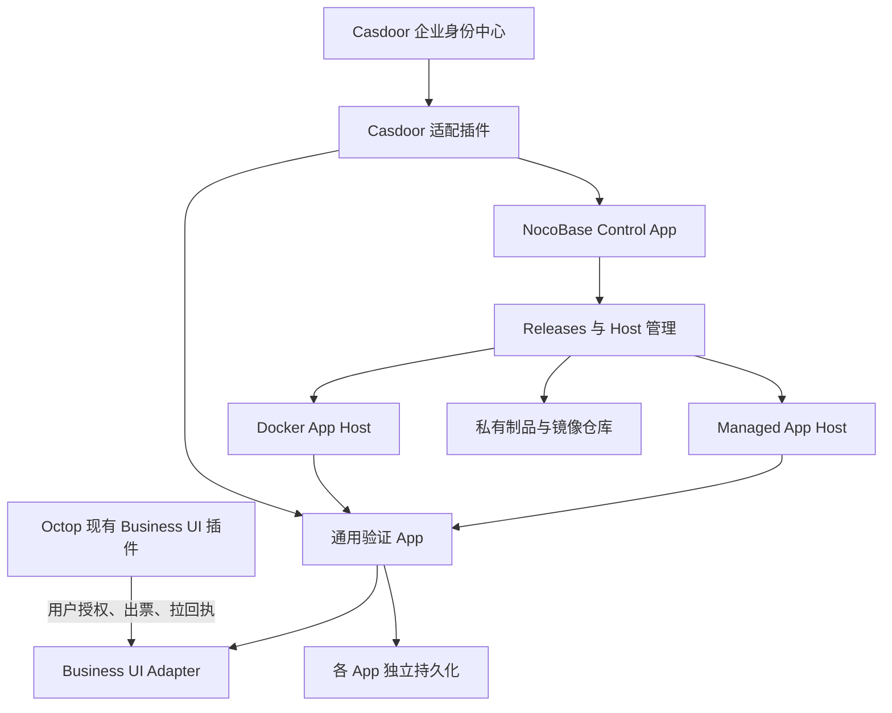
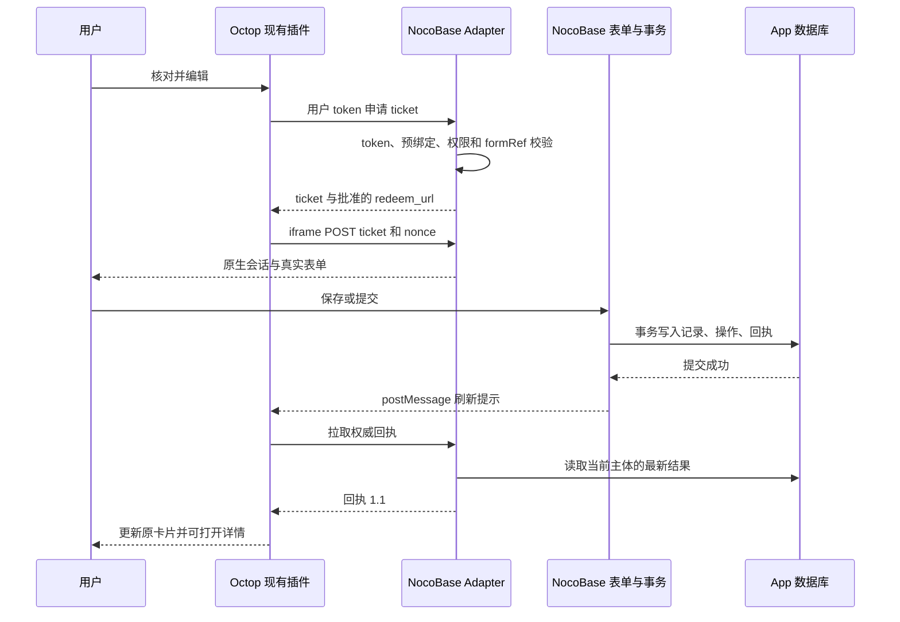

# SMC Enterprise Integration — NocoBase 平台底座 PRD

> **版本：V1.2 · 方案与产品需求基线**  
> **日期：2026-11-13（北京时间）**  
> **项目：SMC Enterprise Integration / NocoBase Platform Foundation**  
> **开发范围：NocoBase 控制面、Casdoor 适配、Business UI Adapter。**  
> **验收载体：通用集成测试 App 与测试表单，不开发、不部署、不接入 HR、CRM、财务实际业务 App。**  
> **交付性质：开发与验收依据；不代表文中功能已实施或已通过运行验证。**

---

## 1. 文档定位与需求优先级

### 1.1 本文解决的问题

为企业建立可复用的 NocoBase 应用托管与集成底座，使后续业务应用具备统一的发布运行方式、企业身份接入方式，以及在 Octop 对话内打开真实页面、提交操作并拉取权威回执的标准能力。

本阶段完成平台通用能力和最小可运行闭环，不建设具体业务领域系统。通用测试表单仅用于证明框架的真实持久化、授权、事务、并发、幂等与恢复能力。

### 1.2 依据与约束优先级

| 优先级 | 依据                                              | 用途                                             |
| ------ | ------------------------------------------------- | ------------------------------------------------ |
| 1      | 用户本轮确认的项目范围及修订                      | 决定本次开发、交付、排除项                       |
| 2      | 固定提交下的 NocoBase 源码与原生扩展接口          | 决定 NocoBase 实现方式                           |
| 3      | 固定提交下的 Octop Business UI 插件源码及协议文档 | 决定外部协议兼容行为                             |
| 4      | 附件 `web-business-ui-adapter-prompt(2).md`       | 仅参考对接 Octop 插件的协议与规范                |
| 5      | 本文提出的默认值与工程建议                        | 可在不改变范围、授权边界和外部兼容性的前提下调整 |

**附件不是本项目的总需求，也不是技术选型约束。** 其中“不引入第三方业务平台”等针对其他开发任务的表述，不适用于本项目。本文明确基于既有 NocoBase 实施。附件中的测试提示词、目录偏好及可选授权方法，也不自动变成本次必做功能。

### 1.3 状态标记

- **已核查**：已读取固定基线源码或文档，能够确认相应代码/契约存在。
- **本次建设**：本项目必须实现、配置、部署并提交验证证据。
- **建议默认**：本方案给出的工程默认值，需在实现和环境配置中明确记录。
- **待联调**：依赖真实系统、网络、浏览器或账号配置，未验证前不能标记通过。
- **后续范围**：本期不建设，不得混入验收。

## 2. 项目背景、目标与成功标准

### 2.1 背景

未来招聘、CRM、财务等垂直应用需要共用发布运行底座、企业身份和 Octop 业务交互能力。若每个应用重复实现登录、跨系统身份关联、页面票据、结果回执和状态恢复，将造成授权不一致、集成耦合与维护成本上升。

Octop 已存在 Business UI 插件。本项目以其为现有对接端，只完成 NocoBase 一侧能力，不再开发替代插件或自定义另一套通信协议。

### 2.2 建设目标

| ID  | 目标                                            | 达成证据                                                           |
| --- | ----------------------------------------------- | ------------------------------------------------------------------ |
| G01 | 建立自有 Control App，复用 Releases 与 App Host | 控制台可管理通用测试 App 的发布、启动、停止、重启和回退            |
| G02 | 接入 Casdoor 统一身份                           | Control App 和通用测试 App 完成真实 Casdoor 登录与本地身份关联     |
| G03 | 建立通用身份生命周期与 Permission Set 映射      | 新用户初始化、重复登录、禁用、会话撤销、映射变更均有证据           |
| G04 | 实现兼容现有 Octop 插件的 Business UI Adapter   | 完成握手、逐用户授权、出票、兑票、表单操作、回执与操作查询         |
| G05 | 验证可靠性和安全边界                            | 同一测试用户覆盖成功、拒绝、确认失败、结果未知、查询恢复及历史恢复 |
| G06 | 形成可复用交付                                  | 代码、迁移、构建制品、部署配置、接口文档和测试报告完整             |

### 2.3 第一阶段完成定义

可以在目标 Octop 实例中，用一个完成企业身份关联的测试用户打开通用表单，保存、提交或查看详情；NocoBase 产生真实持久化记录及事务一致的回执，Octop 通过现有插件拉取回执并更新原卡片；平台重启、重复请求、权限拒绝和结果未知均有确定处理方式。

## 3. 范围与排除项

### 3.1 本期三个开发模块

| 模块                           | 工程职责                                                                             | 必须交付                                         |
| ------------------------------ | ------------------------------------------------------------------------------------ | ------------------------------------------------ |
| `nocobase-control`             | Control App 组装、Releases 接入、App Host/Docker Host 配置、部署权限、制品和运行管理 | 可运行控制面、生命周期、发布回退、日志与部署配置 |
| `nocobase-casdoor-adapter`     | Better Auth Generic OAuth 配置、企业身份映射、用户状态同步、Permission Set 映射      | 可复用插件、配置入口、迁移、生命周期管理和验证   |
| `nocobase-business-ui-adapter` | Octop 连接鉴别、用户令牌验证与本地身份解析、表单注册、票据、会话、操作与回执         | 与 `business-ui.v1` 和回执 1.1 兼容的插件        |

通用验证 App、测试表单、测试数据和故障注入属于上述能力的验收夹具，不构成第四条产品线。

### 3.2 明确不包含

1. HR、CRM、财务等实际 App 的开发、部署、接入、数据迁移、页面、报表及角色设计。
2. 新建或改写 Octop Business UI 插件、Octop 核心、Dashboard、聊天存储和 Casdoor 核心。
3. 新建通用表单引擎、页面设计器、低代码平台、业务流程引擎或报表平台。
4. Agent 独立身份委托、Agent 自主提交业务、权限代理和自动审批。
5. Adapter 向 Octop 推送 webhook/HMAC Callback、后端调用 `patchResult`、直接更新聊天数据库。
6. 回执自动唤醒模型、自动推进下一项 Agent 工作流。
7. Octop 登出立即注销所有 NocoBase 会话的联动承诺。
8. Kubernetes、多地域高可用、跨数据库分布式事务、跨 App 全局业务权限继承。
9. 原生账号与 PAT 两种逐用户激活方式的生产实现；本期以 Casdoor OAuth2 为必做方式。

### 3.3 范围控制规则

新增实际业务实体、领域报表、业务审批或领域连接器均应创建独立后续需求，不能以“验证框架”为名纳入本期。新建测试字段必须能够说明其对应的框架验收目标。

## 4. 已核查基线与技术边界

### 4.1 版本基线

| 系统       | 仓库/分支                                              | 固定提交                                   | 核查结论                                                        |
| ---------- | ------------------------------------------------------ | ------------------------------------------ | --------------------------------------------------------------- |
| NocoBase   | `smc-copilot/nocobase` / `v3-develop`                  | `e1f584e6d514aca08c762f6cbba43a4848d5f363` | 含 App Host、Releases、Authentication、Authorization 和默认模板 |
| Octop 插件 | `smc-copilot/octop` / `cursor/business-ui-plugin-a7f2` | `64689a5b9863d974783f0605ed7673a7d5f73b22` | 含完整 `plugins/business-ui/`，插件版本 0.1.0                   |
| 协议       | 同上                                                   | 同上                                       | `business-ui.v1`，回执 1.1 扩展                                 |
| Casdoor    | 企业现有实例                                           | 实施时记录镜像 Digest/版本                 | 本文不假定现场版本、Claim 或跨 Client Subject 行为              |

NocoBase 仓库根 `package.json` 当前声明 `version: 0.0.0`，不能据此命名某个正式稳定版；本文使用“V3 开发基线”。构建工具声明 Node.js `>=24.0.0`、pnpm `11.7.0`，实际构建应锁定满足要求的具体版本。

Octop PR #7 在本轮核查时为 Open、未合并，目标分支 `feature/ver1.0`；不能假定 `feature/ver1.1` 已包含插件。部署可使用上述插件提交构建的安装包，但必须对目标 Octop 运行版本执行宿主兼容验证。安装包版本相同不代表提交相同，交付必须记录 SHA。

### 4.2 不沿用旧版架构假设

附件 `wiki-nocobase.md` 中关于 `packages/core/*`、Koa、Sequelize、`resource:action` 的描述是旧版概览，不能直接用于本 V3 基线。

本次已核查 V3 使用 `packages/app/app-server`、Hono Router 服务、ServiceProvider、Better Auth 和 `app-plugin-authorization`。新增路由应使用该基线的认证与授权扩展链，而不是机械套用 V2 resourcer/ACL 接口。

### 4.3 已有能力与新增职责

| 能力           | 上游已有                                                    | 本次职责                                           |
| -------------- | ----------------------------------------------------------- | -------------------------------------------------- |
| Releases       | App/环境/制品/部署/回退/部署请求/日志；权限端口需组装       | 组装自有 Control App、绑定访问端口、配置权限并验证 |
| App Host       | standalone/managed、不可变 revision、持久卷、恢复和容量控制 | 建立 managed 管理闭环，不重新开发 Host             |
| Docker Host    | 每 App 镜像按 Digest 拉取、容器运行与健康检查切换           | 配置私有仓库、隔离执行权限、验证恢复               |
| Authentication | Better Auth 集成、会话、用户管理服务                        | Generic OAuth 配置、Casdoor 特定 Claim 与准入适配  |
| Authorization  | Permission Sets、资源与数据授权                             | 企业映射策略、控制面权限绑定、表单与操作授权       |
| Business UI    | NocoBase 无本项目专用适配                                   | 新增 NocoBase 协议 Adapter 与通用测试夹具          |

本方案基于公开仓库可取得的上述模块，不以商业 Studio、商业企业 SSO 插件或商业页面设计能力作为必需依赖。保留仓库许可与声明；按锁定源码的实际许可交付，不将整仓简化标注为无附加条件的 Apache-2.0。对外 SaaS/PaaS 不属于本期用途。

## 5. 用户、角色与主要场景

### 5.1 平台角色

下表为本项目建议的 Permission Set 组合，不代表新增一套绕过原生授权的角色系统。

| 角色         | 主要权限                               | 边界                                         |
| ------------ | -------------------------------------- | -------------------------------------------- |
| 平台管理员   | 控制面环境、Host、仓库、配置与集成管理 | 不自动取得每个受管 App 的业务数据权限        |
| 发布人员     | 指定 App 的上传、发布、启停及日志      | 无全局用户映射、Secret 明文读取权限          |
| 身份管理员   | IdP 配置、映射、同步、禁用处理         | 不自动获得部署或单据操作权限                 |
| 集成管理员   | Octop 实例登记、主体绑定、表单注册     | 不使用连接服务密钥访问用户单据               |
| 审计人员     | 脱敏部署、身份、操作和安全事件只读     | 无写入、兑票、令牌明文权限                   |
| 通用测试用户 | 自有测试单据的授权操作                 | 无平台管理权限；测试拒绝使用同一用户不同规则 |
| CI 服务账号  | 指定 App 的受限 API Key                | 无交互登录、跨 App 全权或身份映射权限        |

### 5.2 用户故事

- US-01：发布人员在 Control App 创建测试 App、上传 V1、部署、停止、启动、升级 V2，再回退到 V1，验证数据保留。
- US-02：员工从 Casdoor 登录 Control App 或测试 App，各 App 创建自己的本地用户且按各自规则授权。
- US-03：身份管理员禁用员工，适配器同步后撤销本地会话和 Adapter 访问资格。
- US-04：同一员工在 Octop 激活业务身份，点击草稿卡打开真实测试表单，保存不等于提交。
- US-05：用户提交成功后得到真实编号，原 Octop 卡片显示权威回执，并可打开只读详情。
- US-06：提交请求响应丢失时，用户只能查询原操作，不能再次创建单据。
- US-07：用户重开历史线程，插件重新拉取最新回执，结果与 NocoBase 持久化状态一致。

## 6. 总体方案与部署拓扑

### 6.1 方案选择

采用“复用上游控制面能力 + 两个 NocoBase 通用插件”的方案。

| 方案                                                   | 评价                                     | 结论               |
| ------------------------------------------------------ | ---------------------------------------- | ------------------ |
| 自有 Control App 组装 Releases，新增身份与协议适配插件 | 复用生命周期、原生认证授权；改动边界清晰 | 本方案采用         |
| 在 Octop 重做业务管理和页面                            | 超出范围，重复已有插件，形成双份业务状态 | 不采用             |
| 独立旁路服务直接管理 NocoBase 数据库                   | 难以保持原生权限、事务和用户生命周期一致 | 不作为本期核心实现 |

域名默认建议：`control.company.com`、`integration.company.com`、`octop.company.com`、`sso.company.com`。均为示例，占位符不得直接作为部署配置。优先同一注册域的 HTTPS 子域；同站部署仍须实际验证 Cookie。

### 6.2 组件图



图中 Managed 与 Docker 为可选运行模式，同一 App 实例只属于一个环境与运行目标。验收使用同一个通用模板的两个测试部署实例验证两种模式，不部署任何领域 App。

### 6.3 数据和信任边界

1. Control App 保存应用、部署、环境、制品元数据和自身管理身份。
2. 每个受管 App 保存自己的用户、权限、表单注册、交互、操作和回执。
3. Casdoor 是身份事实来源；NocoBase 是本 App 业务权限与单据事实来源。
4. Octop 插件负责 UI、Host 身份与卡片状态；不直接读写 NocoBase 数据库。
5. 连接服务密钥仅用于连接鉴别和协议规定的授权辅助接口；单据接口必须验证用户访问令牌。
6. 业务 App 不挂载 Docker Socket，不接触控制面或其他 App 的私密配置。
7. App Host in-process 不构成强安全沙箱；需要进程/容器隔离的部署使用 Docker Host。

## 7. 模块一：NocoBase 控制面需求

### 7.1 控制面组装

使用默认应用模板或其最小派生模板组成自有 Control App，注册 Authentication、Authorization、Users、API Keys、Secrets、Releases 所需能力和客户端页面。

**关键要求：必须绑定 `releasesAccessToken`，不能认为启用 Releases 插件就自动获得管理权限。** 上游文档明确未绑定时所有调用者无权限。按本项目角色组合映射页面、设置项、App 操作与关联 App 范围。CI 使用原生 scoped API Key，不创建永久超级管理员密钥。

Control App 不依赖商业 Studio；不复制 Studio 专有功能。保留一个受控应急本地管理员入口，Casdoor 联调通过前不关闭原有登录方式。

### 7.2 功能清单

| ID      | 功能       | 需求及验收要点                                                               |
| ------- | ---------- | ---------------------------------------------------------------------------- |
| CTL-001 | 环境管理   | 至少建立测试 in-process 和测试 Docker 环境，配置检查失败须阻断保存/部署      |
| CTL-002 | App 管理   | 创建、查看、配置通用 App；记录环境归属、运行模式、URL 和状态                 |
| CTL-003 | 制品管理   | 归档制品记录版本、SHA-256；容器镜像记录 Digest，不使用可漂移标签作为回退依据 |
| CTL-004 | 生命周期   | 启动、停止、重启；展示真实运行状态和可披露错误，不以按钮点击即视为成功       |
| CTL-005 | 发布升级   | 制品校验、变量检查、部署日志、健康检查及结果可追踪                           |
| CTL-006 | 回退       | 选择明确旧 release；检查数据库兼容性和变量完整性后回退                       |
| CTL-007 | 配置隔离   | 每环境/App 独立配置，Secret 只写不回显，日志显示名称和来源不显示值           |
| CTL-008 | 容量与恢复 | 显示 Host 容量、等待和错误；控制面/Host 重启后对账恢复部署状态               |
| CTL-009 | 仓库管理   | 私有制品磁盘及容器 Registry 凭据加密，非管理者不可修改                       |
| CTL-010 | 日志审计   | 用户、App、release、deployment、时间和结果可关联；权限拒绝可追踪             |
| CTL-011 | 删除保护   | App 删除显式确认目标；持久卷和数据删除与停用、代码回退分别管理               |
| CTL-012 | 发布权限   | 发布人员只能操作被授予的 App；CI Key 不允许创建/删除 App 和管理身份          |

### 7.3 Host 与制品策略

- 本期部署一个由 Releases 管理的 in-process Host，以及一个 Docker Host 执行域，用通用模板验证两条路径。
- in-process 使用不可变 `.tar.gz` release；代码 revision、运行持久卷与归档制品分离。
- Docker 镜像按 Digest 固定；App 持久卷不可放入容器可写层。
- MinIO/S3 作为建议制品后端；也可使用原生私有文件磁盘。MinIO 不成为新增产品功能，S3 兼容性需实测。
- release 归档必须置于 private disk，不提供公开下载直链。
- Host 管理通信使用原生私有管理机制；不把控制端口直接暴露给业务浏览器。
- 停止 App 不删除卷。回退代码不回退业务数据，不承诺自动撤销数据库迁移。
- in-process 原生替换为 stop-first，不能描述为零停机；Docker 原生健康门控切换仍需验证数据库迁移和连接行为。

### 7.4 配置与回退规则

记录配置版本、密钥标识、镜像/制品版本和部署操作。修改 `secrets.keys`、`auth.secret`、`session.secret` 具有影响会话的后果，必须有明确变更流程。

数据库迁移采用先扩展后收缩的兼容策略。本期 V1→V2→V1 回退试验只使用向后兼容迁移。若迁移不兼容，Control App 应提示阻断或明确人工恢复要求，不能宣称“点击回滚即可恢复数据库”。

## 8. 模块二：Casdoor 适配需求

### 8.1 两条身份链路

| 链路                        | 目标                                                          | 认证结果                                             |
| --------------------------- | ------------------------------------------------------------- | ---------------------------------------------------- |
| 浏览器访问 Control/Test App | Casdoor OIDC → Better Auth Generic OAuth                      | 当前 App 自己的 Better Auth Session                  |
| Octop 逐用户激活            | 现有插件 PKCE → Adapter 回调/consume → Casdoor token endpoint | 插件保存该用户访问令牌，Adapter 校验并映射到本地用户 |

**SSO 登录成功不等于 Octop 已激活，也不等于 Casdoor Access Token 可直接当作 NocoBase Session。** 两条链路必须分别验证，不共享 Cookie，不复制会话，不要求修改 Octop。

### 8.2 OIDC 配置

- 每个 App 配置受信 Issuer、Discovery/JWKS 地址、Client ID、Secret 引用、精确 Redirect URI 和准入规则。
- Better Auth Generic OAuth 通过应用配置和插件扩展接入，不修改第三方源码。
- 采用 PKCE S256，验证 state；对于使用 ID Token 的流程验证签名、Issuer、Audience、有效期和适用的 nonce。
- Access Token 校验按真实 Casdoor 配置选择 JWT 校验或受保护的 introspection/userinfo；不能用 ID Token 代替资源服务访问令牌。
- 明确令牌适用受众/资源、Client、Scope、有效期和撤销策略。仅能成功解码 JWT 不构成验证通过。
- 认证类型和 Claim 名称通过配置定义，不硬编码某个企业的部门、姓名或组织字段。

### 8.2.1 外部 token 到原生授权上下文的必做验证

普通 `auth.required()` 不会天然接受 Casdoor Access Token；将请求中的 localUserId 写入 Hono 变量、直接操作 Repository，或仅验证 JWT，均不满足原生认证授权要求。

本期必须通过 Authentication 的受支持认证扩展或受支持服务调用，把已验证外部 token 解析为当前启用的本地用户，并构建原生 Authorization 使用的身份上下文。所有用户 token 路由复用同一个解析器与原生 Permission Set/记录级策略；不能建立一套“看起来相同”的旁路授权规则。`Auth.signInUser` 只用于兑票后可信地创建浏览器会话，不能拿它替代服务端 token 路由认证，也不向 Octop 返回第二枚自制 Session token。

P0 必须做最小技术验证：真实 Casdoor token → 稳定企业身份 → 已绑定本地用户 → 原生权限允许/拒绝 → 账号禁用后拒绝。记录实际采用的扩展 API、请求链和测试证据；若固定基线没有可用的受支持衔接路径，应作为明确技术阻断评估最小扩展，不能通过写变量或绕过原生鉴权继续推进。该验证不依赖实际 HR/CRM App。

### 8.3 身份模型

| 身份         | 唯一键                                                                    | 用途                       |
| ------------ | ------------------------------------------------------------------------- | -------------------------- |
| 企业身份     | Casdoor `issuer + subject`                                                | 关联员工的认证身份         |
| App 本地身份 | `appId + localUserId`                                                     | 当前 App 的授权和数据归属  |
| Octop 主体   | `octopIssuer + octopSubject`，其中插件 Subject 为 `issuer\|local_user_id` | 关联现有插件的命名空间主体 |

企业身份和 Octop 主体使用不同命名空间；不能因为两者字段都叫 `sub` 就认为它们相等。跨 Casdoor Client 的 Subject 稳定性必须验证；若为 pairwise Subject，应使用经确认、受签名保护的稳定企业标识及绑定流程，不能退回按邮箱匹配。

同邮箱不同 Subject 不自动绑定。已有账号合并必须由身份管理员显式处理并审计；禁止隐式邮件自动合并。

### 8.4 用户初始化、同步与权限映射

| ID      | 功能                | 必须行为                                                                                                |
| ------- | ------------------- | ------------------------------------------------------------------------------------------------------- |
| IAM-001 | 首次登录初始化      | 验证准入后创建本地用户及唯一外部身份绑定；并发首登只创建一次                                            |
| IAM-002 | 重复登录            | 复用稳定身份，姓名/邮箱变更不创建重复账号                                                               |
| IAM-003 | 准入规则            | 可按组织、受验证的用户属性和企业名单允许/拒绝；未配置规则不得默认准入所有 IdP 用户                      |
| IAM-004 | Permission Set 映射 | 外部受信属性映射到 App 内白名单 Permission Sets，禁止令牌字符串直接授予 root                            |
| IAM-005 | 映射所有权          | 自动映射仅撤销自己管理的授权，不误删本地人工管理的授权；禁用用户则拒绝所有会话                          |
| IAM-006 | 状态同步            | 登录时检查 + 周期对账；可选事件触发加速，但不可只有前端登录时检查                                       |
| IAM-007 | 禁用与撤销          | 通过原生 UserAdministrationService disable/revokeSessions 撤销会话及实时连接，并使 Adapter 令牌映射失效 |
| IAM-008 | 再启用              | 同步可信启用状态；不恢复过期票据或已撤销会话，用户重新认证                                              |
| IAM-009 | 管理页面            | 查看同步状态、失败原因、映射规则和最近同步；Secret 只写不回显                                           |
| IAM-010 | 人工对账            | 提供只读预览、批次执行及差异报告，操作可审计和重跑                                                      |

建议周期 5 分钟，禁用生效目标不超过一次成功同步周期加 60 秒。同步失败应告警；离线缓存的可用期限建议 10 分钟，超过期限对新出票和写操作失败关闭。已知禁用状态立即生效，不能等待令牌自然过期。

Casdoor 用户目录查询使用只读最小权限服务凭据，必须配置真实可用的读取接口和字段映射。本项目不创建完整组织架构管理产品，不把部门信息当作天然业务权限。

### 8.5 Octop 主体的可信关联

当前插件在 OAuth token 兑换中不会向 Adapter提供一个可直接验证的 Octop 用户证明；请求 body 中的 `subject` 只是声明。因此本期采用**受控预绑定**：

1. 身份管理员从受信管理记录取得 Octop 实例、其本地用户 ID 与企业身份映射。
2. 在 NocoBase 集成管理页预览并批准绑定到本 App 的本地用户；可批量导入但必须校验唯一性、来源和操作者。
3. Adapter 每次根据已验证 Casdoor token 解析本地用户，再检查请求 Octop 主体是否与既有绑定一致。
4. 无绑定、冲突或不匹配时拒绝，不在首次出票时“相信 subject 并自动认领”。
5. 映射变更撤销旧票据/嵌入会话，留存审计；不迁移他人的历史操作归属。

该方案不要求修改 Octop 协议。本期无需实现自动批量查询 Octop 用户的新连接器；由管理员提供受信导出/经核对的配置。未来自助绑定属于独立增强项。

## 9. 模块三：Business UI Adapter 需求

### 9.1 定位与职责

Adapter 是 NocoBase App 内的通用插件，不是独立旁路业务数据库。它将现有 Octop 插件的协议请求转换为本 App 的认证、授权、表单打开和真实业务操作。

| 子模块              | 职责                                                     |
| ------------------- | -------------------------------------------------------- |
| connection-registry | 信任 Octop 实例、服务凭据、允许 Origin 与状态            |
| credential-resolver | 验证用户令牌、检查账号状态、解析本地身份并核对预绑定主体 |
| form-registry       | 逻辑 formRef → 当前 App 页面/动作处理器、版本、授权资源  |
| ticket-service      | 短期一次性出票、原子兑票、防重放                         |
| embed-context       | 创建经 Better Auth 管理的浏览器会话并绑定受限交互上下文  |
| action-api          | save/submit/detail 与原生业务授权、字段过滤、并发和事务  |
| operation-receipt   | 持久化操作和权威回执，提供只读查询及受限安全重试         |

不建设 `event-callback` 向 Octop 推送链路。可有 NocoBase 内部事务事件或审计事件，但它们不是外部 webhook。

### 9.2 表单注册表

每条注册项至少包含：`formRef`、逻辑 `documentType`、`schemaVersion`、编辑/详情模式、服务端页面标识、处理器标识、允许动作、授权资源、摘要白名单、启用状态。

注册原则：

- 不接受用户或模型传入任意 URL、脚本、模板代码或外部页面地址。
- 注册目标必须位于当前受信 App 内；跨 App 跳转本期不支持。
- 注册页属于配置化管理界面，不是新表单引擎。
- 使用配置文件或受保护的管理 API 注册可执行处理器；普通管理员页面不得注入服务器代码。
- schema 升级保留旧版本兼容或返回明确不支持；不能用新 schema 悄悄解释旧草稿。
- 详情导航只接受注册的逻辑 formRef 和已授权 recordId。

### 9.3 票据与嵌入会话

建议票据 TTL 60 秒，服务器端仅保存摘要或不可逆索引；随机性不低于 128 bit，消费使用数据库原子条件更新。票据绑定 App、连接、Octop issuer/sub、本地用户、interaction、form、record、版本、action、nonce、受众和过期时间。

浏览器只用 `application/x-www-form-urlencoded` POST 传 `ticket`、`nonce`。重放、过期、主体变更、已禁用连接或用户一律拒绝。

兑票后通过原生 `Auth.signInUser`/受支持认证流程创建 Better Auth Session，转发其 Set-Cookie；不得手写一个绕开 Authentication 的第二套用户 Session。额外 embed context 只保存约束和关联，不单独赋予用户身份。

若浏览器已有不同用户会话，拒绝覆盖并提示在顶层页面核对/重新认证；不得静默把用户 A 的会话替换为用户 B。嵌入会话不得提升权限，只能在当前用户原生权限与交互约束交集中操作。

建议嵌入会话空闲 TTL 15 分钟、绝对 TTL 60 分钟；其凭证生命周期和注销必须由原生认证管理。建议保存时重新检测状态，页面过期后返回明确重新打开指引。

### 9.4 浏览器安全

- HTTPS；Cookie `HttpOnly`、`Secure`，跨站场景评估 `SameSite=None`，按 App 隔离名称、Path/Origin，不共享顶级域 Cookie。
- CSP `frame-ancestors` 只允许批准的 Octop Origin；不得使用 `*`。
- 仅保留现有插件所需 sandbox 能力，不要求改 Octop 核心。
- Cookie 写操作校验可信 Origin 与适用 CSRF 防护；原生机制不能覆盖的自定义路由必须补充保护。
- `postMessage` 仅作为刷新提示；消息含 interaction 和 nonce，使用明确 targetOrigin，不携带用户 token 或业务 Secret。
- 插件现有代码中的防御不能替代 Adapter 的服务端认证、授权和重放防护。
- 第三方 Cookie 被目标浏览器阻止时，顶层登录可作为人工恢复指引；本期不承诺它必然解决跨站 iframe 存储问题。优先调整到同站受信域名；否则标记嵌入验收阻断，不伪造完成。

### 9.5 操作执行规则

1. 每次出票、兑票、保存、提交、详情、回执、查询和重试均检查用户、绑定、连接状态与资源权限。
2. 业务动作执行前检查字段白名单、记录范围、状态规则和乐观版本；拒绝由客户端修改 owner、正式编号和系统版本。
3. 接口需同时执行原生 Authorization 和当前交互限制；页面可见不等于单据可写。
4. 本期测试单据、操作结果和回执位于同一 App 同一事务数据库中，保证提交一致性。
5. 业务写入失败回滚；事务外记录确认失败的审计/操作结果，不伪造业务成功。
6. 已提交记录的后续动作被拒绝时，保留已有正式 ID；拒绝新建时不产生正式 ID。
7. 只有确认原操作失败且不存在已完成副作用，或有经证明的可靠幂等机制时，才允许安全重试。
8. 后续跨 ERP 等外部系统写入不属于本期；不能把本期同库事务结论扩展到跨系统事务。

## 10. 对外接口与协议兼容

### 10.1 路由前缀和响应规则

本文的 `/v1/*` 是 Octop 协议相对于 Adapter base URL 的路径。本期按连接隔离挂载，例如 `https://integration.company.com/business-ui/connections/site-a`，对应 `/business-ui/connections/site-a/v1/*`。反向代理和 App 基路径必须完整保留；OAuth Redirect URI 与 `redeem_url` 使用外部完整地址。

协议接口按 Octop 实际期望返回顶层 JSON，不能套用 NocoBase 普通管理 API 的 `{ data }` 外壳；Adapter 在边界完成格式转换。管理接口继续使用 NocoBase 标准响应与认证规范。

### 10.2 接口清单

| 方法/相对路径                    | 身份                               | 本期要求                                                       |
| -------------------------------- | ---------------------------------- | -------------------------------------------------------------- |
| `POST /v1/handshake`             | 连接服务凭据                       | 非破坏探测、协议和真实能力声明                                 |
| `GET /v1/oauth/callback`         | OAuth code/state 回调              | 接收并暂存一次性授权码；校验格式、TTL、实例配置和回调策略      |
| `POST /v1/oauth/consume`         | 连接服务凭据                       | 返回一次性 code；未完成按当前插件兼容 pending 返回             |
| `POST /v1/tickets`               | 当前用户访问令牌                   | 验证主体绑定、权限、注册表并出票                               |
| `POST /v1/tickets/redeem`        | 短期票据 + nonce                   | 一次性兑票，认证会话与受限上下文，返回 HTML                    |
| `POST /v1/documents/save`        | 原生浏览器 Session + embed context | 保存草稿，版本检查，不等于提交                                 |
| `POST /v1/documents/submit`      | 原生浏览器 Session + embed context | 幂等提交并产生正式记录与回执                                   |
| `POST /v1/interactions/{id}`     | 当前用户访问令牌                   | 返回当前交互的权威回执                                         |
| `POST /v1/operations/{id}`       | 当前用户访问令牌                   | 只查询原操作；`query_only: true`，不触发任何提交               |
| `POST /v1/operations/{id}/retry` | 当前用户访问令牌                   | 本期实现仅用于确认安全的 FAILED；UNKNOWN 一律拒绝重试          |
| `/v1/forms/resolve`              | 暂无冻结请求契约                   | 握手保留 `resolve_path`，内部实现注册表；不发明新的外部 schema |

`/v1/auth/native` 与 `/v1/auth/pat` 为协议可选路径，本期不宣告支持。`/v1/forms/resolve` 若被非预期调用，返回标准未支持结果；不得为满足“接口全部实现”捏造协议。

### 10.3 握手

请求：

```json
{
  "protocol": "business-ui.v1",
  "destructive": false,
  "instance_issuer": "https://octop.company.com"
}
```

响应示例（所有 true 均需实现后才能启用）：

```json
{
  "protocol": "business-ui.v1",
  "ok": true,
  "kind": "business-ui-adapter",
  "service": { "name": "smc-nocobase-adapter", "environment": "test" },
  "auth": { "identity": "connection", "mode": "bearer" },
  "features": {
    "form_registry": true,
    "tickets": true,
    "receipts": true,
    "interactions": true,
    "user_auth_methods": ["oauth2"],
    "oauth_authorization_code": true,
    "oauth_pkce_s256": true,
    "receipt_schema_v11": true,
    "query_status": true,
    "safe_retry": true
  },
  "ticket_path": "/v1/tickets",
  "redeem_path": "/v1/tickets/redeem",
  "interaction_path": "/v1/interactions/{id}",
  "operation_path": "/v1/operations/{id}",
  "resolve_path": "/v1/forms/resolve",
  "save_path": "/v1/documents/save",
  "submit_path": "/v1/documents/submit"
}
```

`destructive: true` 必须拒绝。握手不能创建单据、用户会话或改变授权。当前插件按默认相对路径调用多个接口，不能仅修改握手 path 字段而不提供对应默认路径。

### 10.4 OAuth 回调兼容

**本期采用每连接独立 Adapter base 路径（或独立 Origin），不支持多个连接共用无法识别连接的 callback URL。** 例如 site-a 与 site-b 分别配置 `/business-ui/connections/site-a`、`/business-ui/connections/site-b`。现有插件用 `urljoin(base + "/", "v1/oauth/callback")` 生成回调，兼容这种配置，无需修改 Octop。

回调路由由挂载路径选定固定 connectionId，consume 的服务凭据也必须属于同一连接；任何请求 body 的 connection_id 只能与已选连接一致，不能用来切换连接。Casdoor 精确登记各连接完整回调 URL。其他协议路由同样在该连接路径下，票据和 Cookie/上下文不得跨连接使用。

当前插件未事先向 Adapter 注册 state，Adapter 不能仅凭 code/state 证明发起者或 Octop 用户归属。Adapter 负责连接路径隔离、受控暂存、限速和一次性消费；state 对当前用户的绑定及 PKCE 证明由现有插件和授权服务器完成，不宣称 Adapter 已实现不存在的前置注册链。

插件生成 state、PKCE verifier/challenge，验证当前 Host 用户，Adapter 不生成替代 state。Adapter callback 保存 code；插件带服务凭据轮询 consume，再自行向 Casdoor token endpoint 用 verifier 兑换用户 token。

Adapter 应将 callback code 存储加密并设置短 TTL、一次性消费和请求限速；consume 绑定该服务连接的状态空间。现有 callback 不提供完整的可信 Octop 主体信息，不能据它自动创建第 8.5 节的用户绑定。

未授权完成返回当前插件可识别的 `404` 或 `pending: true`；生产应使用已跑过契约测试的单一行为。回调日志不得记录 code/state 明文，回调页面不加载第三方资源，设置适当 Referrer Policy。

### 10.5 出票与权威回执

出票请求保持当前插件实际字段：

```json
{
  "protocol": "business-ui.v1",
  "subject": {
    "issuer": "https://octop.company.com",
    "sub": "https://octop.company.com|42"
  },
  "form_ref": "generic.request.edit",
  "record_id": null,
  "schema_version": "1",
  "record_version": 0,
  "action": "edit",
  "interaction_id": "int-example",
  "nonce": "random-example",
  "connection_id": "default"
}
```

出票响应包含短期 `ticket`、批准 Origin 的 HTTPS `redeem_url`，可含 `expires_in` 与 `form_ref`。不把 ticket 放进 URL。

成功回执示例：

```json
{
  "success": true,
  "status": "submitted",
  "approval_status": "not_required",
  "subject_sub": "https://octop.company.com|42",
  "interaction_id": "int-example",
  "operation_id": "op-example",
  "document_type": "generic.request",
  "record_id": "REQ-EXAMPLE-0001",
  "form_ref": "generic.request.edit",
  "schema_version": "1",
  "record_version": 2,
  "receipt_sequence": 3,
  "allowed_actions": ["view_document", "close"],
  "documentType": "generic.request",
  "recordId": "REQ-EXAMPLE-0001",
  "formRef": "generic.request.edit",
  "schemaVersion": "1",
  "recordVersion": 2,
  "interactionId": "int-example",
  "allowedActions": ["view_document", "close"],
  "result": {
    "type": "SUCCESS",
    "status": "SUCCESS",
    "code": "SUBMITTED",
    "message": "通用测试单据已提交",
    "disclosable": true,
    "safe_retry": false,
    "idempotent": true,
    "side_effect": true
  },
  "navigation": { "form_ref": "generic.request.detail" },
  "summary": { "title": "通用集成测试", "quantity": 1 }
}
```

示例 ID 均为说明占位符，验收必须由服务器真实签发。SUCCESS 回执的 `result.status` 使用现有解析器归一后的 `SUCCESS`；内部操作状态 `SUCCEEDED` 不直接替代该协议值，不能推断为有通用审批语义。`approval_status` 仅表示无需审批，不实现审批系统。

### 10.6 字段兼容纪律

- 七字段 `documentType / recordId / formRef / schemaVersion / recordVersion / allowedActions / interactionId` 保留在内部契约和输出中。
- 外部响应同时输出上述 camelCase 字段与插件所用 snake_case 别名；两者由一个 DTO 生成，禁止出现不一致。
- **必须输出 `record_id`、`record_version`**：当前插件后端并非对所有 camelCase 字段都有相同兼容能力。
- 交互 ID、operation ID、subject、record、版本和序列必须相互匹配。
- 回执携带单调递增 `receipt_sequence`；只读查询不能凭空增加业务版本或再次提交。
- 不返回当前插件未实际处理的 `continue` / `request_permission`。
- 管理端错误可采用原生结构；协议端 HTTP 状态及 body 必须按插件行为测试。HTTP `200 + BUSINESS_REJECTED` 用于可披露的已识别操作拒绝，身份无效仍为 401，跨主体资源访问为 403/防枚举结果。

### 10.7 错误模型

| 情况                        | HTTP/回执处理                | 用户行为                           |
| --------------------------- | ---------------------------- | ---------------------------------- |
| 服务凭据无效                | 401/403，握手失败            | 管理员修复连接                     |
| 用户未激活、token 无效/过期 | 401；不返回单据内容          | 重新激活                           |
| 用户已禁用、主体绑定不匹配  | 403；安全审计                | 联系身份管理员                     |
| formRef 不存在/未注册       | 400/404，稳定错误码          | 修复配置，不打开任意 URL           |
| 票据过期/重放               | 403                          | 重新出票                           |
| 乐观锁冲突                  | 409                          | 重新加载并核对，不覆盖他人修改     |
| 已识别业务动作规则拒绝      | 权威回执 `BUSINESS_REJECTED` | 仅展示可披露原因                   |
| 已确认失败且无副作用        | `TECHNICAL_ERROR/FAILED`     | 仅 `safe_retry` 条件成立才提供重试 |
| 结果暂不确定/响应丢失       | `TECHNICAL_ERROR/UNKNOWN`    | 只查询原 operation                 |
| 详情打开失败                | 独立详情错误                 | 不把已提交单据改成失败             |

建议稳定错误码：`AUTH_REQUIRED`、`ACCOUNT_DISABLED`、`SUBJECT_BINDING_REQUIRED`、`SUBJECT_MISMATCH`、`FORM_NOT_REGISTERED`、`TICKET_EXPIRED`、`TICKET_REPLAYED`、`VERSION_CONFLICT`、`OPERATION_NOT_FOUND`、`RETRY_NOT_SAFE`。这些是 NocoBase Adapter 的本地错误码，不宣称 Octop 均有专门翻译或 UI 处理。

## 11. 数据模型、状态与一致性

### 11.1 数据集合

以下为概念模型与约束，不替代开发时的真实迁移定义；表名可按仓库规范添加前缀。

| 集合                         | 关键字段                                                                    | 约束与用途                                    |
| ---------------------------- | --------------------------------------------------------------------------- | --------------------------------------------- |
| identityProviders            | providerId、issuer、clientId、secretRef、claimMapping、admissionPolicy      | 每 App 受信 IdP，Secret 不明文回显            |
| externalIdentities           | providerIssuer、providerSubject、localUserId、lastSyncedAt                  | issuer+subject 唯一；不直接修改原生认证表结构 |
| managedPermissionAssignments | localUserId、mappingRuleId、permissionSetId、sourceRevision                 | 只管理适配器自身授予项                        |
| identitySyncRuns             | batchId、cursor、counts、result、errorClass                                 | 周期同步、重跑和审计                          |
| businessUiConnections        | connectionId、octopIssuer、allowedOrigins、serviceSecretHash/Ref、enabled   | 服务凭据按连接管理，不跨实例复用              |
| businessUiSubjectBindings    | connectionId、octopSubject、localUserId、externalIdentityId、status         | 同连接主体唯一，变更显式审计                  |
| businessUiForms              | formRef、schemaVersion、mode、handlerKey、permissionRef                     | 同 App formRef+version 唯一                   |
| businessUiOAuthCodes         | stateDigest、connectionId、encryptedCode、expiresAt、consumedAt             | 短期、一次性，不存明文 verifier               |
| businessUiTickets            | ticketDigest、subjectBindingId、context、expiresAt、consumedAt              | 原子消费和重放拒绝                            |
| businessUiEmbedContexts      | authSessionRef、interactionId、formRef、actionBounds、expiresAt             | 与原生 Session 绑定，不能单独认证             |
| businessUiInteractions       | interactionId、connectionId、subjectBindingId、recordId、latestReceiptId    | 主体与归属不可由客户端重写                    |
| businessUiOperations         | operationId、interactionId、idempotencyKey、requestDigest、status、result   | 幂等键唯一、查询不提交                        |
| businessUiReceipts           | operationId、interactionId、recordVersion、sequence、payload                | 不可变审计快照，当前状态可定位                |
| integrationTestDocuments     | draftId、formalRecordId、ownerId、title、quantity、status、version、batchId | 仅测试 App；正式 ID 提交事务中生成            |

Control App 的 release/部署/环境等复用原生数据模型，不另建竞争账本。普通测试记录、操作与回执同库，允许事务原子提交。

### 11.2 身份及令牌生命周期

使用原生 UserAdministrationService、Authentication 与 Authorization 的受支持服务；身份插件不维护一套与原生用户启用状态互相矛盾的 `active` 标识。

令牌校验缓存必须有短 TTL，并在账号禁用、绑定变更和连接停用时失效。嵌入上下文要核对 Session 的当前用户及状态。一次性票据不能使一个失效账号重新获得会话。

### 11.3 状态区分

| 状态对象       | 状态                                                                        | 说明                                                   |
| -------------- | --------------------------------------------------------------------------- | ------------------------------------------------------ |
| 测试单据       | DRAFT、SUBMITTED                                                            | 保存创建/更新草稿；提交产生正式编号                    |
| 操作           | RECEIVED、RUNNING、SUCCEEDED、BUSINESS_REJECTED、FAILED                     | 服务端已知执行状态，重启后可恢复/对账                  |
| 外部可观察结果 | SUCCESS、BUSINESS_REJECTED、TECHNICAL_ERROR/FAILED、TECHNICAL_ERROR/UNKNOWN | UNKNOWN 表示观察者尚不能确认，不等于数据库最终执行失败 |
| 票据           | ISSUED、CONSUMED、EXPIRED、REVOKED                                          | 原子消费，仅一次                                       |

`UNKNOWN` 时只允许查询，不会重新发起提交；若服务端已提交成功但响应丢失，查询读取原操作直接恢复 SUCCESS。若执行中进程退出且无法立即判定，保持 UNKNOWN，由恢复任务核对事务事实后明确结果，不猜测失败。

### 11.4 UNKNOWN 的操作关联与恢复入口

operationId 必须在第一次产生业务副作用前持久化，并与 interaction 关联。通用表单每个交互的提交使用稳定 operationId；重复出票、重开同一表单或网络重试不得隐式生成另一项提交操作。保存操作可有独立内部审计 ID，但不得使客户端持有的提交 operationId 变成另一项保存操作的 ID。

当前插件不保证从 ticket 响应读取 operationId，因此不得依靠向出票响应增加一个新字段完成客户端关联。Adapter 必须使 `POST /v1/interactions/{id}` 始终能按既有 interaction 找回最新的稳定提交 operationId；在未提交阶段返回草稿状态和该关联，不能伪造 SUCCESS/正式编号。

若响应丢失时插件还未获知 operationId，先通过现有 `interactions.get` 或历史 lookup 后的回执拉取恢复关联，再执行 query_status。网络整体不可达时只能保持 UNKNOWN，不能承诺查询按钮已具备有效 ID，也不能再次提交来“找回”状态。P3/P4 必须验证首次提交、连续保存后提交以及首次回执响应也丢失三个时序，不修改 Octop 核心或发明新 API。

表单在提交开始、完成及异常时都发送最小刷新提示，不传可信成功结论或凭据。若首次回执同样不可达，明确的现有恢复入口是重新打开历史线程触发 lookup/get；拿到 operationId 后才具备有效的操作查询。场景 E 的证据必须包含这一路径，不能只测试预先知道 operationId 的情况。

### 11.5 幂等与事务

- 浏览器表单由服务端嵌入上下文分配稳定提交键，与 interaction、动作、记录版本和请求摘要关联；无需 Octop 新增请求字段。
- 同幂等键同摘要返回原结果；同键不同摘要返回冲突。
- 用唯一约束与行锁/条件更新控制并发，不能仅靠单进程 Map/Mutex。
- 事务内完成：记录更新/正式编号、操作结果、回执快照与 latestReceipt 指针。
- 重复 submit 不创建第二条正式单据；query-only 不写入业务记录。
- 重试保留原 operation 的因果关系，记录 attempt，底层提交键保证副作用最多一次。
- 保存草稿使用内部 draftId；正式 recordId 未签发前，对外不伪造正式单号。
- 安全重试接口必须重新授权，不能沿用失败时的旧权限快照。

## 12. 关键流程

### 12.1 发布与恢复

发布人员选择 release → 控制面检查权限/配置/制品 → Host 验证归档或镜像 → 初始化/健康检查 → 更新部署结果。失败时保留旧 revision/可用实例或明确故障状态，控制面和 Host 重启后按原生操作日志恢复对账。

### 12.2 用户交互闭环



图中 `postMessage` 不承载可信成功结论；丢失提示后仍可由插件现有轮询/查询获得结果。

### 12.3 UNKNOWN 查询

提交响应超时 → 插件显示 UNKNOWN → 按原 operationId POST 查询 → Adapter 检查当前用户及操作归属 → 读取原执行结果 → 返回 SUCCESS/FAILED/仍 UNKNOWN。整个查询路径不调用 submit 处理器，不分配新正式编号。

### 12.4 历史恢复

重新打开历史线程 → 插件通过 Host 校验 callId/线程归属并 lookup → 使用当前有效用户 token 拉回执 → Adapter 重新授权并返回最新状态。历史数据不绕过当前用户禁用或权限变更，不要求改写 `thread_messages`。

## 13. 页面与管理交互

### 13.1 控制面页面

复用 Releases 的环境列表、App 列表/详情、部署记录、变量与日志页面，补充项目需要的入口和访问绑定。展示真实 Host 状态、等待原因、release 及 deployment 关联；错误信息脱敏。

### 13.2 身份管理页面

包含 IdP 配置（Secret 只写）、连接检查、Claim 预览（不展示原 token）、准入规则、映射规则、本地身份关联、同步批次、禁用处理和手工对账预览。

### 13.3 集成管理页面

包含受信 Octop 实例、服务密钥轮换、允许 Origin、主体预绑定导入预览、注册表启停、交互/操作检索和审计。表单 handler 与权限资源使用预注册选项，不提供任意 URL 输入。

### 13.4 通用表单

字段：标题、说明、数量，以及只读状态/版本信息；owner、正式编号、operationId 和版本由服务器维护。页面提供保存、提交、关闭；提交后显示只读详情。业务拒绝和技术失败以明确可披露信息说明，不能只显示“系统错误”。

这不是 HR 招聘申请、CRM 客户单或财务凭证，不包含这些业务术语和模型。

## 14. 通用验收夹具与场景

### 14.1 夹具范围

建立 `integration-demo` 通用模板，部署两个测试实例：一个验证 in-process，一个验证 Docker；两者无实际业务含义。主要 Business UI 场景在指定的主测试实例执行，另一实例用于运行隔离、身份独立及生命周期验证。

使用同一个测试用户，在同一 App 下配置允许类型、拒绝类型和既有记录的后续拒绝规则。不得通过换用户或前端 userId 模拟权限差异。未创建记录不得生成假正式编号。

### 14.2 核心场景 A–F

| 场景                 | 准备与操作                                  | 必须结果                                                           |
| -------------------- | ------------------------------------------- | ------------------------------------------------------------------ |
| A 成功               | 允许的通用类型：创建草稿、保存、提交、查看  | save 不等于 submit；提交生成一条正式记录，原卡片成功，详情只读     |
| B 新建被拒绝         | 同一用户无权创建另一通用类型                | 不生成正式记录/编号；可披露拒绝回执；无越权按钮                    |
| C 后续动作被拒绝     | 合法预置既有记录，对特定后续动作拒绝        | 保留原 recordId/原记录，不把既有单据抹成不存在                     |
| D 确认失败           | 在写入前注入可确认、无副作用故障            | FAILED；只有 safe_retry 条件成立才重试，成功后仍最多一条记录       |
| E 响应丢失           | 服务端提交成功，隔离代理丢弃/延迟客户端响应 | UNKNOWN；只查原操作，恢复为 SUCCESS，不发生二次提交                |
| F 继续未知后确认失败 | 原操作结果先无法确认，后完成对账            | 查询仍 UNKNOWN 时不猜；确认失败后才显示 FAILED；重开历史拉最新状态 |

D/E/F 的故障注入只存在于隔离测试配置和测试代理中。建议生产构建不包含测试管理路由；仅靠隐藏按钮不构成关闭。

### 14.3 负向与恢复测试

| 编号   | 测试                                  | 预期                                                                           |
| ------ | ------------------------------------- | ------------------------------------------------------------------------------ |
| SEC-01 | 服务密钥请求用户单据接口              | 拒绝，不能冒充用户                                                             |
| SEC-02 | 有效用户 token + 别人的 Octop subject | 403，不自动创建绑定                                                            |
| SEC-03 | 同邮箱不同 Casdoor subject            | 不自动合并                                                                     |
| SEC-04 | 重放/过期 ticket、错误 nonce          | 拒绝，不创建会话                                                               |
| SEC-05 | 修改 formRef 为 URL 或外部地址        | 拒绝                                                                           |
| SEC-06 | 伪造 postMessage                      | 不能改变服务端状态或权威回执                                                   |
| SEC-07 | 非批准 Origin 嵌入/提交               | CSP/Origin/CSRF 机制拒绝                                                       |
| SEC-08 | 账号禁用、连接停用或绑定撤销          | 新票据、写入和读取拒绝；会话按设计撤销                                         |
| SEC-09 | 普通用户改权限映射、仓库或密钥        | 拒绝                                                                           |
| CON-01 | 两个并发 submit，同一提交键           | 只产生一个正式结果                                                             |
| CON-02 | 相同提交键但不同请求摘要              | 冲突，不悄悄覆盖                                                               |
| CON-03 | 旧 record_version 保存                | 409                                                                            |
| REC-01 | App 重启后读回执                      | 持久状态不丢失                                                                 |
| REC-02 | Host/Control 重启                     | 部署记录与运行状态对账，不把未知直接显示成功                                   |
| REC-03 | V1→V2→V1                              | 兼容迁移下正常回退、数据保留                                                   |
| REC-04 | 旧 receipt_sequence 回执              | 不覆盖新卡片状态；跨 DTO 别名值一致                                            |
| REC-05 | 历史会话访问已失去权限的单据          | Adapter 不再返回未授权摘要/详情；不承诺抹除用户此前已看到或 Octop 已缓存的内容 |

### 14.4 运行验证边界

验收报告必须区分：单元测试、真实数据库集成测试、Octop 完整浏览器联调、真实 Casdoor 联调和故障演练。仓库已有测试文件不等于本项目测试已执行。

必须验证目标生产浏览器版本；建议至少包括现场 Chrome/Edge。未验证 Safari、iPad 等平台不宣称支持。保留请求脱敏样例、截图/视频或日志证据，但不得包含 token、code、票据或真实员工敏感信息。

## 15. 安全、审计与非功能需求

### 15.1 安全控制

- 全链路 TLS；Adapter 出站保持插件要求的 HTTPS、批准 Origin 与私网显式例外。
- 服务密钥按 Octop 实例/连接隔离，支持轮换、撤销和最小权限，不使用共享管理员业务 token。
- 生产部署必须使用非默认管理员密码及独立加密密钥。
- 不信任请求 body 的用户 ID、role、subject 或前端 allowedActions。
- 外部 JWT/Access Token 校验与原生 NocoBase 业务授权均不可省略。
- 默认不在日志记录密码、Cookie、Access/Refresh Token、授权码、PKCE verifier、ticket、服务 Secret。
- 摘要只输出注册表允许字段，业务权限收回后 Adapter 的新响应不得继续返回未授权内容；不能承诺擦除用户已读取或 Octop 已缓存的历史内容。
- 不向受管业务容器挂载 Docker Socket、控制面密钥或其他 App 卷。

### 15.2 审计字段

`requestId`、appId、environmentId、releaseId、deploymentId、connectionId、localUserId、externalIdentityId、interactionId、operationId、recordId、动作、权限结论、结果分类、耗时、操作者和时间。

interactionId 为跨 UI 交互关联标识，operationId 为具体操作关联标识，deploymentId 为发布关联标识；不能要求所有系统事件都只有同一个 operationId。所有审计时间存 UTC，界面按用户时区显示；报告写明时区。

建议审计保留 90 天、应用日志 30 天、未消费票据过期后 24 小时清理、OAuth code 到期立即不可用并尽快清理密文。保留时长为工程默认，不是已确认的组织合规政策。

### 15.3 性能与可靠性目标

以下为建议验收目标，实施时记录硬件、样本量、并发、缓存和网络；不作为当前性能事实。

| 指标            | 目标/条件                                                    |
| --------------- | ------------------------------------------------------------ |
| 握手            | 热 App、内网，P95 ≤ 500ms                                    |
| 出票            | 热 App、内网，P95 ≤ 500ms                                    |
| 拉回执/操作查询 | 热 App、内网，P95 ≤ 500ms，低于插件 8s 超时                  |
| 已登录表单打开  | 目标浏览器正常网络下 P95 ≤ 3s                                |
| 提交后卡片可见  | 正常网络、现有插件轮询策略下建议 ≤ 5s；以实际测得行为为准    |
| 冷启动          | 单独记录，不与热请求混算；插件超时后允许查询恢复，不重复提交 |
| 禁用生效        | 成功同步周期 + 60s 内；已知禁用立即拒绝                      |
| 数据一致性      | 成功提交与回执同事务，不出现成功记录无可恢复操作状态         |
| 重复提交        | 正式记录副作用最多一次，有数据库约束及并发测试               |
| 响应体          | 遵守现有插件 256KiB 上限；列表/管理日志分页                  |

### 15.4 备份与恢复

备份 Control DB、测试 App DB、加密密钥、配置、私有制品及必要持久卷；仅备份数据库而丢失密钥不能视为可恢复。部署验收包含一次从备份恢复到隔离环境的演练，验证身份映射、操作及回执关联。RPO/RTO 在目标基础设施容量确认后由部署手册记录，本 PRD 不虚构生产 SLA。

## 16. 工程结构与修改边界

### 16.1 建议工程组织

在 NocoBase fork 中按实际包规范组织，以下为新增代码的建议目录，不宣称它们已经存在。

```text
packages/
  templates/
    app-template-smc-control/       自有 Control App 组装、权限绑定、配置
    app-template-integration-demo/ 通用验证 App；测试专用
  plugins/
    app-plugin-casdoor-identity/    身份映射、同步、Permission Set 映射
    app-plugin-business-ui-adapter/协议路由、令牌校验、注册表、票据、回执
```

每个插件按仓库当前规范组织 server/client/shared/database/tests；应用级 Better Auth 新模型迁移按原生约定放入应用 `database/main/migrations/`。插件自有表通过插件的 migration/数据库 Provider 机制接入，不能在运行时启动钩子随意改表。

### 16.2 插件内部职责

| 插件                | 服务端                                                             | 客户端                             | 共享                              |
| ------------------- | ------------------------------------------------------------------ | ---------------------------------- | --------------------------------- |
| Casdoor Identity    | Provider 配置、token/Claim 验证、用户初始化、同步、映射、撤销      | 设置页、映射页、同步结果           | 配置 schema、错误码与身份契约     |
| Business UI Adapter | 连接、主体绑定、协议路由、票据、原生会话接入、授权处理器、操作回执 | 管理页、嵌入容器、通用表单页面接入 | 协议 DTO、状态机、输入输出 schema |

Control App 只组装和配置上游能力，优先不修改 `app-host`、Releases、Authentication、Authorization 内部源码。若发现上游缺陷，应形成独立、最小修复及证据，不扩展为重写内核。

### 16.3 开发纪律

1. 固定基线 SHA，开发期间不自动追随上游。
2. 先冻结外部 DTO 和授权边界，再进行插件实现。
3. 不直接修改 Better Auth 依赖、Octop 核心或聊天数据库。
4. Hono 路由显式安装认证和授权；挂在 `/api` 或插件目录下并不会自动安全。
5. 通过原生服务管理用户、Permission Sets、Session 和 Secret，不直接操作其内部表实现旁路。
6. 状态、锁、票据和幂等持久化，考虑多进程；后台同步注册在原生 jobs/scheduler 能力中，避免每副本重复执行。
7. 新增接口定义输入、输出、权限、错误码、审计及 OpenAPI；OAuth/browser-only 路由遵循原生文档边界。
8. 使用 lockfile 和可复现构建，记录 Node、pnpm、提交 SHA、制品 checksum、镜像 Digest。

## 17. 配置与部署交付

### 17.1 交付内容

- Control App 与通用测试 App 的构建/启动配置。
- 本地测试和目标服务器的 Compose/反向代理配置；数据库、私有制品存储和私有镜像仓库配置示例。
- Managed/Docker Host 执行权限、卷、健康检查、日志与恢复配置。
- Casdoor Client 注册说明、Redirect URI 清单、token 受众/Scope、Claim 与目录读取权限配置。
- 两个插件的安装、升级、迁移、禁用和恢复说明。
- Octop 现有插件连接配置、逐用户激活、私网例外及 CA 配置指引。

### 17.2 配置命名纪律

| 配置类别      | 规则                                                                                             |
| ------------- | ------------------------------------------------------------------------------------------------ |
| NocoBase 原生 | 使用基线已定义的 `releases.*`、`host.*`、auth/session/secrets/drive 配置，不凭空新增同名替代变量 |
| 自有身份插件  | 通过类型化插件配置定义，标记为本项目新增；Secret 使用原生加密配置或受保护文件/Secret 注入        |
| 自有 Adapter  | 同上，按 App/连接隔离；服务 Secret 与用户 token 分离                                             |
| Octop         | 严格使用现有 `docs/env.template` / `docs/env-deploy.md`，本项目不发明新的 Octop 环境变量         |

Octop 既有关键配置包括 `BUSINESS_UI_BASE_URL`、`BUSINESS_UI_INSTANCE_ISSUER`、`BUSINESS_UI_OPERATOR_USER_ID`、`BUSINESS_UI_SERVICE_SECRET_FILE`、`BUSINESS_UI_USER_AUTH_METHOD=oauth2`，以及现有 OAuth/Origin/CA 配置。服务 Secret 通过 `*_FILE`；用户个人 token 不放全局环境变量。

本 PRD 不把建议配置名冒充已生效的 NocoBase 原生环境变量。开发交付的 `.env.example` 和配置 schema 必须一一对应。

### 17.3 部署顺序

1. 校验基线、构建链和许可证声明，准备隔离测试域名/TLS/数据库。
2. 启动 Control App，绑定 Releases 权限与 Secrets，检查管理端权限隔离。
3. 配置制品磁盘、Registry、Managed Host 和 Docker Host。
4. 发布通用模板的两个测试实例，完成生命周期与兼容回退。
5. 接入 Casdoor，配置准入、身份及 Permission Set 映射，验证禁用和会话撤销。
6. 安装 Adapter，登记 Octop 连接、允许 Origin、主体预绑定和 formRef。
7. 使用固定版本的现有 Octop 插件完成连接测试与逐用户激活。
8. 执行 A–F、并发、重放、恢复和浏览器验收；形成报告后开放平台正式管理入口。

## 18. 分阶段计划与依赖

| 阶段            | 主要交付                                                                        | 出口条件                                                        |
| --------------- | ------------------------------------------------------------------------------- | --------------------------------------------------------------- |
| P0 基线与契约   | 基线清单、环境检查、DTO/权限矩阵、目录与迁移设计、外部 token 到原生授权最小验证 | 实证允许/拒绝/禁用链路；连接回调路径隔离；不含自定义 Octop 扩展 |
| P1 控制面       | Control App、Releases 权限、两个运行模式、发布回退和日志                        | 通用模板生命周期与重启恢复通过                                  |
| P2 企业身份     | Casdoor 登录、初始化、同步、禁用撤销、Permission Set 映射                       | Control/Test App 真实登录通过，主体预绑定可管理                 |
| P3 协议 Adapter | 握手、OAuth 辅助、token 解析、注册表、票据、Session、表单动作、回执查询重试     | 接口契约与真实数据库测试通过                                    |
| P4 联调验收     | Octop 现有插件联调、A–F、目标浏览器、故障和恢复                                 | 全部本期强制验收项通过，未测项明确列出                          |

建议评审拆分：Control App 组装、Casdoor Identity、Adapter 身份与票据、Adapter 操作回执、通用夹具及联调报告。阶段安排不意味着本期必须重写上游已有模块。

本 PRD 不在没有团队规模、基础设施和评估数据时承诺固定人天。实施计划可按上述出口条件拆任务，优先消除真实 IdP token 接受规则、Octop 目标宿主兼容和 Cookie 三项风险。

## 19. 验收清单与交付物

### 19.1 必须交付

| 编号 | 交付物                       | 验收依据                                         |
| ---- | ---------------------------- | ------------------------------------------------ |
| D01  | Control App 源码与配置       | 原生 Releases 组装、权限端口和路由接入           |
| D02  | Casdoor Identity 插件源码    | 身份、同步、禁用、映射及管理界面                 |
| D03  | Business UI Adapter 插件源码 | 固定协议、原生授权和持久化一致性                 |
| D04  | 通用测试 App/模板            | 少量字段的真实表单、只读详情及权限规则           |
| D05  | 数据库迁移与种子             | 可重复部署、升级与受控回退，不含领域业务表       |
| D06  | 构建与部署文件               | lockfile、镜像/制品、Compose/代理/卷/Secret 示例 |
| D07  | API 与身份规范               | 接口 schema、别名映射、授权矩阵、主体预绑定流程  |
| D08  | 自动化测试和结果             | 运行命令、环境、版本、结果与失败证据             |
| D09  | 浏览器/IdP/Octop 联调报告    | 实际浏览器和系统版本、步骤、证据及未测项         |
| D10  | 运维手册                     | 发布回退、备份恢复、密钥轮换、账号禁用、故障处理 |

### 19.2 Definition of Done

- [ ] NocoBase/Octop/Casdoor 实际版本、提交和制品身份已记录。
- [ ] Control App 可运行，Releases 管理权限已绑定，普通用户无法管理环境。
- [ ] 通用模板分别在 in-process 和 Docker 运行，启停、升级、兼容回退和恢复已验证。
- [ ] Control 与受管 App 的数据库、Cookie、配置及权限独立。
- [ ] Casdoor 新用户、重复用户、同邮箱不同 Subject、并发首登通过。
- [ ] 用户禁用、Session 撤销、Adapter 访问拒绝、权限映射撤销通过。
- [ ] Octop 主体通过受控预绑定，伪造 subject 不能出票或读取回执。
- [ ] 协议握手声明真实能力，仅宣告本期已实现的 OAuth2 激活方式。
- [ ] 一次性出票/兑票、过期、重放、nonce 和账号变更检查通过。
- [ ] 浏览器使用原生认证会话，保存/提交/详情每次重新授权。
- [ ] 同库业务事务、正式编号、operation 与 receipt 一致持久化。
- [ ] A–F、版本冲突、并发幂等、查询不提交、安全重试通过。
- [ ] Octop 原卡片更新、只读详情、历史恢复在目标运行版本真实验证。
- [ ] 目标浏览器 Cookie/CSP/Origin 验收有证据；未测平台未宣称支持。
- [ ] 备份恢复、Secret 轮换及日志脱敏通过相应检查。
- [ ] 测试故障入口生产关闭，仅能清理指定测试批次。
- [ ] 未包含 HR、CRM、财务实际 App、数据模型、页面或接入工作。

**完成状态只能在测试报告给出上述证据后标记为“验收通过”，不能仅凭本文或单元测试存在标记完成。**

## 20. 风险、待验证条件与后续扩展

### 20.1 风险与处理

| 风险                                   | 影响                      | 本期措施                                            |
| -------------------------------------- | ------------------------- | --------------------------------------------------- |
| V3 开发分支变化                        | API/目录与依赖不兼容      | 固定 SHA；上游更新单独评估，不自动升级              |
| 旧版 wiki 混入设计                     | 使用错误 Koa/ACL 接口     | 以当前 App Server/Hono/Authorization 源码为准       |
| Octop 插件未在目标宿主包含/兼容        | 安装或 Host Action 不可用 | 固定插件包，在实际 Octop 版本验证，不假设 PR 已合并 |
| Casdoor token 与 NocoBase Session 混同 | 认证失败或越权            | 两条链路分开实现、校验受众、原生 Session 接入       |
| Octop subject 被当作身份证明           | 冒充其他用户              | 受控预绑定 + 已验证 token + 每次匹配                |
| Claim 或 Subject 跨 Client 不一致      | 身份重复或关联错误        | 真实测试并配置稳定身份，不按邮箱猜                  |
| iframe Cookie 被阻止                   | 页面无法保存/持续认证     | 同站 HTTPS、Cookie/CSP 实测；不通过则阻断嵌入验收   |
| Host 冷启动超过插件超时                | UNKNOWN 或打开失败        | 记录冷热延迟、关键验证 App 常驻、查询恢复           |
| 代码回退误认为数据库回退               | 数据损坏/启动失败         | 兼容迁移与备份恢复分开验收                          |
| 参考 Adapter 内存夹具被当生产代码      | 重启丢状态、鉴权不足      | 新插件使用原生认证授权、数据库事务和原子约束        |
| 显示不支持的按钮                       | 用户点击无效              | 不返回 continue/request_permission                  |

### 20.2 实施前必须记录的现场参数

这些是部署输入，不扩大产品范围；可以在执行对应阶段前补齐，不阻碍本文作为 PRD 交付。

1. 目标服务器 OS/资源、Docker Endpoint、数据库类型与版本、网络和备份位置。
2. Control、测试 App、Octop、Casdoor 的真实外部 Origin、代理路径和 TLS 信任。
3. Casdoor 版本、Client、Redirect URI、token 受众/Scope、Claim、用户目录读取接口与权限。
4. 目标 Octop 宿主版本、插件安装包 SHA、Host Action/凭据服务可用性。
5. 管理员提供的可信 Octop 用户—企业身份映射，以及同一测试用户的权限规则。
6. 实际验收浏览器和 Cookie 策略。

若上述输入无法满足安全绑定、合法 token 接受或浏览器嵌入，应记录明确阻断原因；不得通过共享管理员 token、信任前端用户 ID、关闭 TLS 或绕过授权“完成联调”。

### 20.3 后续可扩展点

在本期通过后，未来可按独立需求接入 HR、CRM、财务 App；扩展更多 formRef 与业务 handler、组织数据同步、个人 PAT/原生账号激活、自助身份绑定、Agent 委托身份、外部系统操作恢复、报表和高级编排。

这些后续项只复用本期边界，不是本期承诺；接入真实业务时仍需独立设计领域模型、权限、数据迁移和业务验收。

## 21. 决策记录

| ID     | 决策                                                        | 状态/来源                                         |
| ------ | ----------------------------------------------------------- | ------------------------------------------------- |
| ADR-01 | 只建设 NocoBase 控制面、Casdoor 适配和 Business UI Adapter  | 用户确认                                          |
| ADR-02 | 通用测试表单验收，不接 HR/CRM 实际 App                      | 用户确认                                          |
| ADR-03 | Octop 插件已有，作为现有对接端，不开发 Octop                | 用户确认与源码核查                                |
| ADR-04 | 附件仅为协议与规范参考，不作为总需求/选型限制               | 用户最新澄清                                      |
| ADR-05 | 复用 Releases/App Host，组装自有 Control App                | 本方案采用，基于已有源码能力                      |
| ADR-06 | 使用 V3 App Server/Hono/Better Auth/Permission Sets         | 固定源码核查                                      |
| ADR-07 | 本期逐用户激活只要求 Casdoor OAuth2                         | 本方案工程默认，符合协议能力子集                  |
| ADR-08 | Octop 主体采用管理员受控预绑定                              | 本方案工程默认，避免未验证声明自动认领            |
| ADR-09 | 原生 Session + 受限 embed context                           | 本方案工程默认，不建立旁路用户会话                |
| ADR-10 | 拉取回执，不做 Adapter→Octop webhook                        | 既有插件契约                                      |
| ADR-11 | 外部 DTO 保留七字段并输出插件必需 snake_case                | 源码兼容要求                                      |
| ADR-12 | 事务与幂等在同一 App 数据库内实现                           | 本期可靠性边界                                    |
| ADR-13 | in-process 与 Docker 用同一通用模板验证                     | 本方案验收设计，不增加业务 App                    |
| ADR-14 | 成功状态以实际测试证据为准，不能将文档当完成证明            | 验收纪律                                          |
| ADR-15 | 每连接独立 Adapter base 路径/Origin，回调不共享不明连接空间 | 本方案工程默认，适配现有插件无 state 预注册的事实 |
| ADR-16 | P0 验证外部 token 到原生授权上下文，失败阻断后续实现        | 本期技术前置条件                                  |

## 22. 源码与协议参考

以下均为核查来源或参考，不将未运行的能力写成已通过。

### NocoBase 固定基线

- [仓库与固定提交](https://github.com/smc-copilot/nocobase/tree/e1f584e6d514aca08c762f6cbba43a4848d5f363)
- [构建工具与版本约束 package.json](https://github.com/smc-copilot/nocobase/blob/e1f584e6d514aca08c762f6cbba43a4848d5f363/package.json)
- [App Host README](https://github.com/smc-copilot/nocobase/blob/e1f584e6d514aca08c762f6cbba43a4848d5f363/packages/app/app-host/README.md)
- [Releases README](https://github.com/smc-copilot/nocobase/blob/e1f584e6d514aca08c762f6cbba43a4848d5f363/packages/plugins/app-plugin-releases/README.md)
- [默认模板认证配置](https://github.com/smc-copilot/nocobase/blob/e1f584e6d514aca08c762f6cbba43a4848d5f363/packages/templates/app-template-default/server/config/auth.ts)
- [默认模板插件组装](https://github.com/smc-copilot/nocobase/blob/e1f584e6d514aca08c762f6cbba43a4848d5f363/packages/templates/app-template-default/server/plugins.ts)
- [Authentication 扩展说明](https://github.com/smc-copilot/nocobase/blob/e1f584e6d514aca08c762f6cbba43a4848d5f363/packages/plugins/app-plugin-authentication/skills/nocobase-app-plugin-authentication/SKILL.md)
- [Authorization README](https://github.com/smc-copilot/nocobase/blob/e1f584e6d514aca08c762f6cbba43a4848d5f363/packages/plugins/app-plugin-authorization/README.md)
- [Router 服务源码](https://github.com/smc-copilot/nocobase/blob/e1f584e6d514aca08c762f6cbba43a4848d5f363/packages/app/app-server/src/router/index.ts)
- [基线仓库许可声明](https://github.com/smc-copilot/nocobase/blob/e1f584e6d514aca08c762f6cbba43a4848d5f363/LICENSE.txt)

### Octop 固定插件基线

- [Business UI 插件目录](https://github.com/smc-copilot/octop/tree/64689a5b9863d974783f0605ed7673a7d5f73b22/plugins/business-ui)
- [插件声明 plugin.yaml](https://github.com/smc-copilot/octop/blob/64689a5b9863d974783f0605ed7673a7d5f73b22/plugins/business-ui/plugin.yaml)
- [协议 protocol.md](https://github.com/smc-copilot/octop/blob/64689a5b9863d974783f0605ed7673a7d5f73b22/plugins/business-ui/docs/protocol.md)
- [后端出站与回执 service.py](https://github.com/smc-copilot/octop/blob/64689a5b9863d974783f0605ed7673a7d5f73b22/plugins/business-ui/business_ui/service.py)
- [逐用户激活 activation.py](https://github.com/smc-copilot/octop/blob/64689a5b9863d974783f0605ed7673a7d5f73b22/plugins/business-ui/business_ui/activation.py)
- [前端交互 BusinessCard.tsx](https://github.com/smc-copilot/octop/blob/64689a5b9863d974783f0605ed7673a7d5f73b22/plugins/business-ui/ui/src/BusinessCard.tsx)
- [环境配置说明](https://github.com/smc-copilot/octop/blob/64689a5b9863d974783f0605ed7673a7d5f73b22/plugins/business-ui/docs/env-deploy.md)
- [需求覆盖与未测项](https://github.com/smc-copilot/octop/blob/64689a5b9863d974783f0605ed7673a7d5f73b22/plugins/business-ui/docs/requirements-coverage.md)
- [已知安全与会话缺口](https://github.com/smc-copilot/octop/blob/64689a5b9863d974783f0605ed7673a7d5f73b22/plugins/business-ui/docs/security-gaps.md)
- [PR #7（状态应在实际部署时复查）](https://github.com/smc-copilot/octop/pull/7)

### 用户附件

- `web-business-ui-adapter-prompt(2).md`：仅参考对接协议与规范；与固定插件源码不一致时按已核查兼容行为处理。
- `wiki-nocobase.md`：旧版语义概览；本 V3 项目不直接复用其中 Koa/Sequelize/resourcer 路径和接口。

---

**本期交付边界：NocoBase 平台底座和通用集成闭环。HR、CRM、财务实际业务 App 的开发与接入全部留在后续独立项目。**
