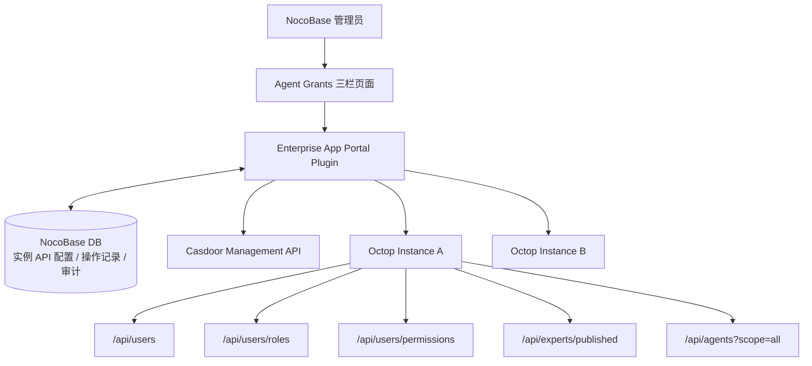

# NocoBase Agent Grants：Octop 用户创建与专家模板授权管理 PRD

> 本文严格沿用《需求PRD工程模板.md》v1.0 的 0--36 章结构，是供 Cursor /
> Coding Agent 执行的 Engineering Contract PRD。
>
> 本 PRD 定义在现有 NocoBase Casdoor
> 连接、应用目录和应用授权能力之上，新增 Agent Grants 页面及 Octop
> 用户创建、专家初始化流程。
>
> **文档状态：APPROVED_FOR_PLAN（v1.1.0）。** 2026-11-21 已对目标实例
> `http://192.168.99.170:8088` 完成 SG-AG-001–007 Contract Probe（证据见
> `prd/casdoor/evidence/`）。实例不暴露 OpenAPI；契约以冻结字段清单 +
> 422 监控替代 OpenAPI Fingerprint。Bootstrap Oracle 已定义：完成仅当
> Agent 可见且 `bootstrap_pending==false` 且 `last_error==null`；超时不得判失败。
>
> 本文不代表功能已经实现、测试通过或上线。

**快速导航：**[Scope](#4-scope) ·
[SOT](#7-authoritative-state--source-of-truth) ·
[Schema](#9-data--schema-contract) ·
[Requirements](#10-requirement-unit) · [Side
Effects](#11-side-effect-contract) ·
[Acceptance](#20-acceptance-design-standard) ·
[Traceability](#27-requirement-traceability-matrix) · [Plan
Gate](#28-plan-generation-contract)

---

# 0. PRD 使用原则

## 0.1 PRD 职责

本 PRD 必须同时回答：

```text
WHY          为什么需要 Agent Grants
WHAT         管理员如何选择 Octop、员工、专家模板及用户创建参数
BOUNDARY     NocoBase、Casdoor、Octop 各自负责什么
STATE        用户、应用授权、Octop 账号、专家模板分别以谁为事实源
INPUT        Casdoor 用户、应用、角色、权限、专家模板及创建参数
OUTPUT       Octop 用户创建结果、专家初始化状态和专家编号
SIDE EFFECT  哪些 API 可以写入，哪些系统只能读取
FAILURE      重复账号、权限变化、API 超时、Bootstrap 失败如何处理
ACCEPTANCE   如何证明真实 Octop 账号与专家已创建
EVIDENCE     如何证明每项验收通过
```

PRD 不允许 Cursor 根据常识自行补全：

- Octop 用户创建 API 的字段、枚举及默认值；
- 角色与权限字段的覆盖优先级；
- 目录账号与本地密码的互斥关系；
- `allowed_backend_types` 的合法取值；
- 默认专家模板的来源和模板编号；
- 已有 Octop 用户的处理方式；
- API 超时后的重试和重复创建语义；
- `bootstrap_status` 的终态；
- 每个 Octop 实例的 API 认证方式；
- 任何跨系统写入、回滚或删除行为。

## 0.2 强制规范关键词

- `MUST`：必须实现、测试并提供 Evidence。
- `MUST NOT`：禁止行为，违反即 Requirement FAIL。
- `SHOULD`：默认满足；偏离必须记录原因。
- `SHOULD NOT`：原则上禁止；偏离必须记录批准理由。
- `MAY`：可选，不影响本版本 Required Release Gate。

所有 `MUST / MUST NOT` 必须映射至少一个 Acceptance、Test、机器可判断
Oracle 和 Evidence。

## 0.3 No-Inference Rule

如果 Cursor 无法唯一确定以下任一事项：

```text
Source of Truth
API schema
default value
selection semantics
identity matching
permission semantics
ownership
side effects
transaction boundary
retry behavior
rollback behavior
conflict resolution
error behavior
acceptance oracle
```

则必须：

```text
MUST report SPEC_SEMANTIC_GAP
MUST BLOCK affected Plan Todo
MUST NOT select a plausible implementation by guess
MUST NOT mark affected Requirement as implemented or verified
```

Cursor 可以执行只读 Contract Probe 来关闭缺口；不得在 Probe
阶段创建真实员工或修改生产权限。

## 0.4 Requirement → Code → Test → Evidence

交付链路固定为：

```text
Requirement
  → Implementation
  → Acceptance
  → Test
  → Evidence
  → Release Gate
```

代码已写不等于 `verified`；测试文件存在不等于测试通过；模拟 Octop API
不等于真实 Octop 联调通过。

---

# 1. 文档元数据 / 源码基线

## 1.1 PRD 元数据

项目 值

---

PRD ID PRD-NOCOBASE-AGENT-GRANTS-001
Version 1.1.0
Status APPROVED_FOR_PLAN
Template 需求PRD工程模板.md v1.0
Product NocoBase Enterprise Portal / Agent Grants
Target Release Agent Grants v1.0
Golden Consumer 真实 Casdoor + NocoBase + Octop 实例
Created / Updated 2026-11-21

## 1.2 NocoBase 源码基线

```text
repository: smc-copilot/nocobase
branch: cursor/casdoor-octop-portal-e860
commit: 24324a7952dd8e5aaecdfd7192fd8faafd6a81a2
```

关键现有文件：

```text
packages/apps/app-enterprise-portal/
  client/pages/settings/portal-casdoor-connection.tsx
  client/pages/settings/portal-casdoor-grants.tsx
  client/pages/settings/portal-catalog.tsx
  client/pages/settings/routes.ts

packages/plugins/app-plugin-enterprise-app-portal/
  server/routes/portal.ts
  server/routes/schemas.ts
  server/services/composition.ts
  server/services/casdoor-management-client.ts
  server/services/casdoor-application-grants.ts
  server/services/casdoor-application-access.ts
  server/services/application-catalog.ts
  server/services/application-launch.ts
  server/services/access-audit.ts
  database/migrations/
```

源码链接：

- https://github.com/smc-copilot/nocobase/tree/cursor/casdoor-octop-portal-e860
- https://github.com/smc-copilot/nocobase/blob/cursor/casdoor-octop-portal-e860/packages/apps/app-enterprise-portal/client/pages/settings/portal-casdoor-grants.tsx
- https://github.com/smc-copilot/nocobase/blob/cursor/casdoor-octop-portal-e860/packages/plugins/app-plugin-enterprise-app-portal/server/services/casdoor-application-grants.ts

## 1.3 Octop 源码参考基线

```text
repository: loudon84/octop
branch: codex/enterprise-p1
commit: 724e33c6cb4f083ea8d69cd3bb416d9388d1655b

repository: loudon84/octop
branch: main
commit: 890111b7879665840414ca28ab168b05b0db0921
```

关键参考文件：

- `src/octop/api/routers/users.py`
- `src/octop/api/routers/user_roles.py`
- `src/octop/api/routers/experts.py`
- `src/octop/api/routers/agents.py`
- `docs/api.md`

源码链接：

- https://github.com/loudon84/octop/blob/main/src/octop/api/routers/users.py
- https://github.com/loudon84/octop/blob/main/src/octop/api/routers/user_roles.py
- https://github.com/loudon84/octop/blob/main/src/octop/api/routers/experts.py
- https://github.com/loudon84/octop/blob/main/src/octop/api/routers/agents.py
- https://github.com/loudon84/octop/blob/main/docs/api.md

## 1.4 已知真实运行环境

系统 已知信息

---

Casdoor `http://192.168.99.160:8000`，Organization `smartcore`
Octop 测试实例 `http://192.168.99.170:8088`
Octop 用户创建 API `POST /api/users`
NocoBase 已有 Casdoor 连接、群组/用户/应用读取、用户应用授权功能
Octop 实例数量 多套，分别对应不同 Casdoor Octop Application
WeKnora 已在 Casdoor 注册，但不属于 Octop Agent Grants

上述 Octop URL 是本次已提供的测试实例，不得推断其他 Octop 实例的
URL、端口或 Token。

## 1.5 Source Integrity

当前可见 GitHub `main` 源码中的 `UserCreateBody` 包含：

```text
username
password
role
display_name
email
permissions
role_name
workspace_root_dir
token_quota
max_agents
create_default_expert
expert_template_id
```

用户提供的真实运行实例成功请求还包含：

```text
directory
allowed_backend_types
expert_template_source
```

且真实成功请求在 `directory=true` 时没有发送 `password`。

因此：

- 用户提供的 HTTP 201 请求/响应是本 PRD 的真实运行行为样本。
- GitHub 源码是参考实现，不覆盖真实实例契约。
- Cursor MUST 从目标实例 `/api/openapi.json` 读取实际 Schema。
- 如果 OpenAPI 与用户提供的成功请求存在差异，必须同时执行只读 Schema
  Probe 和隔离测试账号验证。
- 未验证的字段不得作为已确认事实写入代码默认值。

---

# 2. 一句话目标

让企业应用授权管理员在 NocoBase 的 Agent Grants 页面选择一个已登记的
Octop 应用、一名已获得该 Casdoor Application 访问权限的员工和该 Octop
实例已发布的专家模板，通过可配置的 Octop 用户创建参数调用目标实例
`POST /api/users`，在员工账号不存在时创建目录用户并初始化指定专家，在账号已存在时阻止重复创建并展示该员工已经安装的专家及
`agent_id`，同时保证跨实例隔离、权限复核、幂等控制和完整审计。

---

# 3. 背景与问题定义

## 3.1 Current State

当前已经具备：

1.  NocoBase 已配置 Casdoor 连接。
2.  NocoBase 已能读取 Casdoor 群组、用户和 Application。
3.  NocoBase 已能为 Casdoor 用户授予指定 Application 的访问权限。
4.  NocoBase 已有企业应用目录。
5.  每个 Octop 实例在 Casdoor 中作为独立 Application 管理。
6.  Octop 已有 `POST /api/users` 创建用户接口。
7.  用户创建请求可以同时指定默认专家模板。
8.  Octop 已有已发布专家模板接口。
9.  Octop 已有管理员用户列表和专家列表接口。
10. Octop 用户创建界面已经提供目录账号、角色、权限和默认专家等配置项。

用户提供的真实成功请求样本：

```json
{
  "username": "demo",
  "display_name": "demo",
  "email": null,
  "directory": true,
  "role": "user",
  "permissions": [
    "agent_plugins",
    "connector_builtin",
    "connector_enabled",
    "experts",
    "mbti",
    "memory",
    "skill_builtin",
    "skill_packages",
    "skills",
    "subagents",
    "tasks",
    "token_usage",
    "tools"
  ],
  "role_name": "用户",
  "workspace_root_dir": null,
  "token_quota": null,
  "max_agents": 3,
  "allowed_backend_types": ["docker"],
  "create_default_expert": true,
  "expert_template_source": "published",
  "expert_template_id": "01M7SH5HEGK5VC8MR87F2T185F"
}
```

用户提供的成功响应包含：

```text
id
username
role
display_name
email
has_password
sso_linked
directory
disabled
permissions
role_name
workspace_root_dir
token_quota
max_agents
allowed_backend_types
default_expert.requested
default_expert.source
default_expert.template_id
default_expert.status
default_expert.agent_id
default_expert.bootstrap_status
default_expert.error_code
default_expert.error_message
```

## 3.2 Problem

当前缺少 NocoBase 对 Octop 用户和专家初始化的统一管理入口：

- 管理员需要进入每个 Octop 实例分别创建员工账号。
- NocoBase 不能直观判断某员工是否已经在当前 Octop 实例存在。
- 管理员无法在同一个页面查看员工在当前 Octop
  实例已安装的专家和专家编号。
- 专家模板选择与 Octop 用户创建参数没有统一管理。
- 多个 Octop 实例容易发生 API 地址、员工账号或模板来源混用。
- 如果创建请求超时，无法仅凭 HTTP 客户端结果判断 Octop
  是否已经创建账号。

## 3.3 Impact

---

影响维度 影响

---

业务 员工账号创建与专家初始化分散在多个 Octop 实例

工程 缺少 NocoBase 到 Octop 的受控管理 API 适配

数据 存在重复账号、错误实例创建和专家编号不可追踪风险

安全 Octop 管理凭据必须由 NocoBase 服务端保管

运维 多实例需要独立连接测试、错误追踪和审计

AI Coding API Schema 差异若未冻结，Cursor
可能根据旧源码生成错误请求
--------------------------------------------------------------------------------------

---

# 4. Scope

## 4.1 In Scope

---

Scope ID 范围 Requirement

---

SCOPE-AG-001 新增 Agent Grants REQ-AG-001
页面，三栏布局

SCOPE-AG-002 左侧读取并选择 Casdoor REQ-AG-001
已登记的 Octop Application

SCOPE-AG-003 中间读取该 Application REQ-AG-002
已授权员工

SCOPE-AG-004 员工列表严格单选 REQ-AG-002

SCOPE-AG-005 显示员工在当前 Octop REQ-AG-003
的账号状态

SCOPE-AG-006 显示员工已安装专家及 REQ-AG-003
`agent_id`

SCOPE-AG-007 右侧读取当前 Octop REQ-AG-004
已发布专家模板

SCOPE-AG-008 显示创建用户时可配置的 API REQ-AG-005
参数

SCOPE-AG-009 调用目标 Octop REQ-AG-006
`POST /api/users`

SCOPE-AG-010 用户已存在时禁止重复创建 REQ-AG-007

SCOPE-AG-011 验证默认专家 Bootstrap REQ-AG-008
状态和专家编号

SCOPE-AG-012 每套 Octop 独立 API REQ-AG-009
地址和服务端凭据

SCOPE-AG-013 创建操作持久化、幂等和审计 REQ-AG-010
----------------------------------------------------------------------------

## 4.2 Out of Scope

---

Non-Goal ID 明确禁止范围

---

NON-GOAL-AG-001 MUST NOT 修改 Casdoor LDAP/AD
同步逻辑

NON-GOAL-AG-002 MUST NOT 重新创建 Casdoor 用户

NON-GOAL-AG-003 MUST NOT 重新创建 Casdoor
Application

NON-GOAL-AG-004 MUST NOT 修改现有 Casdoor
Application Permission

NON-GOAL-AG-005 MUST NOT 修改 Octop 源码或数据库

NON-GOAL-AG-006 MUST NOT 修改 WeKnora 源码或数据库

NON-GOAL-AG-007 MUST NOT 将 WeKnora 显示为 Octop
实例

NON-GOAL-AG-008 MUST NOT 批量创建 Octop 用户

NON-GOAL-AG-009 MUST NOT 在本次功能中修改已有 Octop
用户角色、权限或密码

NON-GOAL-AG-010 MUST NOT 为已有 Octop 用户重复调用
`POST /api/users`

NON-GOAL-AG-011 MUST NOT 为已有 Octop
用户通过重复创建用户的方式追加专家

NON-GOAL-AG-012 MUST NOT 开发独立 Agent Gateway 或
Octop Router

NON-GOAL-AG-013 MUST NOT 实现员工登录 SSO 或跨系统
Cookie 共享

NON-GOAL-AG-014 MUST NOT 将 Octop 管理 Token
暴露给浏览器

NON-GOAL-AG-015 MUST NOT 使用员工 AD 密码创建 Octop
本地密码
------------------------------------------------------------------------

## 4.3 Architecture Boundary

---

Domain Owner Input Output 不负责

---

Casdoor Casdoor AD 同步用户 用户、账号状态、群组 Octop 用户创建
Identity

Casdoor Casdoor Permission / Group / Application 访问决策 专家模板授权
Application Role  
Authorization

NocoBase Portal NocoBase Casdoor Agent Grants UI、操作审计 Octop 账号事实
用户和应用、Octop  
API

Octop Instance 对应 Octop 用户创建请求 Octop Casdoor 用户目录
用户、专家记录、Bootstrap  
状态

Published 对应 Octop 已发布模板 模板 ID 和元数据 NocoBase 自建模板
Expert Catalog

NocoBase DB NocoBase 实例配置、操作状态 配置和审计 外部用户/专家主数据
-----------------------------------------------------------------------------------------------------

---

# 5. Terminology / Domain Model

---

术语 唯一定义

---

Agent Grants NocoBase 中管理员工在指定 Octop
实例创建用户和初始化默认专家的功能

Octop Application Casdoor 中登记、并在 NocoBase 应用目录中映射到一套
Octop 实例的 Application

`appCode` NocoBase 应用目录内部唯一编码

`casdoorAppKey` Casdoor Application 的真实名称

Casdoor User Casdoor 中已有的企业员工账号

Casdoor User ID Casdoor 用户唯一标识，格式以实际 API
返回为准；当前实现通常为 `owner/name`

Authorized Employee 对所选 Application 的 Casdoor 有效访问决策为 Allow
的员工

Direct Grant 用户通过 Casdoor Permission.users 直接获得的授权

Inherited Grant 用户通过 Casdoor Group 或 Role 获得的授权

Octop User 当前选定 Octop 实例 `/api/users` 中的用户记录

Directory Account 使用 Octop 已配置目录认证的账号，API 字段为
`directory`

Role Template Octop `/api/users/roles` 返回的角色模板

Permission Catalog Octop `/api/users/permissions` 返回的可分配权限键

Resource Policy Octop 用户资源限制字段，例如
`workspace_root_dir`、`token_quota`、`max_agents`

Published Expert 当前 Octop 实例 `/api/experts/published`
返回的已发布专家模板

`expert_template_id` 已发布专家模板的 ID

`published_expert_id` 已安装专家所来源的已发布模板 ID

`agent_id` Octop 实例内实际创建的专家编号

Bootstrap Pending Octop
已接受默认专家创建请求，但初始化尚未被验证为完成

Existing Account 当前 Octop 实例已存在同名员工账号；不允许再次创建

Create Options 管理员提交 `POST /api/users` 前配置的用户创建参数

Operation ID NocoBase 为一次创建尝试生成的唯一操作 ID
---------------------------------------------------------------------------------------

不得将 `agent_id` 与 `published_expert_id` 混为一谈。

---

# 6. System Context

## 6.1 Context Diagram



## 6.2 System Boundary

**Inside Boundary**

- NocoBase Agent Grants 页面。
- Octop 实例与 API 地址映射。
- Octop API 服务端凭据解析。
- Casdoor Application 授权用户查询。
- Octop 用户、角色、权限、模板、专家查询。
- 创建前检查。
- Octop 用户创建。
- 默认专家 Bootstrap 状态读取。
- 操作状态与审计。

**Outside Boundary**

- Casdoor 用户创建与 LDAP 同步。
- Casdoor Application 创建。
- Octop 本地数据库。
- Octop Agent Runtime 内部创建逻辑。
- Octop 专家模板发布逻辑。
- WeKnora。
- 员工浏览器的 Octop 登录过程。

**Trusted Input**

- NocoBase 服务端配置。
- Casdoor 服务端 API 返回。
- 目标 Octop 服务端 API 返回。
- 具有 Agent Grants 配置权限的管理员操作。

**Untrusted Input**

- 浏览器提交的 `appCode`、Casdoor 用户 ID、模板 ID 和创建参数。
- 外部 API 返回的文本字段、URL 和错误消息。
- 任何未经服务端重新校验的用户选择。

---

# 7. Authoritative State / Source of Truth

---

State Role Authoritative? Writer Reader 可否自动覆盖

---

Casdoor User 员工身份 YES Casdoor / LDAP NocoBase NO

Casdoor 应用身份 YES Casdoor 管理员 NocoBase NO
Application

Casdoor 员工应用访问权 YES Casdoor / NocoBase NO
Permission 现有授权页面

Casdoor Group 员工群组 YES Casdoor / LDAP NocoBase NO

NocoBase 应用内部映射 YES NocoBase NocoBase NO
`appCode` 管理员

NocoBase Octop 管理 API YES NocoBase NocoBase Server NO
`apiBaseUrl` 地址 管理员

NocoBase API Octop YES 运维环境 NocoBase Server NO
Secret Ref 服务端凭据引用

Octop User Octop 账号 YES Octop API NocoBase NO

Octop Role Octop 角色定义 YES Octop 管理员 NocoBase NO
Template

Octop Octop 可分配权限 YES Octop 版本 NocoBase NO
Permission  
Catalog

Octop 专家模板 YES Octop 发布流程 NocoBase NO
Published  
Expert

Octop Agent 员工已安装专家 YES Octop NocoBase NO

Agent Grant 创建流程状态 YES（仅操作状态） NocoBase NocoBase NO
Operation

Agent Grant 操作审计 YES NocoBase NocoBase NO
Audit

Create Form 当前页面输入 NO（临时态） 浏览器 浏览器/Server N/A
Draft
-------------------------------------------------------------------------------------------------

## 7.1 状态分类

- Casdoor 用户、应用和权限属于 `OBSERVED_STATE`，由 Casdoor 决定。
- Octop 用户、角色、权限目录、专家模板和专家记录属于
  `OBSERVED_STATE`，由对应 Octop 实例决定。
- NocoBase 应用映射和 API 连接配置属于 `DESIRED_STATE`。
- Agent Grants 操作记录属于 `EVIDENCE_STATE` / `RUNTIME_STATE`。
- 前端创建表单属于临时 `RESOLVED_STATE`，不得作为创建成功的事实源。

## 7.2 禁止双事实源

NocoBase MUST NOT 建立第二套员工主表、Octop 用户主表或专家模板主表。

NocoBase
可以保存外部查询结果的短期缓存，但缓存不是授权或账号存在的事实源；执行创建前必须重新查询外部系统。

---

# 8. State Machine

## 8.1 Agent Grants 页面状态

```text
UNSELECTED
  ↓ select Octop Application
APPLICATION_SELECTED
  ↓ load authorized users and Octop data
DATA_LOADING
  ↓ all required reads succeeded
READY
  ↓ select exactly one employee
EMPLOYEE_SELECTED
  ↓ select published template and configure options
CREATE_CONFIGURED
  ↓ submit
PREFLIGHTING
```

## 8.2 创建操作状态

```text
PREFLIGHTING
  ├─ user exists ───────────────> ACCOUNT_EXISTS
  ├─ permission denied ─────────> BLOCKED
  ├─ invalid template/options ──> BLOCKED
  ├─ API unavailable ───────────> FAILED_NO_MUTATION
  └─ all checks pass ───────────> SUBMITTING

SUBMITTING
  ├─ confirmed 201 ─────────────> USER_CREATED
  ├─ confirmed no-write error ──> FAILED_NO_MUTATION
  └─ timeout / lost response ───> OUTCOME_UNKNOWN

USER_CREATED
  ├─ create_default_expert=false -> COMPLETED
  ├─ bootstrap pending ─────────> BOOTSTRAP_PENDING
  ├─ expert observed ──────────> COMPLETED
  └─ bootstrap failed ─────────> BOOTSTRAP_FAILED

OUTCOME_UNKNOWN
  ↓ query Octop authoritative state
RECONCILING
  ├─ matching user exists ──────> ACCOUNT_EXISTS_UNATTRIBUTED
  ├─ user absent, no request active -> SAFE_TO_RETRY
  └─ result cannot be proven ───> MANUAL_REVIEW
```

## 8.3 状态语义

---

State 含义 是否允许再次 POST

---

`PREFLIGHTING` 正在执行只读检查 NO

`SUBMITTING` 已持久化操作记录并发送创建请求 NO

`ACCOUNT_EXISTS` 目标 Octop 已存在该用户名 NO

`USER_CREATED` Octop 已返回成功创建结果 NO

`BOOTSTRAP_PENDING` 用户已创建，专家初始化尚未验证完成 NO

`COMPLETED` 用户创建完成，且所请求的专家状态已验证 NO

`BOOTSTRAP_FAILED` 用户已创建，但专家初始化失败 NO

`FAILED_NO_MUTATION` 已证明未发生 Octop 写入 允许显式重试

`OUTCOME_UNKNOWN` 请求结果未知 NO

`ACCOUNT_EXISTS_UNATTRIBUTED` 超时后发现账号存在，但无法证明由本次操作创建 NO

`SAFE_TO_RETRY` 已证明账号不存在且无在途创建请求 需要管理员重新提交
-----------------------------------------------------------------------------------------------------------

## 8.4 非法状态转移

- `ACCOUNT_EXISTS` MUST NOT 转移到 `SUBMITTING`。
- `BOOTSTRAP_PENDING` MUST NOT 再次创建用户。
- `OUTCOME_UNKNOWN` MUST NOT 自动重发 POST。
- `BOOTSTRAP_FAILED` MUST NOT 自动删除用户。
- 账号禁用、Casdoor 权限撤销或应用停用后，MUST 阻止新的创建操作。

## 8.5 持久化位置

创建状态保存在 NocoBase Agent Grant Operation 表。

Octop 用户与专家是否真实存在，必须重新读取 Octop API 验证，不得只依据
NocoBase 操作记录。

---

# 9. Data / Schema Contract

## 9.1 Schema Rule

内部 Schema 必须：

- 有明确 `schema_id` 和 `schema_version`。
- 明确 required、optional、nullable、enum 和 default。
- 默认 `additionalProperties=false`。
- 外部 API Schema 单独记录版本和 Contract Fingerprint。
- 不允许将未知字段自动透传到 Octop。
- 不允许将密码、Token、Secret 写入操作记录。

## 9.2 Octop User Create Request Schema

以下是用户提供的真实成功请求字段。除已由真实请求证明的字段外，字段类型、枚举、范围和默认值仍必须由目标实例
`/api/openapi.json` 验证。

---

Field Type Required 默认/来源 管理员可编辑 语义

---

`username` string YES Casdoor `name` NO 目录登录账号

`display_name` string/null NO Casdoor YES 显示名称
`displayName`

`email` string/null NO Casdoor `email` YES 邮箱

`directory` boolean YES（真实样本） `true` YES 是否使用目录账号

`password` string 条件必填 仅本地账号模式 条件 目录账号模式禁止发送

`role` string YES 默认 `user` YES Octop Role Template ID

`role_name` string NO 选中角色名称 NO 角色显示名快照

`permissions` string\[\] YES（真实样本） 选中角色权限 YES 用户权限集合

`workspace_root_dir` string/null NO 角色策略或 null YES 工作空间目录限制

`token_quota` integer/null NO 角色策略或 null YES Token 配额

`max_agents` integer/null NO 角色策略；样本为 3 YES 专家数量上限

`allowed_backend_types` string\[\] YES（真实样本） 实例支持值；样本为 YES 允许的 Backend 类型
`docker`

`create_default_expert` boolean YES（真实样本） `true` YES 是否同时初始化默认专家

`expert_template_source` enum/string 条件必填 `published` NO 本期固定已发布模板来源

`expert_template_id` string 条件必填 右侧选中模板 ID YES（选择） 已发布专家模板 ID
------------------------------------------------------------------------------------------------------------------------

### 9.2.1 Field Rules

1.  `username` MUST 从当前 Casdoor 用户读取，页面只读显示。
2.  `display_name` 默认 Casdoor `displayName`，允许管理员覆盖。
3.  `email` 默认 Casdoor `email`；Casdoor 为空时默认 `null`。
4.  `directory=true` 时 MUST NOT 发送本地密码。
5.  `directory=true` 时 Octop LDAP 配置必须通过服务端预检。
6.  `directory=false` 时，只有目标 API Schema
    明确支持本地密码模式，页面才允许开启；此时密码必须由管理员在当前表单输入并确认，密码不得持久化。
7.  `role` 必须来自当前 Octop `/api/users/roles`。
8.  普通 Agent Grants 流程不得选择 `system_role=admin` 的角色。
9.  `permissions` 必须来自当前 Octop `/api/users/permissions`
    可分配权限目录。
10. 角色切换后，权限和资源策略默认值必须重置为新角色定义。
11. 管理员手动修改权限后，提交值为最终显式权限集合。
12. `role_name` 由选中角色的 `user_role_name` 生成，不允许前端自由伪造。
13. `workspace_root_dir` 只能从目标 Octop 返回的允许路径中选择。
14. `token_quota=null`、`max_agents=null` 的含义必须以目标实例
    Schema/接口契约为准；不得擅自将 null 解释为 0。
15. `allowed_backend_types` 只能选择目标实例实际支持的类型。
16. `expert_template_source` 本期固定为 `published`。
17. `create_default_expert=true` 时 `expert_template_id` 必填。
18. `create_default_expert=false` 时不发送
    `expert_template_id`，并且本次只创建用户。
19. 未知字段不得通过 `additionalProperties` 自动传递。

## 9.3 真实成功请求基线

```json
{
  "username": "demo",
  "display_name": "demo",
  "email": null,
  "directory": true,
  "role": "user",
  "permissions": [
    "agent_plugins",
    "connector_builtin",
    "connector_enabled",
    "experts",
    "mbti",
    "memory",
    "skill_builtin",
    "skill_packages",
    "skills",
    "subagents",
    "tasks",
    "token_usage",
    "tools"
  ],
  "role_name": "用户",
  "workspace_root_dir": null,
  "token_quota": null,
  "max_agents": 3,
  "allowed_backend_types": ["docker"],
  "create_default_expert": true,
  "expert_template_source": "published",
  "expert_template_id": "01M7SH5HEGK5VC8MR87F2T185F"
}
```

该 JSON 是请求样本，不是对所有 Octop 实例的硬编码默认值。

## 9.4 Octop API Response Projection

NocoBase 至少需要解析：

```text
User:
  id
  username
  role
  display_name
  email
  has_password
  sso_linked
  directory
  disabled
  permissions
  role_name
  workspace_root_dir
  token_quota
  max_agents
  allowed_backend_types

Default Expert:
  requested
  source
  template_id
  status
  agent_id
  bootstrap_status
  error_code
  error_message
```

`bootstrap_status=pending` 不等于初始化完成。

## 9.5 Octop API Read Models

---

Model API 关键字段

---

Octop User `GET /api/users` `id`, `username`, `role`, `display_name`,
`email`, `disabled`, `directory`

Role Template `GET /api/users/roles` `user_role_id`, `user_role_name`,
`system_role`, `permissions`, `policies`

Permission Catalog `GET /api/users/permissions` `key`, `category`, `label`, `page`,
`page_label`

Published Expert `GET /api/experts/published` `id`, `slug`, `name`, `description`,
`creator_username`, `icon_url`, `updated_at`

Installed Agent `GET /api/agents?scope=all` `id`, `agent_id`, `user_id`, `owner_username`,
`name`, `published_expert_id`, `kind`, `state`

LDAP Config `GET /api/auth/ldap/config` 仅读取目录配置是否存在/可用，不读取或暴露密码

Health `GET /api/health` `status`, `version`
------------------------------------------------------------------------------------------------------

所有字段必须以目标实例 OpenAPI 和真实返回为准。

## 9.6 NocoBase Persistence Schema

### A. `enterprisePortalApplications` 扩展字段

只对 `appType=octop` 的记录使用：

---

Field Type Required Meaning

---

`agentGrantsEnabled` boolean YES 是否允许该 Octop 实例进入 Agent Grants

`apiBaseUrl` string YES when enabled 服务端管理 API Origin

`apiAuthMode` enum YES when enabled `bearer_env` /
`password_login_env`，仅允许已验证模式

`apiTokenEnv` string/null conditional Bearer Token 环境变量名

`apiUsernameEnv` string/null conditional 服务账号用户名环境变量名

`apiPasswordEnv` string/null conditional 服务账号密码环境变量名
------------------------------------------------------------------------------------------------------

`baseUrl` 是员工浏览器打开应用的地址；`apiBaseUrl` 是 NocoBase
服务端访问管理 API 的地址，两者必须分开。

### B. `enterprisePortalAgentGrantOperations`

Field Type Required Meaning

---

`id` string/UUID YES Operation ID
`appCode` string YES 目标 Octop 应用
`casdoorUserId` string YES Casdoor `owner/name`
`username` string YES Casdoor 登录账号快照
`actorUserId` string YES NocoBase 操作人
`status` enum YES 创建状态机
`expertTemplateId` string/null NO 选中模板
`createOptionsSnapshot` JSON YES 脱敏后的创建参数
`octopUserId` string/null NO Octop 用户 ID
`agentId` string/null NO 创建出的专家编号
`bootstrapStatus` string/null NO Octop Bootstrap 状态
`errorCode` string/null NO 结构化错误码
`errorMessage` text/null NO 脱敏错误信息
`startedAt` datetime YES 开始时间
`updatedAt` datetime YES 更新时间
`completedAt` datetime/null NO 终态时间

`createOptionsSnapshot` MUST NOT 包含 password、Token 或 Secret。

### C. 并发锁

必须提供数据库级、跨 NocoBase 进程有效的创建锁：

```text
lock_key = appCode + ":" + casdoorUserId
```

同一 Octop 实例、同一 Casdoor 员工在同一时刻最多存在一个未完成创建操作。

锁必须在终态或人工完成对账后释放。

## 9.7 Migration Rule

- 使用 NocoBase 3 migration。
- 只新增必要字段、操作表和索引。
- 不重建现有应用目录。
- 不修改现有 Casdoor 用户或授权表。
- 不修改 Octop 数据库。
- 不删除已有审计记录。
- Migration 必须有 up/down 测试。
- down 不得删除已经产生的外部 Octop 用户。

---

# 10. Requirement Unit

## REQ-AG-001 --- Octop Application 选择与实例配置

### Goal

管理员只能选择已登记且已启用 Agent Grants 的 Octop 实例。

### Normative Requirement

- MUST 从现有 Casdoor Application 与 NocoBase 应用目录映射中读取应用。
- MUST 只显示 `appType=octop` 且 `agentGrantsEnabled=true` 的应用。
- MUST 使用 `casdoorAppKey` 映射真实 Casdoor Application。
- MUST 使用当前 `appCode` 解析对应 `apiBaseUrl` 和服务端凭据。
- MUST 在切换应用时清空员工、模板、创建参数和上一次实例数据。
- MUST NOT 将 WeKnora 或其他业务 HTTPS 应用作为 Octop 实例。
- MUST NOT 从浏览器传入任意 Octop API URL。

### Inputs

```text
appCode
Casdoor Application mapping
apiBaseUrl
apiAuthMode
server-side credential reference
```

### Preconditions

- Application 存在于 Casdoor。
- NocoBase 目录记录存在。
- `appType=octop`。
- Agent Grants 已启用。
- API URL 通过内部管理 API allowlist 校验。

### Authoritative State

```text
SOT: Casdoor Application + NocoBase enterprisePortalApplications
Observed: Octop health/version response
Derived: selected Octop instance context
```

### State Transition

```text
UNSELECTED -> APPLICATION_SELECTED -> DATA_LOADING -> READY
```

### Allowed Side Effects

- 读取 Casdoor Application。
- 读取 NocoBase 应用目录。
- 请求 Octop `/api/health`。

### Forbidden Side Effects

- 不修改 Casdoor Application。
- 不创建 Octop 用户。
- 不修改任何 Permission。
- 不向浏览器返回管理凭据。

### Ownership Scope

```text
RESOURCE: one NocoBase Octop application mapping
```

### Idempotency

重复选择同一应用只触发只读刷新，不创建记录。

### Failure Semantics

- 应用不存在：`OCTOP_APPLICATION_NOT_FOUND`。
- 应用类型不为 octop：`APP_TYPE_NOT_SUPPORTED`。
- API 地址未配置：`OCTOP_API_NOT_CONFIGURED`。
- 服务端凭据不可解析：`OCTOP_CREDENTIAL_UNAVAILABLE`。
- Health 检查失败：`OCTOP_INSTANCE_UNAVAILABLE`。

失败时不得进入可创建状态。

### Postconditions

- 当前页面只持有一个 `appCode`。
- 后续所有 Octop API 请求均使用该 `appCode` 对应实例。

### Invariants

```text
INV-AG-001: One page operation has exactly one selected Octop appCode.
INV-AG-002: appCode -> apiBaseUrl mapping is server-owned.
INV-AG-003: WeKnora never enters Octop Agent Grants.
```

### Error Codes

```text
OCTOP_APPLICATION_NOT_FOUND
APP_TYPE_NOT_SUPPORTED
OCTOP_API_NOT_CONFIGURED
OCTOP_CREDENTIAL_UNAVAILABLE
OCTOP_INSTANCE_UNAVAILABLE
```

### Acceptance

- A-AG-001
- A-AG-002
- A-AG-016

### Evidence

- Casdoor Application 列表脱敏响应。
- NocoBase appCode 到 Octop API 地址映射。
- 非 Octop 应用过滤测试。
- 实例 Health 响应。

---

## REQ-AG-002 --- Casdoor 已授权员工读取与单选

### Goal

中间栏只显示对当前所选 Casdoor Application
具有有效访问权限的员工，并且只允许单选一人。

### Normative Requirement

- MUST 复用现有 Casdoor Management Client 和 Application Permission
  逻辑。
- MUST 根据当前 Application 对应的 `casdoorAppKey` 查询有效授权。
- MUST 同时识别 direct 与 inherited 授权。
- MUST 以 Casdoor
  实际权限决策为准，不得只根据前端缓存或本地勾选状态判断。
- MUST 过滤 `isForbidden=true` 或 `isDeleted=true` 的员工。
- MUST 使用单选控件。
- MUST 在服务端创建请求再次校验该员工的 Application 权限。
- MUST NOT 接受前端伪造的员工列表或 `isAuthorized=true`。
- MUST NOT 支持全选或批量创建。

### Inputs

```text
appCode
casdoorAppKey
Casdoor users
Portal-managed Application Permission
Casdoor enforce decision
```

### Preconditions

- Casdoor Management API 可用。
- 当前应用存在。
- 当前 Casdoor 授权查询逻辑处于真实联调模式。
- `contractFixture` 不得用于生产连接。

### Authoritative State

```text
SOT: Casdoor Permission + Casdoor enforce
Observed: Casdoor User records
Derived: authorized employee list
```

### State Transition

```text
APPLICATION_SELECTED -> DATA_LOADING -> EMPLOYEE_LIST_READY
EMPLOYEE_LIST_READY -> EMPLOYEE_SELECTED
EMPLOYEE_SELECTED -> EMPLOYEE_SELECTED (new selection replaces old)
```

### Allowed Side Effects

仅允许读取 Casdoor 用户和 Permission。

### Forbidden Side Effects

不得在员工列表加载时授予、撤销或修改 Casdoor 权限。

### Ownership Scope

```text
ROW: Casdoor User projection
NONE: Casdoor User mutation
```

### Idempotency

刷新员工列表只重新读取，不产生写入。

### Failure Semantics

- Casdoor 不可用：`CASDOOR_AUTHORIZATION_UNAVAILABLE`。
- 当前应用没有有效授权策略：显示空授权用户列表。
- 用户状态禁用：不显示为可创建对象。
- 权限决策无法确认：fail closed，不得放行。

### Postconditions

- 员工列表全部具有当前应用的有效授权。
- 当前选中员工数量只能为 0 或 1。

### Invariants

```text
INV-AG-004: selectedEmployeeCount <= 1.
INV-AG-005: every selectable employee is currently authorized for selected app.
INV-AG-006: backend rechecks Casdoor authorization before POST /api/users.
```

### Error Codes

```text
CASDOOR_AUTHORIZATION_UNAVAILABLE
CASDOOR_USER_DISABLED
CASDOOR_USER_NOT_AUTHORIZED
CASDOOR_USER_NOT_FOUND
```

### Acceptance

- A-AG-003
- A-AG-011

### Evidence

- Casdoor enforce 真实响应。
- direct/inherited 用户样本。
- 单选交互测试。
- 未授权员工负向测试。

---

## REQ-AG-003 --- Octop 账号与已安装专家读取

### Goal

中间栏显示员工在当前 Octop 实例是否已有账号，以及已安装专家和专家编号。

### Normative Requirement

- MUST 调用当前 Octop `GET /api/users`。
- MUST 调用当前 Octop `GET /api/agents?scope=all`。
- MUST 使用 Octop 服务端凭据调用，浏览器不得直接调用管理 API。
- MUST 将 Casdoor `name` 与 Octop `username` 做规范化比较。
- MUST 展示账号存在状态、禁用状态和 Octop User ID。
- MUST 只将 `kind=expert` 的 Agent 作为专家展示。
- MUST 展示 `agent_id`。
- 若存在 `published_expert_id`，MUST 同时展示来源模板编号。
- MUST 展示专家 `name` 和 `state`。
- MUST NOT 将 `agent_id` 误用为模板编号。
- MUST NOT 直接查询 Octop SQLite/PostgreSQL。

### Inputs

```text
selected Casdoor User
GET /api/users
GET /api/agents?scope=all
```

### Preconditions

- Octop API 连接成功。
- 服务端凭据具备 `users` 权限。
- 用户列表和 Agent 列表读取均成功。

### Authoritative State

```text
SOT User: Octop GET /api/users
SOT Agent: Octop GET /api/agents?scope=all
Derived: Casdoor user -> Octop user -> installed experts
```

### State Transition

```text
EMPLOYEE_SELECTED -> OCTOP_USER_LOOKUP
  -> USER_MISSING
  -> USER_EXISTS
  -> LOOKUP_FAILED
```

### Allowed Side Effects

只读 Octop 用户和 Agent 列表。

### Forbidden Side Effects

不得在查询时创建、启用、禁用、删除或修改 Octop 用户/专家。

### Ownership Scope

```text
NONE: Octop user/agent records are externally owned.
```

### Idempotency

重复读取不得改变 Octop 状态。

### Failure Semantics

- `/api/users` 失败：`OCTOP_USER_LOOKUP_FAILED`。
- `/api/agents?scope=all` 失败：`OCTOP_AGENT_LOOKUP_FAILED`。
- 用户匹配结果多于一条：`OCTOP_USERNAME_AMBIGUOUS`。
- 同名用户存在但 disabled：仍判定为 Existing
  Account，不得创建替代账号。

### Postconditions

- 当前员工的 Octop 账号存在性可被证明。
- 已安装专家列表来自当前 Octop 实例。
- 用户存在时页面显示"账号已存在"。

### Invariants

```text
INV-AG-007: Octop account existence is determined by Octop API.
INV-AG-008: installed expert IDs are read from the selected Octop instance.
INV-AG-009: existing account never enters user creation.
```

### Error Codes

```text
OCTOP_USER_LOOKUP_FAILED
OCTOP_AGENT_LOOKUP_FAILED
OCTOP_USERNAME_AMBIGUOUS
OCTOP_ACCOUNT_EXISTS
```

### Acceptance

- A-AG-004
- A-AG-008

### Evidence

- `/api/users` 脱敏响应。
- `/api/agents?scope=all` 脱敏响应。
- 用户与 Agent 映射结果。
- 已安装专家编号截图。

---

## REQ-AG-004 --- 当前 Octop 已发布专家模板读取

### Goal

右侧只展示当前选定 Octop 实例已发布的专家模板。

### Normative Requirement

- MUST 调用当前 Octop `GET /api/experts/published`。
- MUST 使用模板真实 `id` 作为 `expert_template_id`。
- MUST 显示名称、描述、模板 ID、发布人、图标和更新时间。
- MUST 支持模板搜索。
- MUST 单选一个模板。
- MUST 在提交前重新检查模板 ID 仍存在于当前实例。
- MUST NOT 将其他 Octop 实例的模板混入当前列表。
- MUST NOT 将 SkillHub Market 或 bundled expert 当作 `published`
  模板。
- MUST NOT 允许管理员手工输入模板 ID 绕过读取校验。

### Inputs

```text
appCode
GET /api/experts/published
```

### Preconditions

- 当前 Octop 实例已通过 Health。
- API 认证成功。

### Authoritative State

```text
SOT: selected Octop GET /api/experts/published
Derived: template display projection
```

### State Transition

```text
APPLICATION_SELECTED -> TEMPLATE_LOADING -> TEMPLATE_LIST_READY
TEMPLATE_LIST_READY -> TEMPLATE_SELECTED
```

### Allowed Side Effects

只读当前实例的已发布模板。

### Forbidden Side Effects

不得发布、取消发布、修改或删除专家模板。

### Ownership Scope

```text
NONE: Published Expert records are Octop-owned.
```

### Idempotency

重复加载模板只读取，不写入。

### Failure Semantics

- API 失败：`OCTOP_TEMPLATE_LIST_FAILED`。
- 模板列表为空：显示空状态，禁止默认专家创建。
- 模板已删除：`OCTOP_TEMPLATE_NOT_FOUND`。
- 模板来自其他实例：`OCTOP_TEMPLATE_INSTANCE_MISMATCH`。

### Postconditions

所选模板的 `id` 与当前 Octop API 返回的模板 ID 完全一致。

### Invariants

```text
INV-AG-010: expert_template_source = published in v1.
INV-AG-011: expert_template_id belongs to selected Octop instance.
```

### Error Codes

```text
OCTOP_TEMPLATE_LIST_FAILED
OCTOP_TEMPLATE_NOT_FOUND
OCTOP_TEMPLATE_INSTANCE_MISMATCH
```

### Acceptance

- A-AG-005

### Evidence

- 当前 Octop `/api/experts/published` 原始脱敏响应。
- 模板列表截图。
- 模板 ID 提交校验测试。

---

## REQ-AG-005 --- Octop 用户创建参数管理界面

### Goal

在创建前向管理员提供与目标 Octop 用户创建 API 对应的参数表单，避免
NocoBase 隐式硬编码所有用户权限和资源策略。

### Normative Requirement

- MUST 在"创建专家"操作前提供创建参数确认 Drawer/Panel。
- MUST
  显示用户名、显示名称、邮箱、目录账号、角色、权限、资源策略、Backend
  类型、默认专家开关和模板。
- MUST 将用户名绑定为 Casdoor `name`，只读。
- MUST 默认显示 Casdoor `displayName` 和 `email`。
- MUST 从当前 Octop `/api/users/roles` 读取角色。
- MUST 从当前 Octop `/api/users/permissions` 读取权限目录。
- MUST 在角色切换时将权限和资源策略重置为新角色模板值。
- MUST 允许管理员在权限目录范围内调整权限集合。
- MUST 从当前实例的 API Schema/能力目录读取 `allowed_backend_types`
  可选值。
- MUST 允许配置
  `workspace_root_dir`、`token_quota`、`max_agents`，前提是目标实例支持相应字段。
- MUST 对每个字段显示有效默认值和说明。
- MUST NOT 将角色或权限列表写死在 NocoBase 代码中。
- MUST NOT 自动透传未知 API 字段。
- MUST NOT 允许普通 Agent Grants 流程选择 `system_role=admin`。
- MUST 在角色、权限目录或 Schema 读取失败时阻止提交。

### Inputs

```text
Casdoor User
Octop Role Templates
Octop Permission Catalog
Octop API Schema
Octop instance policy defaults
selected Published Expert
```

### Preconditions

- 用户已授权。
- 用户在 Octop 中不存在。
- 当前 Octop 连接正常。
- 角色和权限目录读取成功。
- 创建请求 Schema 已通过 Contract Probe。

### Authoritative State

```text
SOT Role: GET /api/users/roles
SOT Permission: GET /api/users/permissions
SOT API fields: target /api/openapi.json
SOT selected expert: GET /api/experts/published
```

### State Transition

```text
USER_MISSING -> CREATE_OPTIONS_LOADING
CREATE_OPTIONS_LOADING -> CREATE_OPTIONS_READY
CREATE_OPTIONS_READY -> CREATE_CONFIGURED
```

### Allowed Side Effects

只读角色、权限、OpenAPI 和实例能力。

创建表单草稿只保存在当前页面内存。

### Forbidden Side Effects

不得在打开 Drawer 时创建 Octop 用户或写入用户权限。

### Ownership Scope

```text
NONE: role/permission catalog is Octop-owned.
FIELD: current create form draft is browser-owned until submit.
```

### Idempotency

打开/关闭 Drawer 不创建记录；角色切换仅更新当前草稿。

### Failure Semantics

- 角色目录不可用：`OCTOP_ROLE_CATALOG_FAILED`。
- 权限目录不可用：`OCTOP_PERMISSION_CATALOG_FAILED`。
- API Schema 不匹配：`OCTOP_CREATE_SCHEMA_DRIFT`。
- 选中角色已删除：`OCTOP_ROLE_TEMPLATE_NOT_FOUND`。
- 选择了不可分配权限：`OCTOP_PERMISSION_NOT_ASSIGNABLE`。

### Postconditions

创建请求体只能包含已确认 Schema 中的字段，且字段值通过服务端校验。

### Invariants

```text
INV-AG-012: role options are instance-specific.
INV-AG-013: permission options are instance-specific.
INV-AG-014: unknown request fields are never submitted.
INV-AG-015: admin role is unavailable in ordinary Agent Grants.
```

### Error Codes

```text
OCTOP_ROLE_CATALOG_FAILED
OCTOP_PERMISSION_CATALOG_FAILED
OCTOP_CREATE_SCHEMA_DRIFT
OCTOP_ROLE_TEMPLATE_NOT_FOUND
OCTOP_PERMISSION_NOT_ASSIGNABLE
```

### Acceptance

- A-AG-006
- A-AG-018
- A-AG-019

### Evidence

- 角色列表 API 响应。
- 权限目录 API 响应。
- 表单截图。
- 角色切换和权限覆盖测试。
- 生成请求体与 Schema 对比报告。

---

## REQ-AG-006 --- 目录账号与用户创建请求

### Goal

使用 Casdoor 员工身份和管理员确认的创建参数，在指定 Octop
实例创建用户，并按需初始化所选默认专家。

### Normative Requirement

- MUST 使用当前 `appCode` 对应的 Octop API。
- MUST 使用服务端认证调用 `POST /api/users`。
- MUST 从 Casdoor 读取员工身份，不允许浏览器传入任意 username。
- MUST 在 `directory=true` 时验证 Octop LDAP 配置可用。
- MUST 在 `directory=true` 时不发送本地密码。
- MUST 在 `directory=false` 时，只有目标 API Schema
  明确支持且管理员提供本地密码时才允许提交。
- MUST NOT 使用 Casdoor/AD 密码作为 Octop 本地密码。
- MUST 默认 `directory=true`。
- MUST 默认 `role=user`，实际角色 ID 必须存在于当前实例角色目录。
- MUST 默认 `create_default_expert=true`。
- MUST 在默认专家开关开启时要求一个当前实例的 Published Expert。
- MUST 固定 `expert_template_source=published`。
- MUST 发送用户确认的权限和资源策略。
- MUST 在服务端重新校验 Casdoor Application 授权、用户状态、Octop
  账号不存在、模板有效和 API Schema。
- MUST NOT 允许前端直接调用 Octop 管理 API。

### Inputs

```text
Casdoor user owner/name
username
display_name
email
directory
role
role_name
permissions
workspace_root_dir
token_quota
max_agents
allowed_backend_types
create_default_expert
expert_template_source
expert_template_id
conditional local password
```

### Preconditions

- 当前 Octop 应用有效。
- Casdoor 用户有效。
- Casdoor enforce 为 Allow。
- Octop 用户不存在。
- Octop 连接与认证成功。
- 创建参数通过校验。
- 如 `directory=true`，Octop LDAP 配置检查通过。
- 如 `create_default_expert=true`，模板存在。

### Authoritative State

```text
SOT employee: Casdoor
SOT application access: Casdoor enforce
SOT existing user: Octop GET /api/users
SOT create result: Octop POST /api/users response
SOT expert result: Octop GET /api/agents?scope=all
```

### State Transition

```text
CREATE_CONFIGURED -> PREFLIGHTING -> SUBMITTING -> USER_CREATED
```

### Allowed Side Effects

唯一业务写入：

```text
POST {selectedOctop.apiBaseUrl}/api/users
```

该接口可能同时创建 Octop 用户并初始化默认专家。

### Forbidden Side Effects

- 不写 Casdoor。
- 不修改 Octop 其他用户。
- 不修改 Octop 角色模板。
- 不修改 Octop LDAP 配置。
- 不写 Octop 数据库。
- 不自动删除已创建的 Octop 用户。
- 不创建第二个 Octop 用户。
- 不向 NocoBase User 表复制 Octop 用户。

### Ownership Scope

```text
RESOURCE: one user in one selected Octop instance
SIDE EFFECT: Octop user creation and optional default expert bootstrap
```

### Idempotency

- 每次创建前必须执行用户存在性检查。
- 同一 `appCode + casdoorUserId` 必须持有唯一创建锁。
- NocoBase 不得并发发送相同用户创建请求。
- Octop 若未提供 idempotency key，不得假设外部 POST 天然幂等。

### Failure Semantics

- 用户已存在：`OCTOP_ACCOUNT_EXISTS`，不发送 POST。
- 权限已撤销：`CASDOOR_USER_NOT_AUTHORIZED`，不发送 POST。
- LDAP 未配置：`OCTOP_DIRECTORY_NOT_CONFIGURED`，不发送 POST。
- 模板失效：`OCTOP_TEMPLATE_NOT_FOUND`，不发送 POST。
- 参数非法：`OCTOP_CREATE_OPTIONS_INVALID`，不发送 POST。
- API 返回明确无写入错误：`OCTOP_USER_CREATE_REJECTED`。
- 请求超时或连接中断：进入 `OUTCOME_UNKNOWN`，不得自动重试。

### Postconditions

- 成功时保存 Octop User ID。
- 默认专家请求结果保存为
  `requested/source/template_id/status/agent_id/bootstrap_status`。
- 不允许将 201 自动等同于 Bootstrap 完成。

### Invariants

```text
INV-AG-016: one create operation targets exactly one Octop instance.
INV-AG-017: one create operation targets exactly one Casdoor user.
INV-AG-018: directory=true never sends a local password.
INV-AG-019: no employee AD password is copied to Octop.
INV-AG-020: only POST /api/users performs user creation in v1.
```

### Error Codes

```text
OCTOP_DIRECTORY_NOT_CONFIGURED
OCTOP_CREATE_OPTIONS_INVALID
OCTOP_USER_CREATE_REJECTED
OCTOP_USER_CREATE_OUTCOME_UNKNOWN
OCTOP_CREATE_SCHEMA_DRIFT
```

### Acceptance

- A-AG-007
- A-AG-009
- A-AG-017

### Evidence

- 脱敏请求体。
- HTTP 状态码。
- 脱敏响应体。
- Octop 用户回读。
- 操作记录。
- 目录账号和本地账号模式负向测试。

---

## REQ-AG-007 --- 已存在账号检查与重复创建阻断

### Goal

如果员工已经存在于当前 Octop
实例，明确提示账号已经存在，不创建新用户，也不重复初始化专家。

### Normative Requirement

- MUST 在 POST 前读取当前 Octop 用户列表。
- MUST 使用 Casdoor username 与 Octop username 匹配。
- MUST 对大小写和 Unicode 规范化执行确定性比较。
- MUST 对多个匹配结果报歧义错误。
- MUST 在已有账号时进入 `ACCOUNT_EXISTS`。
- MUST 显示 Octop 用户 ID、账号状态和已安装专家。
- MUST 禁用本次创建按钮。
- MUST NOT 调用 `POST /api/users`。
- MUST NOT 为已有用户重新执行 `create_default_expert`。
- MUST NOT 自动启用或修改已有用户。
- MUST NOT 因账号 disabled 而创建同名替代账号。

### Inputs

```text
Casdoor username
Octop GET /api/users
Octop GET /api/agents?scope=all
```

### Preconditions

当前 Octop 用户读取成功。

### Authoritative State

```text
SOT: Octop GET /api/users
```

### State Transition

```text
PREFLIGHTING -> ACCOUNT_EXISTS
```

### Allowed Side Effects

读取账号与专家列表；写入 NocoBase 操作审计。

### Forbidden Side Effects

任何 Octop POST/PATCH/DELETE。

### Ownership Scope

```text
NONE: existing Octop account is read-only in this feature.
```

### Idempotency

无论点击多少次，只要账号存在，均返回 Existing Account，不发送创建请求。

### Failure Semantics

- 单一匹配：`OCTOP_ACCOUNT_EXISTS`。
- 多个匹配：`OCTOP_USERNAME_AMBIGUOUS`。
- 用户列表读取失败：`OCTOP_USER_LOOKUP_FAILED`，禁止创建。
- Agent 列表读取失败：显示账号存在但专家状态不可读取；禁止创建操作。

### Postconditions

界面显示：

```text
该员工在当前 Octop 实例中已经存在账号，本次不创建用户。
```

并显示已安装专家及 `agent_id`。

### Invariants

```text
INV-AG-021: existing account => zero POST /api/users.
INV-AG-022: existing account => no default expert bootstrap.
INV-AG-023: existing account is never modified by Agent Grants v1.
```

### Error Codes

```text
OCTOP_ACCOUNT_EXISTS
OCTOP_USERNAME_AMBIGUOUS
OCTOP_USER_LOOKUP_FAILED
OCTOP_AGENT_LOOKUP_FAILED
```

### Acceptance

- A-AG-008
- A-AG-012

### Evidence

- 已存在账号样本。
- 网络请求记录证明没有 POST。
- 页面"账号已存在"截图。
- 已安装专家编号回读。

---

## REQ-AG-008 --- 专家 Bootstrap 状态与编号验证

### Goal

准确区分用户创建、专家记录创建和专家 Bootstrap 完成。

### Normative Requirement

- MUST 解析 POST 响应中的 `default_expert`。
- MUST 保存
  `template_id`、`agent_id`、`status`、`bootstrap_status`、`error_code`、`error_message`。
- MUST 在 `bootstrap_status=pending` 时显示"专家初始化中"。
- MUST 通过 `GET /api/agents?scope=all` 回读实际 Agent 记录。
- MUST 将 `agent_id` 与 `user_id`、`published_expert_id` 关联。
- MUST 只有在目标 Agent 记录可见且 Bootstrap
  状态满足目标实例成功契约时才显示"完成"。
- MUST NOT 将 HTTP 201 直接作为专家初始化完成的 Oracle。
- MUST NOT 在 Bootstrap 失败时自动删除 Octop 用户。
- MUST NOT 因 Bootstrap Pending 再次创建用户。

### Inputs

```text
POST /api/users response
GET /api/agents?scope=all
```

### Preconditions

用户创建已返回明确成功结果。

### Authoritative State

```text
SOT account: Octop GET /api/users
SOT agent: Octop GET /api/agents?scope=all
SOT bootstrap initial result: POST /api/users.default_expert
```

### State Transition

```text
USER_CREATED -> BOOTSTRAP_PENDING -> COMPLETED
                         └────────> BOOTSTRAP_FAILED
```

### Allowed Side Effects

读取 Agent 列表、更新 NocoBase 操作状态和审计。

### Forbidden Side Effects

不得再次调用用户创建 API；不得删除用户；不得直接修改 Agent 记录。

### Ownership Scope

```text
NONE: Octop agent lifecycle is Octop-owned.
ROW: NocoBase operation projection only.
```

### Idempotency

重复刷新 Bootstrap 状态只读取，不创建新 Agent。

### Failure Semantics

- Bootstrap Pending：`BOOTSTRAP_PENDING`。
- Bootstrap Failed：`BOOTSTRAP_FAILED`，展示 Octop 原始错误码。
- Agent 列表不可读：保持 Pending/Unknown，不标记成功。
- `agent_id` 缺失：不得构造虚假专家编号。

### Postconditions

用户创建结果和专家初始化结果分别显示。

### Invariants

```text
INV-AG-024: HTTP 201 != bootstrap completed.
INV-AG-025: agent_id is read from Octop response or agent list only.
INV-AG-026: pending/unknown never maps to PASS.
```

### Error Codes

```text
OCTOP_BOOTSTRAP_PENDING
OCTOP_BOOTSTRAP_FAILED
OCTOP_AGENT_NOT_OBSERVED
OCTOP_AGENT_LOOKUP_FAILED
```

### Acceptance

- A-AG-010

### Evidence

- 创建响应。
- Agent 列表回读。
- Bootstrap 状态变化记录。
- 专家编号页面截图。

---

## REQ-AG-009 --- Octop 多实例 API 连接与凭据隔离

### Goal

确保每套 Octop 实例的管理 API 地址和服务端凭据独立配置、独立调用。

### Normative Requirement

- MUST 为每个启用 Agent Grants 的 Octop Application 配置独立
  `apiBaseUrl`。
- MUST 区分员工浏览器访问 `baseUrl` 和服务端管理 `apiBaseUrl`。
- MUST 为每个实例配置独立 Secret 引用。
- MUST 只在 NocoBase Server 解析 Secret。
- MUST 使用 Bearer Authorization 或目标实例已验证的认证方式。
- MUST 禁止浏览器直接调用 Octop 管理 API。
- MUST 设置请求超时。
- MUST 禁止 HTTP 重定向跟随到未授权主机。
- MUST 对内部 HTTP 地址执行显式 allowlist。
- MUST NOT 复用不同 Octop 实例的 Token。
- MUST NOT 将 API Token 保存到普通业务表或日志。
- MUST NOT 将任意用户输入 URL 作为服务端 fetch 目标。

### Inputs

```text
appCode
apiBaseUrl
apiAuthMode
apiTokenEnv / apiUsernameEnv / apiPasswordEnv
```

### Preconditions

运维已在 NocoBase 容器环境配置对应 Secret。

### Authoritative State

```text
SOT endpoint: enterprisePortalApplications.apiBaseUrl
SOT secret value: NocoBase server environment/secret provider
```

### State Transition

```text
UNCONFIGURED -> CONFIGURED -> CONNECTION_TESTED
```

### Allowed Side Effects

连接测试只允许 Health 和身份验证读取。

### Forbidden Side Effects

不得把 Secret 写入 NocoBase 浏览器响应、数据库普通字段或 Git。

### Ownership Scope

```text
FIELD: one Octop application API connection configuration
```

### Idempotency

重复测试连接不改变业务状态。

### Failure Semantics

- Secret 不存在：`OCTOP_CREDENTIAL_UNAVAILABLE`。
- Token 无效：`OCTOP_AUTH_FAILED`。
- API 无权读取用户：`OCTOP_PERMISSION_INSUFFICIENT`。
- URL 不在 allowlist：`OCTOP_API_URL_NOT_ALLOWED`。
- 请求超时：`OCTOP_API_TIMEOUT`。

### Postconditions

当前 `appCode` 的所有管理 API 调用均绑定到唯一实例和唯一凭据。

### Invariants

```text
INV-AG-027: one appCode -> one apiBaseUrl.
INV-AG-028: one appCode -> one credential reference.
INV-AG-029: secrets never leave server.
```

### Error Codes

```text
OCTOP_CREDENTIAL_UNAVAILABLE
OCTOP_AUTH_FAILED
OCTOP_PERMISSION_INSUFFICIENT
OCTOP_API_URL_NOT_ALLOWED
OCTOP_API_TIMEOUT
```

### Acceptance

- A-AG-014
- A-AG-016

### Evidence

- 各实例连接配置脱敏截图。
- 环境变量名（不包含值）。
- 连接测试日志。
- 浏览器 Network 无 Octop Token 证据。

---

## REQ-AG-010 --- 创建操作幂等、并发控制和审计

### Goal

保证管理员重复点击、并发提交、NocoBase 重启和 Octop
请求超时时不会产生未经确认的重复创建。

### Normative Requirement

- MUST 在发送 POST 前创建持久化 Operation 记录。
- MUST 在发送 POST 前获得 `(appCode, casdoorUserId)` 唯一锁。
- MUST 为每次操作生成 UUID Operation ID。
- MUST 记录操作人、应用、员工、模板、脱敏参数和状态。
- MUST 对同一用户的未完成操作阻止第二次创建。
- MUST 在 POST 超时后进入 `OUTCOME_UNKNOWN`。
- MUST 在 `OUTCOME_UNKNOWN` 时先读取 Octop 用户和 Agent 状态。
- MUST NOT 自动重发未知结果的 POST。
- MUST NOT 自动调用 Octop DELETE 进行补偿。
- MUST 在外部创建成功但 NocoBase 更新失败时保留 Operation
  记录并执行对账。
- MUST NOT 将 BLOCKED、PENDING 或 UNKNOWN 记为成功。

### Inputs

```text
appCode
casdoorUserId
operationId
sanitized create options
Octop POST result
Octop read-back result
```

### Preconditions

所有只读预检通过。

### Authoritative State

```text
SOT operation: NocoBase Agent Grant Operations
SOT external account: Octop GET /api/users
SOT external agent: Octop GET /api/agents?scope=all
```

### State Transition

```text
NEW -> PREFLIGHTING -> SUBMITTING
SUBMITTING -> USER_CREATED | FAILED_NO_MUTATION | OUTCOME_UNKNOWN
OUTCOME_UNKNOWN -> RECONCILING -> ACCOUNT_EXISTS_UNATTRIBUTED | SAFE_TO_RETRY | MANUAL_REVIEW
```

### Allowed Side Effects

- 写入 NocoBase Operation。
- 写入 NocoBase Audit。
- 单次 Octop 用户创建 POST。

### Forbidden Side Effects

- 未持有锁时 POST。
- 超时自动重发。
- 自动删除 Octop 用户。
- 将密码或 Token 写入 Operation/Audit。

### Ownership Scope

```text
ROW: one operation record
LOCK: one appCode + casdoorUserId
```

### Idempotency

- NocoBase 层必须防止并发重复 POST。
- 若目标 Octop 未提供 idempotency key，不得声称跨系统 exactly-once。
- `OUTCOME_UNKNOWN` 必须通过外部读取对账。
- 对账不能证明结果时进入 `MANUAL_REVIEW`。

### Failure Semantics

- 锁冲突：`AGENT_GRANT_OPERATION_IN_PROGRESS`。
- Operation 持久化失败：不发送 POST。
- POST 超时：`OCTOP_USER_CREATE_OUTCOME_UNKNOWN`。
- 回读发现用户存在：`ACCOUNT_EXISTS_UNATTRIBUTED`，不重发。
- 回读确认用户不存在且无在途请求：`SAFE_TO_RETRY`，需要管理员显式确认。
- 审计写入失败：Operation 保留错误并阻止显示完整成功。

### Postconditions

每次创建尝试均可按 Operation ID
追踪，且同一用户同一实例没有并发创建请求。

### Invariants

```text
INV-AG-030: no POST without persisted operation and lock.
INV-AG-031: unknown outcome never auto-retries.
INV-AG-032: external Octop user is never auto-deleted by NocoBase.
INV-AG-033: every mutation has an audit record or an explicit audit failure state.
```

### Error Codes

```text
AGENT_GRANT_OPERATION_IN_PROGRESS
AGENT_GRANT_OPERATION_PERSIST_FAILED
OCTOP_USER_CREATE_OUTCOME_UNKNOWN
AGENT_GRANT_RECONCILIATION_REQUIRED
AGENT_GRANT_AUDIT_FAILED
```

### Acceptance

- A-AG-012
- A-AG-013
- A-AG-015

### Evidence

- Operation 记录。
- 并发测试结果。
- 超时对账记录。
- Audit 记录。
- 无重复 POST 的网络请求证据。

---

# 11. Side-Effect Contract

---

Operation NocoBase Casdoor Casdoor Octop Read Octop Write Browser
DB Read Write Secret

---

List Octop NO YES NO NO NO NO
apps

List NO YES NO NO NO NO
authorized  
employees

Check NO YES NO NO NO NO
employee  
grant

List Octop NO NO NO YES NO NO
users

List Octop NO NO NO YES NO NO
roles

List Octop NO NO NO YES NO NO
permissions

List NO NO NO YES NO NO
published  
experts

List NO NO NO YES NO NO
installed  
agents

Test Octop NO NO NO YES NO NO
connection

Save API YES NO NO NO NO NO
instance  
config

Start create YES YES NO YES NO NO
operation

Create Octop YES YES NO YES YES NO
user (`POST /api/users`)

Verify YES NO NO YES NO NO
Bootstrap

Write audit YES NO NO NO NO NO
------------------------------------------------------------------------------------------

## 11.1 Read-only Definition

读取操作允许短期进程内缓存，但不得改变 Casdoor 或 Octop 业务数据。

缓存不得作为创建前的唯一授权、账号存在性或模板有效性依据。

## 11.2 Mutation Boundary

本次唯一允许的 Octop 业务写接口：

```text
POST /api/users
```

本次不允许：

```text
PATCH /api/users/{id}
DELETE /api/users/{id}
POST /api/agents
POST /api/agents/from-expert/{id}
POST /api/experts/published/{id}/install
```

除非后续独立 PRD 明确批准。

## 11.3 Audit Write

每次创建操作必须在 NocoBase 记录：

- 操作人。
- Operation ID。
- `appCode`。
- Casdoor User ID。
- username。
- 选中模板 ID。
- 脱敏创建参数。
- 请求开始和结束时间。
- Octop HTTP 状态。
- Octop User ID。
- `agent_id`。
- Bootstrap 状态。
- 错误码。

密码、Access Token、Refresh Token、Client Secret 和 API Token MUST NOT
写入日志或审计。

---

# 12. Ownership Contract

## 12.1 Ownership Type

Resource Ownership

---

Casdoor User EXTERNAL / READ_ONLY
Casdoor Application EXTERNAL / READ_ONLY
Casdoor Permission EXTERNAL / READ_ONLY
NocoBase Application Mapping NOCObase MANAGED
Octop API Connection NOCObase MANAGED
Octop User OCTOP OWNED
Octop Role Template OCTOP OWNED
Octop Permission Catalog OCTOP OWNED
Published Expert OCTOP OWNED
Installed Agent OCTOP OWNED
Agent Grant Operation NOCObase MANAGED
Agent Grant Audit NOCObase APPEND_ONLY

## 12.2 Ownership Rule

- NocoBase 只能创建一个 Octop User，不能接管或覆盖已有 Octop User。
- NocoBase 不能修改 Casdoor 用户、应用或 Permission。
- NocoBase 不能修改 Octop 已有角色模板。
- NocoBase 不能修改 Octop 已安装专家。
- NocoBase 只能保存自己管理的实例连接配置和操作记录。
- 删除 NocoBase 应用目录记录不得删除 Casdoor Application 或 Octop
  用户。
- 不能证明归属的外部数据必须 PRESERVE、REPORT，不得删除。

## 12.3 Drift

Drift Behavior

---

Casdoor 用户被禁用 BLOCK 创建
Casdoor Application 授权被撤销 BLOCK 创建
Octop API 地址变化 BLOCK，要求管理员更新配置
Octop 角色模板变化 重新读取；若表单快照过期则 BLOCK 并要求刷新
Octop 权限目录变化 重新读取；未知权限不得提交
专家模板被取消发布 BLOCK 创建
已有 Octop 用户状态变化 重新读取，不自动修改

---

# 13. Hash / Identity Contract

## 13.1 Identity

Identity Canonical Form

---

Octop Application NocoBase `appCode` + Casdoor `casdoorAppKey`
Casdoor User Casdoor API 返回的 `owner/name` 唯一标识
Directory Username Casdoor `name` 原始值
Username Compare Key `NFKC(trim(username)).casefold()`
Octop User Octop User `id`
Published Expert 当前 Octop 返回的 `id`
Installed Agent 当前 Octop 返回的 `agent_id`
Operation UUID

用户名比较使用规范化值仅用于检测重复，不得改变实际提交给 Octop 的原始
Casdoor username。

如果规范化后出现多个 Octop 用户匹配，必须阻止创建并报告
`OCTOP_USERNAME_AMBIGUOUS`。

## 13.2 Contract Drift Detection

本功能不对员工密码、Octop 用户数据或专家文件计算业务 Hash。

目标实例（2026-11-21 Probe）不暴露 OpenAPI。契约漂移检测改为：

1. 冻结字段允许清单（`prd/casdoor/evidence/octop_create_request.frozen.json`）。
2. 提交前白名单过滤；未知字段不得透传。
3. 监控 422 `detail` / 409 `USERNAME_TAKEN` / 400 业务错误码变化。
4. 角色、权限、模板、LDAP 配置均在提交前重新读取当前实例。

若出现未列入冻结清单的必填字段或枚举扩展导致创建失败，返回
`OCTOP_CREATE_SCHEMA_DRIFT` 并阻止提交；不得静默接受。

---

# 14. Transaction Contract

## 14.1 Transaction Boundary

本功能涉及 NocoBase、Casdoor 和 Octop，不能宣称分布式 ACID。

```text
TXN includes:
  1. NocoBase operation record creation
  2. NocoBase unique lock acquisition
  3. read-only preflight
  4. one Octop POST /api/users
  5. NocoBase response persistence
  6. Bootstrap read-back
  7. audit finalization

TXN excludes:
  Casdoor user/application/permission writes
  Octop internal DB transaction
  Octop runtime internals
  external user deletion
```

## 14.2 Commit Order

```text
validate request
→ recheck Casdoor authorization
→ recheck Octop user existence
→ recheck template and options
→ persist Operation T0
→ acquire unique lock
→ submit exactly one POST
→ persist Octop response
→ verify user
→ verify agent/bootstrap
→ persist final state
→ release lock
→ emit Evidence
```

## 14.3 Failure Atomicity

定义：

```text
T0 = Octop POST 之前的 NocoBase Operation 状态
     + 当前 Octop 用户查询结果
     + 当前 Octop Agent 查询结果
```

如果在 POST 之前失败：

```text
AfterFailure(Octop business state) == T0 external state
Octop POST count == 0
```

如果 Octop 已成功创建用户：

- NocoBase 不得自动删除该用户。
- NocoBase 必须通过 Octop 读取接口对账。
- NocoBase 必须保留 Operation 记录。
- Bootstrap 失败不能被解释为用户创建失败。

## 14.4 Rollback Failure

本次不执行外部 Octop 用户自动删除作为回滚。

若 NocoBase 在外部 POST 成功后发生数据库更新失败：

- MUST 保留已创建的 Operation 初始记录。
- MUST 在服务恢复后执行 Octop 用户和 Agent 对账。
- MUST 保留 Recovery Evidence。
- MUST NOT 因审计失败删除 Octop 用户。
- MUST NOT 自动重发 POST。

Recovery 证据不得在人工确认前清理。

---

# 15. Conflict Contract

---

Conflict Detection Default Behavior Error Octop Mutation

---

Casdoor user Casdoor lookup BLOCK `CASDOOR_USER_NOT_FOUND` 0
missing

Casdoor user Casdoor state BLOCK `CASDOOR_USER_DISABLED` 0
disabled

Application Casdoor BLOCK `CASDOOR_USER_NOT_AUTHORIZED` 0
grant revoked enforce

Non-Octop app appType BLOCK `APP_TYPE_NOT_SUPPORTED` 0
selected

Octop account GET ACCOUNT_EXISTS `OCTOP_ACCOUNT_EXISTS` 0
exists `/api/users`

Multiple normalized BLOCK `OCTOP_USERNAME_AMBIGUOUS` 0
username lookup  
matches

Role template role re-read BLOCK and `OCTOP_ROLE_TEMPLATE_DRIFT` 0
changed refresh

Permission catalog BLOCK and `OCTOP_PERMISSION_CATALOG_DRIFT` 0
catalog re-read refresh  
changed

Template template BLOCK `OCTOP_TEMPLATE_NOT_FOUND` 0
removed re-read

API Schema contract BLOCK `OCTOP_CREATE_SCHEMA_DRIFT` 0
changed fingerprint

Directory LDAP preflight BLOCK `OCTOP_DIRECTORY_NOT_CONFIGURED` 0
config  
missing

Same user DB unique lock BLOCK `AGENT_GRANT_OPERATION_IN_PROGRESS` 0
concurrent  
create

POST timeout response RECONCILE `OCTOP_USER_CREATE_OUTCOME_UNKNOWN` unknown
unknown

Audit write operation RECONCILE `AGENT_GRANT_AUDIT_FAILED` already happened
failure after recovery  
create
-----------------------------------------------------------------------------------------------------

禁止：

```text
last writer wins
best effort create
timeout auto retry
overwrite existing account
silently replace role permissions
auto delete after uncertain outcome
```

---

# 16. Compatibility / Migration

## 16.1 Existing State

必须保留：

- 当前 Casdoor 连接配置。
- 当前 Casdoor 用户和群组读取。
- 当前应用目录。
- 当前用户应用授权页面。
- 当前 Permission 发布逻辑。
- 当前门户应用跳转功能。
- 当前 NocoBase 用户和角色。
- 当前 Octop 用户、角色、专家和知识数据。

## 16.2 Migration

新增 migration：

1.  为 Octop 应用目录增加 API 管理连接字段。
2.  增加 Agent Grant Operation 表。
3.  增加必要的唯一索引和查询索引。
4.  注册 `enterpriseAppPortal.agentGrants` 权限资源。
5.  注册新页面路由和菜单。
6.  增加 zh-CN / en-US 文案。

不得重建现有应用目录或重写现有 Casdoor 授权表。

## 16.3 Upgrade

旧目录记录没有 `apiBaseUrl` 时：

- 不得自动把 `baseUrl` 复制成 `apiBaseUrl`。
- Agent Grants 显示"Octop 管理 API 未配置"。
- 管理员显式配置后才允许启用。

无法证明归属的现有记录必须 PRESERVE。

---

# 17. External Dependency Contract

## 17.1 Casdoor

```text
name: Casdoor Enterprise
endpoint: http://192.168.99.160:8000
organization: smartcore
role: employee identity, applications and application authorization
```

必须使用现有 Casdoor Management Client。

必须验证：

- 用户列表可读。
- Application 列表可读。
- Portal-managed Permission 可读。
- 对指定员工和 Application 的 enforce 决策可读。

Casdoor 不可用时 fail closed。

## 17.2 Octop

```text
name: Octop
test endpoint: http://192.168.99.170:8088
role: user account, role, permission catalog, published expert and installed agent authority
```

必须验证的 API：

Method Endpoint 用途

---

GET `/api/health` 健康检查
GET `/api/openapi.json` 可选；目标测试实例返回 404，不作为 Gate
POST `/api/auth/login` 仅当实例使用 service-account login 模式
GET `/api/auth/ldap/config` 目录账号预检
GET `/api/users` 用户存在性
GET `/api/users/roles` 角色模板
GET `/api/users/permissions` 可分配权限
GET `/api/experts/published` 已发布专家模板
GET `/api/agents?scope=all` 用户已安装专家
GET `/api/agents/{agent_id}` 按字符串 agent_id 回读专家
POST `/api/users` 创建用户并可选初始化默认专家

契约来源：冻结字段清单 + 真实响应样本（见 `prd/casdoor/evidence/`），不是 OpenAPI。

### Authentication

所有 Octop 管理 API 必须由 NocoBase Server 调用。

目标实例的认证模式必须经真实 Probe 确认：

- `bearer_env`：从服务端环境变量读取 Bearer Token；
- `password_login_env`：从服务端环境变量读取专用服务账号凭据，调用登录
  API 获得短期 Token。

只启用经过目标实例验证的模式。

不得把员工账号或员工密码用作 Octop 管理 API 服务凭据。

### Failure Behavior

- API 401/403：阻止操作。
- API 404：阻止对应能力。
- API 409：重新读取用户状态，不能盲目重试。
- API 422：显示脱敏字段错误。
- API 5xx：记录失败并执行只读对账。
- 超时：进入 `OUTCOME_UNKNOWN`。

## 17.3 NocoBase

```text
name: NocoBase 3
repository: smc-copilot/nocobase
branch: cursor/casdoor-octop-portal-e860
commit: 24324a7952dd8e5aaecdfd7192fd8faafd6a81a2
```

必须遵循该分支 `AGENTS.md` 和项目内 NocoBase 3 Skills。

不得套用 NocoBase 1.x/2.x 插件 API。

---

# 18. Security Contract

---

Threat Control Acceptance

---

Octop Token 泄露 仅服务端 Secret Provider A-AG-014

浏览器绕过权限 所有 API 后端重新校验 NocoBase 权限 A-AG-011

用户冒用 员工 ID 从 Casdoor 服务端解析 A-AG-003

Application 越权 创建前重新 Casdoor enforce A-AG-011

Octop API SSRF `apiBaseUrl` 管理员 allowlist、禁止任意 A-AG-014
redirect

内网 HTTP 风险 仅允许明确登记的内部管理地址 A-AG-014

跨 Octop 实例误创建 appCode 与 apiBaseUrl 服务端映射 A-AG-016

密码泄露 目录账号不发送密码；本地密码仅瞬时处理 A-AG-017

权限提升 普通 Agent Grants 不允许 admin role A-AG-018

未授权权限注入 permissions 必须属于 Octop A-AG-019
当前可分配目录

模板伪造 template ID 必须来自当前 Octop published A-AG-005
list

重复创建 DB 唯一锁 + Octop 账号复查 A-AG-012

审计泄露 脱敏请求与响应 A-AG-015
----------------------------------------------------------------------------------------

## 18.1 Credential Rules

- Secret 值只能由 NocoBase Server 读取。
- 前端只能看到配置状态和环境变量引用名称。
- 日志禁止记录 `Authorization` Header。
- 日志禁止记录密码、Token、Secret。
- 操作记录的 `createOptionsSnapshot` 必须移除 password。
- 错误消息必须过滤 Token 和密码片段。

## 18.2 Directory Account Rules

`directory=true`：

- MUST 使用 Casdoor 登录账号作为 Octop username。
- MUST 验证 Octop LDAP 配置。
- MUST NOT 发送本地 password。
- MUST NOT 使用 AD 密码填入 Octop 本地密码字段。

`directory=false`：

- 只有目标 Octop OpenAPI 明确支持本地账号密码时才允许。
- 密码必须由管理员主动输入。
- 密码必须仅存在于当前请求内存。
- 密码不得写入数据库、日志、审计或浏览器持久化存储。
- 若目标实例不支持该模式，开关必须禁用并返回明确原因。

## 18.3 Internal API URL Guard

`apiBaseUrl` 不复用员工浏览器 Launch URL 的校验逻辑。

必须：

- 只允许管理员配置。
- 使用独立的 Octop API Host Allowlist。
- 禁止 URL userinfo、fragment 和任意 redirect。
- 限制目标端口。
- 对 DNS 解析结果执行私网地址校验。
- 禁止 loopback、link-local、multicast 和云元数据地址。
- 对内部 HTTP 仅在显式 allowlist 后允许。
- TLS HTTPS 必须验证证书，不得关闭证书验证。

---

# 19. Observability

## 19.1 Operation Stages

```text
LOAD_APPLICATIONS
LOAD_AUTHORIZED_USERS
LOAD_OCTOP_HEALTH
LOAD_OCTOP_USERS
LOAD_OCTOP_AGENTS
LOAD_OCTOP_ROLES
LOAD_OCTOP_PERMISSIONS
LOAD_PUBLISHED_EXPERTS
PREFLIGHT
CREATE_USER
VERIFY_USER
VERIFY_BOOTSTRAP
RECONCILE
FINALIZE_AUDIT
```

## 19.2 Required Log Fields

每次操作至少记录：

```text
operation_id
stage
status
timestamp
actor_user_id
app_code
casdoor_user_id
username
expert_template_id
octop_user_id
agent_id
error_code
duration_ms
```

不得记录：

```text
password
access_token
refresh_token
client_secret
api_token
authorization_header
```

## 19.3 Metrics

至少提供：

- Octop API 请求成功/失败数。
- 创建请求数量。
- Existing Account 数量。
- Bootstrap Pending 数量。
- Bootstrap Failed 数量。
- Outcome Unknown 数量。
- API Schema Drift 数量。
- 各 Octop 实例连接失败数量。

---

# 20. Acceptance Design Standard

Acceptance 必须包含：

```text
Given
When
Then
Oracle
Evidence
```

## A-AG-001 --- Octop Application 列表过滤

**Requirement Refs**

```text
REQ-AG-001
```

**Given**

Casdoor 存在 Octop Application 和 WeKnora Application，NocoBase
目录均有映射。

**When**

管理员打开 Agent Grants。

**Then**

只显示 `appType=octop` 且 Agent Grants Enabled 的应用。

**Oracle**

```text
visible_apps == enabled_octop_apps
weknora_count == 0
disabled_octop_count == 0
```

**Evidence**

真实 Casdoor 应用列表、NocoBase 目录记录、页面截图。

## A-AG-002 --- Octop 实例映射隔离

**Requirement Refs**

```text
REQ-AG-001
REQ-AG-009
```

**Given**

存在两个 Octop Application，apiBaseUrl 和 Secret 引用不同。

**When**

管理员分别选择两个应用并读取用户。

**Then**

每个请求只发送到对应实例。

**Oracle**

```text
request(appA).host == configured_api_host(appA)
request(appB).host == configured_api_host(appB)
credential(appA) != credential(appB)
```

**Evidence**

脱敏服务端请求日志。

## A-AG-003 --- Casdoor 授权员工和单选

**Requirement Refs**

```text
REQ-AG-002
```

**Given**

Casdoor 中存在 direct、inherited、未授权和禁用员工。

**When**

管理员选择一个 Octop Application。

**Then**

仅有效授权员工可选择，任一时刻最多选择一人。

**Oracle**

```text
selectable_users == casdoor_enforce_allow_users
selected_count <= 1
```

**Evidence**

Casdoor enforce 响应和 UI 单选测试。

## A-AG-004 --- 已安装专家编号展示

**Requirement Refs**

```text
REQ-AG-003
```

**Given**

员工在 Octop 已安装两个专家。

**When**

管理员选择该员工。

**Then**

显示专家名称、`agent_id`、`published_expert_id` 和状态。

**Oracle**

```text
displayed_agent_ids == octop_agents_for_user
displayed_agent_ids source == GET /api/agents?scope=all
```

**Evidence**

Octop API 脱敏响应和页面截图。

## A-AG-005 --- Published Expert 模板来源

**Requirement Refs**

```text
REQ-AG-004
```

**Given**

当前 Octop 有已发布模板。

**When**

管理员打开模板列表并选择一个模板。

**Then**

页面显示该实例的模板，提交 ID 与 API 返回 `id` 一致。

**Oracle**

```text
selected.expert_template_id in current_instance.published_expert_ids
expert_template_source == "published"
```

**Evidence**

真实 `/api/experts/published` 响应和请求体。

## A-AG-006 --- 创建参数管理

**Requirement Refs**

```text
REQ-AG-005
```

**Given**

当前实例可读取角色、权限目录和 API Schema。

**When**

管理员选择角色并修改权限、资源策略和 Backend 类型。

**Then**

表单按角色填充默认值，管理员修改后提交显式参数。

**Oracle**

```text
role in current_instance.roles
permissions subset_of current_instance.assignable_permissions
allowed_backend_types subset_of current_instance.supported_backend_types
request_fields subset_of verified_openapi_schema
```

**Evidence**

角色、权限 API 响应、表单截图和请求 Schema 校验报告。

## A-AG-007 --- Directory Account 创建请求

**Requirement Refs**

```text
REQ-AG-006
```

**Given**

`directory=true` 且 Octop LDAP 配置有效。

**When**

管理员提交创建。

**Then**

请求使用 Casdoor username，且不包含 password。

**Oracle**

```text
request.directory == true
"password" not in request.body
request.username == casdoor_user.name
```

**Evidence**

脱敏请求体和 LDAP 配置预检结果。

## A-AG-008 --- Existing Account 阻断

**Requirement Refs**

```text
REQ-AG-007
```

**Given**

员工 username 已存在于当前 Octop。

**When**

管理员选中该员工。

**Then**

显示账号已存在，展示已有专家，禁用创建。

**Oracle**

```text
POST /api/users count == 0
UI state == ACCOUNT_EXISTS
```

**Evidence**

浏览器/服务端网络记录证明没有 POST。

## A-AG-009 --- 新用户创建

**Requirement Refs**

```text
REQ-AG-006
```

**Given**

员工已获授权、Octop 账号不存在、参数合法、模板有效。

**When**

管理员确认创建。

**Then**

当前 Octop 返回 201，NocoBase 保存 Octop User ID 和响应状态。

**Oracle**

```text
HTTP status == 201
GET /api/users contains exact normalized username
stored octopUserId == response.id
```

**Evidence**

真实 API 请求/响应和用户回读。

## A-AG-010 --- Bootstrap Pending 与完成区分

**Requirement Refs**

```text
REQ-AG-008
```

**Given**

创建响应包含 `bootstrap_status=pending`。

**When**

NocoBase 显示创建结果。

**Then**

页面显示"专家初始化中"，后续读取 Agent 列表验证。

**Oracle**

```text
bootstrap_status == pending
UI completion == false
```

当 Agent 记录存在且 Bootstrap 满足成功契约时才允许显示完成。

**Evidence**

创建响应、后续 Agent 回读和状态变化。

## A-AG-011 --- 未授权员工阻断

**Requirement Refs**

```text
REQ-AG-002
REQ-AG-006
```

**Given**

员工在页面打开后失去 Casdoor Application 授权。

**When**

管理员提交创建。

**Then**

服务端重新 enforce 并拒绝。

**Oracle**

```text
Casdoor enforce == deny
POST /api/users count == 0
error == CASDOOR_USER_NOT_AUTHORIZED
```

**Evidence**

撤权后的真实负向测试。

## A-AG-012 --- 并发创建防重

**Requirement Refs**

```text
REQ-AG-007
REQ-AG-010
```

**Given**

两个管理员同时为同一员工、同一 Octop 创建账号。

**When**

两个请求并发提交。

**Then**

最多一个请求进入 Octop POST，另一个返回 Operation In Progress。

**Oracle**

```text
POST /api/users count <= 1
active_lock_count == 1
```

**Evidence**

并发集成测试和 Octop 请求日志。

## A-AG-013 --- 超时结果对账

**Requirement Refs**

```text
REQ-AG-010
```

**Given**

Octop 已处理创建请求，但 NocoBase 未收到响应。

**When**

NocoBase 请求超时。

**Then**

状态进入 `OUTCOME_UNKNOWN`，先读取用户和 Agent，不自动重发。

**Oracle**

```text
automatic_retry_count == 0
operation.status == OUTCOME_UNKNOWN or reconciled terminal state
```

**Evidence**

故障注入日志、Operation 记录和请求计数。

## A-AG-014 --- Secret 与 API URL 安全

**Requirement Refs**

```text
REQ-AG-009
```

**Given**

Octop 管理凭据已配置。

**When**

管理员测试连接、读取员工和创建用户。

**Then**

Secret 只在服务端使用，浏览器不出现凭据；不允许任意 URL。

**Oracle**

```text
browser_response contains no token/secret/password
server_logs contain no token/secret/password
unallowlisted_host -> blocked
```

**Evidence**

脱敏 Network HAR、日志扫描和 URL Guard 测试。

## A-AG-015 --- 操作审计

**Requirement Refs**

```text
REQ-AG-010
```

**Given**

管理员执行成功、失败或 Existing Account 检查。

**When**

操作结束。

**Then**

NocoBase 存在对应 Operation/Audit 记录。

**Oracle**

```text
operation_id exists
actor/app/user/status/error fields match
secret_fields_absent == true
```

**Evidence**

审计表记录和脱敏查询结果。

## A-AG-016 --- WeKnora 排除

**Requirement Refs**

```text
REQ-AG-001
```

**Given**

Casdoor 存在 WeKnora Application。

**When**

管理员打开 Agent Grants。

**Then**

WeKnora 不出现在左侧，不调用 Octop API。

**Oracle**

```text
weknora_visible == false
weknora_octop_api_call_count == 0
```

**Evidence**

应用过滤测试。

## A-AG-017 --- API Schema Drift 阻断

**Requirement Refs**

```text
REQ-AG-005
REQ-AG-006
REQ-AG-009
```

**Given**

目标 Octop OpenAPI 中创建请求字段或类型发生变化。

**When**

管理员打开或提交创建表单。

**Then**

重新验证契约，Schema 不兼容时阻止创建。

**Oracle**

```text
contract_fingerprint_changed == true
incompatible_schema == true
POST /api/users count == 0
error == OCTOP_CREATE_SCHEMA_DRIFT
```

**Evidence**

旧/新 Schema Diff 和负向测试。

## A-AG-018 --- 角色默认值与管理员角色限制

**Requirement Refs**

```text
REQ-AG-005
```

**Given**

当前 Octop 存在 user 和 admin Role Template。

**When**

管理员打开角色列表。

**Then**

默认选中 user；admin 角色在普通 Agent Grants 中不可选。

**Oracle**

```text
default_role == "user"
selectable_admin_role == false
```

**Evidence**

角色 API 和页面测试。

## A-AG-019 --- 权限覆盖校验

**Requirement Refs**

```text
REQ-AG-005
```

**Given**

角色模板有默认权限集合，管理员修改权限。

**When**

管理员提交。

**Then**

提交权限集合为当前实例可分配权限的合法子集。

**Oracle**

```text
submitted_permissions == form_selected_permissions
submitted_permissions subset_of assignable_permissions
```

**Evidence**

请求体和权限校验结果。

## A-AG-020 --- Failure Injection

**Requirement Refs**

```text
REQ-AG-010
```

**Given**

在 POST 前、POST 发送后、响应返回后和 Audit 更新时注入故障。

**When**

执行创建流程。

**Then**

状态符合第 14、15、23 章契约。

**Oracle**

```text
pre-POST failure -> external mutation count == 0
unknown response -> automatic retry count == 0
post-create audit failure -> Octop user preserved
```

**Evidence**

故障注入报告和 Operation 状态快照。

---

# 21. Acceptance Input Matrix

Dimension Case Input Expected

---

Application valid 已启用 Octop 可选择
Application WeKnora appType 非 octop 不显示
Application disabled Agent Grants disabled 不显示
Application missing API apiBaseUrl 未配置 BLOCK
Employee direct direct Permission Allow 可选择
Employee inherited Group/Role Allow 可选择
Employee none enforce deny 不可选择
Employee forbidden isForbidden=true 不可选择
Employee deleted isDeleted=true 不可选择
Selection single 选择 A 后选择 B A 自动取消
Selection multiple 浏览器伪造多用户请求 服务端拒绝
Octop User missing username 不存在 可进入创建配置
Octop User existing username 存在 ACCOUNT_EXISTS
Octop User disabled 已存在但 disabled ACCOUNT_EXISTS，不创建
Octop User ambiguous 规范化匹配多条 BLOCK
Role default user 默认角色
Role custom 自定义非 admin role 按模板填充
Role admin system_role=admin 禁止选择
Permission valid assignable keys 可提交
Permission unknown 未知 key BLOCK
Permission empty 空数组 按目标 API 明确语义处理，不自动替换
Directory true/configured LDAP 配置有效 不发送 password
Directory true/unconfigured LDAP 未配置 BLOCK
Directory false 本地账号模式 仅在 OpenAPI 已验证时开放
Template published 当前实例模板 ID 可选择
Template bundled 非 published 不显示
Template stale 已取消发布 BLOCK
Expert toggle true 有模板 要求模板 ID
Expert toggle false 不创建默认专家 不发送 template ID
Backend docker 当前实例支持 可选
Backend unknown 当前实例不支持 BLOCK
POST 201 创建成功 保存 User ID
POST 409 username conflict 重新 GET 用户，不重试
POST 422 字段校验失败 展示脱敏字段错误
POST timeout 无响应 OUTCOME_UNKNOWN
Bootstrap pending 返回 pending 不标记完成
Bootstrap failed 返回失败 BOOTSTRAP_FAILED
Bootstrap observed Agent 记录可见 按成功契约完成
Concurrency two admins 同时提交 最多一个 POST
Audit DB unavailable before POST Operation 写入失败 不发 POST
Audit DB failure after POST 外部已创建 保留外部用户并对账

---

# 22. Negative Acceptance

以下任一情况发生都必须判定相关 Requirement FAIL：

1.  未授权员工能够触发 Octop POST。
2.  已存在员工触发第二次 `POST /api/users`。
3.  WeKnora 出现在 Agent Grants 左侧。
4.  浏览器可以读取 Octop Token。
5.  前端可以通过修改请求参数指定任意 Octop URL。
6.  页面允许同时选择多名员工。
7.  NocoBase 根据缓存结果绕过实时 Casdoor enforce。
8.  `directory=true` 请求包含 password。
9.  系统将 AD 密码复制为 Octop 本地密码。
10. 未经验证的角色或权限 key 被发送。
11. 管理员可在普通 Agent Grants 中创建 Octop admin 用户。
12. 使用其他 Octop 实例的专家模板 ID。
13. `bootstrap_status=pending` 被显示为完成。
14. 超时后自动重发 POST。
15. Octop 已创建用户但 NocoBase Audit 写入失败时自动删除用户。
16. Bootstrap 失败时自动删除 Octop 用户。
17. 直接查询 Octop 数据库作为用户或专家事实源。
18. 将 `agent_id` 当成 `published_expert_id`。
19. 使用 `contractFixture` 数据作为真实授权结果。
20. API Schema Drift 后仍允许提交创建。

---

# 23. Failure Injection

---

Injection 故障 Expected State External Mutation Recovery
Point

---

Before NocoBase DB FAILED_NO_MUTATION 0 恢复 DB
operation 不可用 后重新操作
insert

After 获取锁失败 BLOCKED 0 释放/等待锁
operation  
insert

During Casdoor Casdoor BLOCKED 0 重新读取授权
enforce timeout

During Octop Octop FAILED_NO_MUTATION 0 恢复实例
health unavailable

During user GET /users FAILED_NO_MUTATION 0 重试只读查询
lookup timeout

During GET published BLOCKED 0 重新读取模板
template timeout  
lookup

Before POST 参数校验失败 FAILED_NO_MUTATION 0 修正参数

After POST NocoBase OUTCOME_UNKNOWN unknown 只读对账
sent timeout

After Octop NocoBase DB RECONCILING 1 user create 恢复后读 Octop
201 update fails

During Agent API BOOTSTRAP_PENDING/UNKNOWN 0 additional 重新读取 Agent
Bootstrap timeout  
verify

Bootstrap Octop returns BOOTSTRAP_FAILED user remains 人工处理
failed failed

During Audit Audit DB AUDIT_FAILED no additional 保留 Operation
finalization failure

Concurrent second request IN_PROGRESS max 1 POST second request
submit denied

Secret missing env var absent BLOCKED 0 运维配置 Secret

Token expired API 401 BLOCKED 0 更新/刷新凭据

Schema changed OpenAPI BLOCKED 0 更新 Contract
incompatible Probe
-------------------------------------------------------------------------------------------

所有 Failure Injection 必须断言状态、外部写入次数和恢复路径。

---

# 24. Evidence Contract

## 24.1 Evidence Schema

每个 Required Acceptance 必须生成结构化 Evidence：

```json
{
  "acceptance_id": "A-AG-009",
  "status": "PASS",
  "requirement_ids": ["REQ-AG-006"],
  "test_ids": ["TEST-A-AG-009-01"],
  "repository": "smc-copilot/nocobase",
  "branch": "cursor/casdoor-octop-portal-e860",
  "commit": "实际测试 Commit SHA",
  "timestamp": "ISO-8601",
  "command": "实际执行的测试命令",
  "exit_code": 0,
  "oracle": {
    "type": "http_status_and_readback",
    "expected": {
      "http_status": 201,
      "octop_user_exists": true
    },
    "actual": {
      "http_status": 201,
      "octop_user_exists": true
    }
  },
  "evidence_files": ["脱敏请求响应", "Octop 用户回读", "操作审计"]
}
```

## 24.2 Evidence Integrity

Evidence 必须绑定：

- NocoBase repository、branch、commit SHA。
- Octop 运行版本和 OpenAPI Contract Fingerprint。
- Casdoor Organization。
- Octop `appCode`。
- 测试时间。
- 测试命令。
- 退出码。
- 真实 API 请求与响应（脱敏）。
- 机器可判断 Oracle。

## 24.3 禁止

不得仅输出：

```json
{
  "A-AG-009": "PASS"
}
```

不得将模拟 API 测试作为真实 Octop 联调 Evidence。

---

# 25. Release Gate

## 25.1 Required Gate

Gate Required Pass Condition

---

G-AG-001 YES 真实 Casdoor Octop Application 读取
G-AG-002 YES Casdoor direct/inherited enforce 验证
G-AG-003 YES Octop 用户、角色、权限 API 真实读取
G-AG-004 YES Published Expert 真实读取
G-AG-005 YES Agent 列表真实读取
G-AG-006 YES 创建请求 Schema 与真实 OpenAPI 一致
G-AG-007 YES 目录账号模式真实验证
G-AG-008 YES 新用户 201 创建与回读
G-AG-009 YES Existing Account 零 POST
G-AG-010 YES Bootstrap Pending/Complete 区分
G-AG-011 YES 并发和超时对账
G-AG-012 YES Secret 不暴露
G-AG-013 YES 审计完整
G-AG-014 YES 原有应用授权页面回归通过

## 25.2 Gate Status

```text
PASS
FAIL
SKIPPED
BLOCKED
```

规则：

```text
SKIPPED != PASS
BLOCKED != PASS
```

任何 Required Acceptance 不是 PASS：

```text
Release Gate FAIL
process exit != 0
```

---

# 26. Golden Consumer / Real-world Acceptance

## 26.1 Golden Consumer

必须使用：

```text
NocoBase:
  repository: smc-copilot/nocobase
  branch: cursor/casdoor-octop-portal-e860
  baseline commit: 24324a7952dd8e5aaecdfd7192fd8faafd6a81a2

Casdoor:
  endpoint: http://192.168.99.160:8000
  organization: smartcore

Octop:
  test endpoint: http://192.168.99.170:8088
  user create API: POST /api/users
```

实际部署 Octop 的版本必须通过 `/api/health` 记录。

实际 OpenAPI 必须通过 `/api/openapi.json` 获取并记录 Contract
Fingerprint。

## 26.2 Golden Scenario

测试流程：

1.  选择一套真实 Octop Application。
2.  读取该应用的 Casdoor 授权员工。
3.  选择一名普通员工。
4.  验证该员工在 Octop 不存在。
5.  读取该实例角色、权限和 Published Expert。
6.  配置目录账号、用户角色、权限和资源策略。
7.  选择已发布专家模板。
8.  点击创建。
9.  验证 Octop 返回 201。
10. 读取 Octop 用户。
11. 读取 Agent 列表。
12. 验证 `agent_id` 和 `published_expert_id`。
13. 再次选择同一员工。
14. 验证页面显示账号已存在且不再 POST。

## 26.3 Golden Evidence

必须保存：

```text
casdoor_application.json (脱敏)
casdoor_authorized_users.json (脱敏)
octop_openapi_relevant_schema.json
octop_roles.json
octop_permissions.json
octop_published_experts.json
octop_users_before.json
octop_agents_before.json
octop_create_request.redacted.json
octop_create_response.redacted.json
octop_users_after.json
octop_agents_after.json
agent_grant_operation.json
agent_grant_audit.json
```

不得保存员工密码、API Token 或 Secret。

Synthetic Fixture 只能用于单元测试，不能替代 Golden Consumer。

---

# 27. Requirement Traceability Matrix

---

Requirement Invariant Acceptance Test Evidence Release
Gate

---

REQ-AG-001 INV-AG-001/002/003 A-AG-001/002/016 TEST-AG-001 EVID-AG-001 REQUIRED

REQ-AG-002 INV-AG-004/005/006 A-AG-003/011 TEST-AG-002 EVID-AG-002 REQUIRED

REQ-AG-003 INV-AG-007/008/009 A-AG-004/008 TEST-AG-003 EVID-AG-003 REQUIRED

REQ-AG-004 INV-AG-010/011 A-AG-005 TEST-AG-004 EVID-AG-004 REQUIRED

REQ-AG-005 INV-AG-012/013/014/015 A-AG-006/018/019 TEST-AG-005 EVID-AG-005 REQUIRED

REQ-AG-006 INV-AG-016/017/018/019/020 A-AG-007/009/017 TEST-AG-006 EVID-AG-006 REQUIRED

REQ-AG-007 INV-AG-021/022/023 A-AG-008/012 TEST-AG-007 EVID-AG-007 REQUIRED

REQ-AG-008 INV-AG-024/025/026 A-AG-010 TEST-AG-008 EVID-AG-008 REQUIRED

REQ-AG-009 INV-AG-027/028/029 A-AG-014/016 TEST-AG-009 EVID-AG-009 REQUIRED

REQ-AG-010 INV-AG-030/031/032/033 A-AG-012/013/015/020 TEST-AG-010 EVID-AG-010 REQUIRED
---------------------------------------------------------------------------------------------------------

规则：

```text
任何 Requirement 没有 Acceptance -> PRD BLOCKED
任何 Acceptance 没有 Test -> PRD BLOCKED
任何 Test 没有 Oracle -> PRD BLOCKED
任何 Required Acceptance 没有 Evidence -> Release BLOCKED
```

---

# 28. Plan Generation Contract

## 28.1 当前状态

```text
status = APPROVED_FOR_PLAN
Plan Generation Gate = OPEN
version = 1.1.0
evidence = prd/casdoor/evidence/probe-2026-11-21-summary.md
```

2026-11-21 对 `http://192.168.99.170:8088` 的 Contract Probe 已关闭全部
`SPEC_SEMANTIC_GAP`。正式 `.plan.md` 允许生成。

## 28.2 Semantic Gaps（全部 CLOSED）

### SG-AG-001 --- 目标 Octop 用户创建 Schema — CLOSED

实例不暴露 OpenAPI。以冻结字段清单
（`prd/casdoor/evidence/octop_create_request.frozen.json`）与 422 监控替代
Fingerprint。仅 `username` 必填；`expert_template_source` 枚举
`catalog|published`；重复用户名 409 `USERNAME_TAKEN`。

### SG-AG-002 --- Octop 管理 API 认证 — CLOSED

Bearer JWT 可用；`POST /api/auth/login` 存在，故 `bearer_env` 与
`password_login_env` 均可配置。凭据仅存 NocoBase Server 环境变量。

### SG-AG-003 --- Directory Account 关闭时的行为 — CLOSED

`directory=true` 不发送 password。`directory=false` 需要本地密码（弱密码
→ 400 `PASSWORD_TOO_WEAK`，≥8 位且含字母数字）。**v1 UI 锁定
`directory=true`**，不开放本地密码模式。

### SG-AG-004 --- Octop LDAP 配置预检 — CLOSED

`GET /api/auth/ldap/config` 返回 `enabled` / `has_bind_password`（不暴露
bind password）。预检 Oracle：`enabled==true && has_bind_password==true`。

### SG-AG-005 --- Role / Permission / Backend Catalog — CLOSED

角色含 `admin`/`user`/`expert`；Agent Grants 排除 `system_role=admin`。
`user` 默认 `max_agents=1`、`allowed_backend_types=["docker"]`。权限目录与
角色默认值均从实例读取。

### SG-AG-006 --- Bootstrap 终态 — CLOSED

写探测创建响应：`default_expert.status=created`、
`bootstrap_status=pending`、`agent_id` 已分配。Agent 列表字段含
`bootstrap_pending`(bool)、`state`、`last_error`、`published_expert_id`。
探测 Agent 约 8 分钟后仍 `bootstrap_pending=true`（state=running）。

**Oracle：** `COMPLETED` 当且仅当 Agent 可见且 `kind=expert` 且
`bootstrap_pending==false` 且 `last_error==null`；否则保持
`BOOTSTRAP_PENDING`。永不因超时判失败；永不自动删除 Octop 用户。
`GET /api/agents/{agent_id}` 使用字符串 agent_id。

### SG-AG-007 --- Octop API 地址和 Secret 部署 — CLOSED

测试实例 `apiBaseUrl=http://192.168.99.170:8088`，`apiAuthMode=bearer_env`
连通验证通过。

## 28.3 Plan Generation Rules

```text
status = APPROVED_FOR_PLAN
```

已满足：探测 Evidence、Gap CLOSED、契约修订、Requirement Coverage 不变。
允许生成正式 `.plan.md` 并进入实现。

---

# 29. `.plan.md` 输出标准

正式 Plan Todo 必须包含：

```yaml
id:
requirement_refs:
acceptance_refs:
files_or_symbols:
implementation_goal:
preconditions:
state_transition:
side_effect_scope:
failure_cases:
verification:
status:
evidence:
```

建议 Plan 分组：

Plan Group 工作

---

P0 Octop API Contract Probe 和实例连接配置
P1 Octop Management Client、认证和 URL Guard
P2 Casdoor Application 授权员工查询
P3 Octop 用户/专家/角色/权限/模板读取
P4 Agent Grants 三栏 UI 和单选
P5 用户创建参数 Drawer
P6 Existing Account 阻断与创建流程
P7 Bootstrap 状态验证
P8 Operation、并发锁、审计和故障恢复
P9 真实 Golden Consumer 验收与部署

状态定义：

```text
planned
implemented
verified
blocked
```

```text
implemented = 代码已写
verified = 对应 Acceptance 已执行且 Evidence 通过
```

禁止代码写完就标记 verified。

---

# 30. Code Review Contract

Review 顺序：

1.  Requirement 是否实现。
2.  是否复用了现有 Casdoor 连接和授权服务。
3.  是否保留原 `portal-casdoor-grants.tsx` 的多用户应用授权逻辑。
4.  是否只允许 Octop Application。
5.  是否正确读取 direct/inherited 授权。
6.  是否强制员工单选。
7.  是否显示正确的 `agent_id`。
8.  是否只读取当前 Octop 的 Published Expert。
9.  是否根据目标 Octop API Schema 构造请求。
10. 是否在创建前检查用户存在。
11. 是否在服务端重新检查 Casdoor 授权。
12. 是否正确处理目录账号与密码。
13. 是否对角色和权限执行合法性校验。
14. 是否对 `bootstrap_status=pending` 保持 Pending。
15. 是否阻止超时自动重试。
16. 是否避免自动删除外部 Octop 用户。
17. 是否隔离每套 Octop API 地址和凭据。
18. 是否没有将 Secret 暴露到浏览器。
19. 是否记录完整 Operation/Audit。
20. 是否有真实 Octop Golden Consumer Evidence。

---

# 31. PRD Quality Gate

## Architecture

- [x] Goal 唯一明确。
- [x] Scope / Non-goal 完整。
- [x] Casdoor、NocoBase、Octop Owner 分离。
- [x] WeKnora 排除。
- [x] 单实例调用边界明确。

## State

- [x] Casdoor User 的 SOT 明确。
- [x] Octop User 的 SOT 明确。
- [x] Published Expert 的 SOT 明确。
- [x] Installed Agent 的 SOT 明确。
- [x] Operation 状态机明确。

## Semantics

- [x] Existing Account 行为明确。
- [x] Single Selection 明确。
- [x] Default Expert 开关明确。
- [x] `agent_id` 与 `published_expert_id` 区分。
- [x] 目标实例所有 API 字段语义已通过 Contract Probe。
- [x] Directory false 密码语义已通过 Probe（v1 UI 锁定 directory=true）。
- [x] Bootstrap 终态 Oracle 已通过真实 Probe（pending 可长时；完成条件明确）。

## Side Effects

- [x] 所有读取和写入 API 已列出。
- [x] Octop 唯一业务写接口明确。
- [x] 不自动删除 Octop 用户。
- [x] Casdoor 只读边界明确。

## Failure

- [x] Existing Account 阻断。
- [x] Timeout Unknown 状态。
- [x] 不自动重试。
- [x] Bootstrap Pending 与 Failed 区分。
- [x] 并发锁和审计失败处理已定义。

## Acceptance

- [x] 每个 Requirement 有 Acceptance。
- [x] 每个 MUST NOT 有 Negative Acceptance。
- [x] 高风险操作有 Failure Injection。
- [x] Oracle 可机器判断。

## Evidence

- [x] Evidence Schema 已定义。
- [x] 真实目标实例契约 Evidence 已收集（无 OpenAPI；冻结字段清单）。
- [x] 真实创建与重复账号 Evidence 已收集。
- [x] Bootstrap 终态 Evidence 已收集。

## Plan Readiness

- [x] 无 SPEC_SEMANTIC_GAP。
- [x] Traceability 全部闭合。
- [x] PRD status = APPROVED_FOR_PLAN。

---

# 32. PRD 禁止写法

禁止：

```text
尽量避免重复创建
正常情况下自动跳转
合理处理 API 错误
安全保存 Token
Bootstrap 成功后展示
尽可能兼容 Octop
根据需要设置权限
自动修复不一致
```

必须改成：

```text
明确唯一键
明确 API 请求次数
明确错误码
明确 Secret 存储位置
明确 Bootstrap Oracle
明确支持的 API Schema
明确可选权限集合
明确状态转移
明确失败后外部写入次数
```

---

# 33. 推荐 ID 体系

```text
REQ-AG-xxx
INV-AG-xxx
A-AG-xxx
TEST-AG-xxx
EVID-AG-xxx
SG-AG-xxx
G-AG-xxx
```

所有 Requirement、Invariant、Acceptance、Test 和 Evidence 必须使用唯一
ID。

---

# 34. PRD 最小完整结构

本 PRD 必须保留模板全部章节：

```text
0. PRD 使用原则
1. 文档元数据
2. 一句话目标
3. 背景与问题定义
4. Scope
5. Terminology / Domain Model
6. System Context
7. Authoritative State / Source of Truth
8. State Machine
9. Data / Schema Contract
10. Requirement Unit
11. Side-Effect Contract
12. Ownership Contract
13. Hash / Identity Contract
14. Transaction Contract
15. Conflict Contract
16. Compatibility / Migration
17. External Dependency Contract
18. Security Contract
19. Observability
20. Acceptance Design Standard
21. Acceptance Input Matrix
22. Negative Acceptance
23. Failure Injection
24. Evidence Contract
25. Release Gate
26. Golden Consumer / Real-world Acceptance
27. Requirement Traceability Matrix
28. Plan Generation Contract
29. .plan.md Output Standard
30. Code Review Contract
31. PRD Quality Gate
32. PRD 禁止写法
33. 推荐 ID 体系
34. PRD 最小完整结构
35. Definition of Done
36. 最终原则
```

---

# 35. Definition of Done

PRD 进入正式开发计划前必须满足：

- [x] 所有业务范围明确。
- [x] 三栏页面结构明确。
- [x] 员工单选规则明确。
- [x] Existing Account 零 POST 规则明确。
- [x] 已安装专家编号来源明确。
- [x] Published Expert 来源明确。
- [x] 用户创建参数清单明确。
- [x] 用户创建与 Bootstrap 状态分离。
- [x] Casdoor / NocoBase / Octop Owner 明确。
- [x] Mutation Boundary 明确。
- [x] Timeout 和并发处理明确。
- [x] Secret 边界明确。
- [x] 目标 Octop 契约已验证（冻结字段清单；无 OpenAPI）。
- [x] Octop 认证和服务账号权限已验证。
- [x] Directory false 行为已验证；v1 UI 明确禁用。
- [x] Bootstrap 终态 Oracle 已验证。
- [x] 所有 Semantic Gap 已关闭。
- [x] 每个 MUST 有 Acceptance。
- [x] 每个 MUST NOT 有 Negative Acceptance。
- [x] 每个高风险 Requirement 有 Failure Injection。
- [x] 每个 Required AC 有 Evidence Contract。
- [x] Golden Consumer 真实联调通过（见 `prd/casdoor/evidence/golden/`）。
- [x] Requirement Traceability 完整。
- [x] PRD status = APPROVED_FOR_PLAN。

Plan Readiness 已满足；Golden Consumer 属于实现后 Release Gate。

---

# 36. 最终原则

```text
1. Casdoor 是企业员工身份和 Octop 应用授权的事实源。
2. Octop 是自身用户、角色、权限目录、专家模板和专家记录的事实源。
3. NocoBase 是 Agent Grants 管理入口，不是第二套用户主数据平台。
4. Agent Grants 只针对已授权员工和已登记 Octop 实例。
5. 员工列表必须单选。
6. 创建前必须重新校验 Casdoor 权限和 Octop 账号状态。
7. 已存在 Octop 用户绝不重复创建。
8. 用户创建参数必须由管理员显式确认。
9. 用户创建成功不等于专家 Bootstrap 完成。
10. agent_id 与 published_expert_id 永远分开。
11. API 超时不能自动重发创建请求。
12. 外部 Octop 用户不能由 NocoBase 自动删除作为补偿。
13. Secret 永远只存在于服务端。
14. 未验证的 API Schema 不得进入正式实现。
15. Synthetic Fixture 不得替代真实 Octop Consumer。
16. BLOCKED / SKIPPED 不等于 PASS。
17. implemented 不等于 verified。
18. 所有 MUST 和 MUST NOT 必须有机器可判断 Acceptance。
19. 如果仍存在多种合理实现解释，PRD 尚未达到 APPROVED_FOR_PLAN。
20. 最终交付必须形成 Requirement → Code → Test → Evidence 闭环。
```
