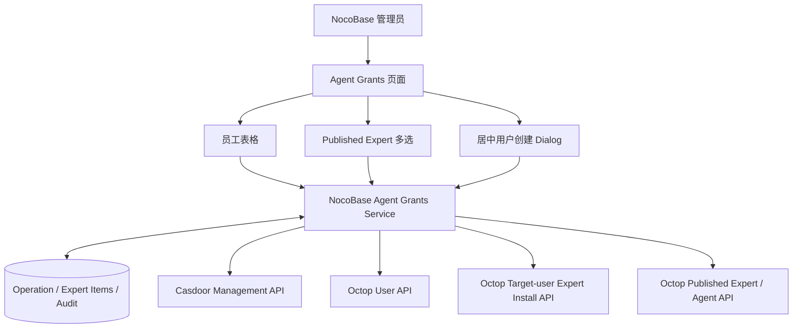

# NocoBase Agent Grants v1.1：员工表格、多专家授权与 Octop 用户创建 Dialog PRD

> 本文严格遵循《需求PRD工程模板.md》v1.0 的 0--36 章结构，是 Agent
> Grants v1.0.0 的增量增强 PRD。
>
> 本版本基于 NocoBase 最新提交
> `eef8cd4ce82af5bf8088b7fd6a756ad3b4c9351c`
> 的实际源码，不重新设计或重写已完成的 Casdoor 连接、Octop
> 应用授权和单用户创建基础能力。
>
> 本版本重点解决三个问题：员工列表表格化、专家模板多选，以及在居中
> Dialog 中完成 Octop 用户创建。创建请求仍提交 Octop
> 用户创建所需的完整字段；页面只展示管理员可操作的字段，其余字段保留默认值。权限不逐项配置，只选择用户角色，权限由该角色继承。
>
> **状态：APPROVED_FOR_PLAN。** SG-AG-101 与 SG-AG-102 已关闭：目标
> Octop 实例确认提供
> `POST /api/users/{user_id}/experts/published/{expert_id}/install`，且允许对已有账号追加未安装的 Published Expert。NocoBase 侧 v1.1 编排、表格 + Dialog UI 与自动化测试已落地；证据见 `prd/casdoor/evidence/probe-2026-11-22-agent-grants-v1.1.md`。
>
> 本 PRD 仍是需求与验收契约。Live Golden Consumer 多专家安装应在可访问目标实例时复跑并归档脱敏响应。

---

# 0. PRD 使用原则

## 0.1 PRD 职责

本 PRD 必须明确：

```text
WHY          为什么需要 Agent Grants v1.1
WHAT         员工表格、专家多选、简化后的完整用户创建表单和 Dialog
BOUNDARY     NocoBase、Casdoor、Octop 的责任边界
STATE        员工身份、应用授权、Octop 账号、专家模板、已安装专家的事实源
INPUT        Casdoor 员工、Octop 账号、角色、权限、资源策略和专家模板
OUTPUT       Octop 用户、多个专家、agent_id、每个专家的 Bootstrap 状态
SIDE EFFECT  哪些接口只读，哪些接口可以创建用户或专家
FAILURE      重复账号、重复专家、权限撤销、超时、部分成功如何处理
ACCEPTANCE   如何证明表格、Dialog、用户和多个专家真实可用
EVIDENCE     如何提供真实 API、界面、测试及审计证据
```

本版本继承 v1.0.0 的既有约束：

- Casdoor 是员工身份和应用授权事实源。
- Octop 是自身用户、角色、权限、专家模板和专家记录事实源。
- NocoBase 是 Agent Grants 管理界面及操作编排层。
- 员工列表保持单选。
- Octop 管理 Token 只保存在 NocoBase Server。
- 已存在 Octop 用户不得重复创建。
- Bootstrap Pending 不得显示为完成。
- 外部 Octop 用户不得由 NocoBase 自动删除作为补偿。
- WeKnora 不属于 Octop Agent Grants。

## 0.2 强制规范关键词

- `MUST`：必须实现、测试并提供 Evidence。
- `MUST NOT`：禁止行为，违反即 Requirement FAIL。
- `SHOULD`：默认满足；偏离必须记录原因。
- `SHOULD NOT`：原则上禁止；偏离必须记录批准理由。
- `MAY`：可选，不影响 Required Release Gate。

每个 MUST/MUST NOT 必须映射 Acceptance、Test、机器可判断 Oracle 和
Evidence。

## 0.3 No-Inference Rule

Cursor 不得根据 Octop 上游某个分支的代码，推断目标运行实例的全部行为。

如果以下内容不能唯一确定：

```text
API schema
target Octop branch
user ownership
expert installation owner
directory/password semantics
role permission inheritance
resource policy semantics
default expert creation
expert bootstrap terminal state
retry/idempotency
partial failure behavior
```

必须：

```text
MUST report SPEC_SEMANTIC_GAP
MUST BLOCK affected implementation
MUST NOT invent a compatible-looking API
MUST NOT report PASS without real evidence
```

可以先执行只读 Contract Probe，不得在 Probe
阶段创建正式员工账号或改变生产专家。

## 0.4 Requirement → Code → Test → Evidence

```text
Requirement
  → Implementation
  → Acceptance
  → Test
  → Evidence
  → Release Gate
```

`implemented` 只表示代码已写；`verified` 表示对应 Acceptance 已执行且
Evidence 通过。

---

# 1. 文档元数据 / 源码基线

## 1.1 PRD 元数据

项目 值

---

PRD ID PRD-NOCOBASE-AGENT-GRANTS-001
Version 1.1.0
Status APPROVED_FOR_PLAN
Template 需求PRD工程模板.md v1.0
Previous PRD Agent Grants v1.0.0
Target Release Agent Grants v1.1
Created / Updated 2026-11-22
Change Type Enhancement / Cross-system integration

## 1.2 NocoBase 最新源码基线

```text
repository: smc-copilot/nocobase
branch: cursor/casdoor-octop-portal-e860
commit: eef8cd4ce82af5bf8088b7fd6a756ad3b4c9351c
parent: 24324a7952dd8e5aaecdfd7192fd8faafd6a81a2
commit message:
feat(enterprise-portal): add Octop Agent Grants and harden local ops
```

GitHub：

- https://github.com/smc-copilot/nocobase/commit/eef8cd4ce82af5bf8088b7fd6a756ad3b4c9351c
- https://github.com/smc-copilot/nocobase/tree/cursor/casdoor-octop-portal-e860

### 已有页面

```text
packages/apps/app-enterprise-portal/client/pages/settings/
  portal-agent-grants.tsx
  portal-agent-grants-model.ts
  portal-casdoor-connection.tsx
  portal-casdoor-grants.tsx
  portal-catalog.tsx
  routes.ts
```

### 已有服务端

```text
packages/plugins/app-plugin-enterprise-app-portal/server/
  routes/agent-grants.ts
  routes/portal.ts
  routes/schemas.ts

  services/agent-grants-read.ts
  services/agent-grants.ts
  services/agent-grant-operations.ts
  services/octop-management-client.ts
  services/octop-create-request.ts
  services/octop-instance-config.ts
  services/octop-url-guard.ts
  services/casdoor-management-client.ts
  services/casdoor-application-grants.ts
  services/casdoor-application-access.ts
  services/application-catalog.ts
  services/composition.ts
```

### 已有数据库迁移

```text
packages/plugins/app-plugin-enterprise-app-portal/database/migrations/
  enterprise_app_portal_202611212000_add_agent_grants.ts
```

### 已有测试

```text
packages/apps/app-enterprise-portal/tests/client/
  portal-agent-grants.test.tsx

packages/plugins/app-plugin-enterprise-app-portal/tests/server/
  agent-grants-create.test.ts
  octop-url-guard.test.ts
  app-env-files.test.ts
```

## 1.3 Octop 用户创建页面源码参考

仓库：

```text
repository: loudon84/octop
```

主要参考文件：

- `dashboard/src/pages/Admin/Users/UsersListPanel.tsx`
- `dashboard/src/pages/Admin/Users/index.tsx`
- `dashboard/src/pages/Admin/Users/ProfileAvatar.tsx`
- `dashboard/src/pages/Admin/Users/permissionPickerLayout.ts`
- `dashboard/src/api/modules/userRoles.ts`
- `dashboard/src/api/modules/publishedExperts.ts`
- `src/octop/api/routers/users.py`
- `src/octop/api/routers/experts.py`
- `src/octop/api/routers/agents.py`

源码：

- https://github.com/loudon84/octop/blob/main/dashboard/src/pages/Admin/Users/UsersListPanel.tsx
- https://github.com/loudon84/octop/blob/main/dashboard/src/pages/Admin/Users/ProfileAvatar.tsx
- https://github.com/loudon84/octop/blob/main/dashboard/src/pages/Admin/Users/permissionPickerLayout.ts
- https://github.com/loudon84/octop/blob/main/src/octop/api/routers/users.py
- https://github.com/loudon84/octop/blob/main/src/octop/api/routers/experts.py

注意：上游源码是页面结构和组件行为参考。目标 Octop 运行实例的 API Probe、真实页面截图和已成功请求优先于上游源码。`permissionPickerLayout.ts` 与 `ProfileAvatar.tsx` 只说明 Octop 原生能力；本版本的 NocoBase 页面不复刻权限勾选和头像选择。

## 1.4 真实运行环境基线

---

系统 当前信息

---

Casdoor `http://192.168.99.160:8000`

Casdoor Organization `smartcore`

Casdoor 员工 已有企业员工目录

NocoBase 已完成 Casdoor
连接、群组/用户/应用读取、应用授权

NocoBase Agent Grants 已有三栏页面、单员工选择、单模板选择、创建
Drawer

Octop 测试实例 `http://192.168.99.170:8088`

Octop 创建用户 `POST /api/users`

Octop Published Experts `GET /api/experts/published`

Octop Users `GET /api/users`

Octop Agents `GET /api/agents?scope=all`
--------------------------------------------------------------------------------

其他 Octop 实例必须使用 NocoBase 应用目录中各自的 API 地址和 Secret
引用，不得推断端口。

## 1.5 v1.0.0 已实现能力与本次差异

v1.0.0 已实现：

1.  Casdoor Octop Application 读取。
2.  Casdoor 有效授权员工读取。
3.  Octop 用户及专家状态读取。
4.  Published Expert 模板读取。
5.  用户角色和权限目录读取。
6.  目录账号创建。
7.  Existing Account 阻断重复创建。
8.  单个默认专家初始化。
9.  Bootstrap 状态和 agent_id 展示。
10. Octop 实例 API 凭据隔离、Operation、并发锁和审计。

v1.1.0 需要改变：

项目 v1.0.0 v1.1.0

---

员工列表 Radio 单项列表 表格
员工选择 单选 继续单选，以表格行选中
账号状态 选中后单独显示 表格列显示
已安装专家 选中后卡片展示 表格列显示名称和编号
专家模板 Radio 单选 Checkbox 多选
已有账号 阻止所有创建操作 不创建用户，但允许安装尚未安装的专家
用户表单 简化表单 创建能力完整；页面只显示管理员可操作字段，其余保留默认值
表单容器 右侧 Sheet 居中 Dialog
身份字段 可改显示名和邮箱 用户名、显示名称、邮箱自动填入且只读
目录账号 固定开启 可选择，默认开启
本地密码 不支持 目录账号关闭时显示密码及确认密码
权限 随角色展示可勾选 不展示权限勾选；权限由所选角色继承
Backend 跟随角色可选 固定为 docker 沙箱，页面只展示该默认值
专家安装 单个默认专家 安装专家多选，并在已勾选专家中单选一个默认专家

---

# 2. 一句话目标

在现有 NocoBase Agent Grants
基础上，将员工单选列表升级为展示用户、账号名、Octop
账号同步状态及已授权专家的表格，并使用居中 Dialog
完成用户创建。Dialog
只展示管理员可操作的字段，用户名、显示名称和邮箱由 Casdoor
自动填入且只读，权限由所选 Octop
角色继承并不在页面逐项编辑，Backend 类型固定为 docker
沙箱；管理员可切换目录账号、选择角色、设置工作空间、Token
配额和专家数量，多选要安装的专家模板。只有新用户才在已勾选模板中单选一个默认专家，并且只把这个默认专家放进用户创建请求；已有账号的默认专家为空。对未创建账号的员工执行一次 Octop 用户创建，对已有账号的员工跳过用户创建。安装专家按 Octop 专家模板为该员工新建专家，同一用户同一模板禁止再建第二个，并分别记录每个专家的 agent_id 和 Bootstrap 状态。

---

# 3. 背景与问题定义

## 3.1 Current State

当前 Agent Grants 页面已经完成第一版三栏布局：

```text
左侧：Octop Application
中间：Casdoor 已授权员工
右侧：Octop Published Expert
```

当前前端：

- 使用 `employeeId` 保存单个员工选择。
- 使用 `templateId` 保存单个模板选择。
- 员工使用 `RadioGroup`。
- 模板使用 `RadioGroup`。
- 用户创建参数通过右侧 `Sheet` 展示。
- `directory=true` 被锁定。
- 表单只支持单个专家模板。
- 选中员工后才读取该员工 Octop 状态。

## 3.2 Problem

### 问题 A：员工列表不利于批量浏览和定位

当前员工以单项选择展示，管理员不能快速对比：

- 员工姓名。
- 登录账号。
- Octop 账号是否已经创建。
- 当前账号是否使用目录登录。
- 已经安装了哪些专家。
- 已安装专家的编号。

### 问题 B：专家模板只能单选

当前 `templateId` 及右侧 `RadioGroup` 只允许选择一个模板，也没有单独的默认专家。

用户需要在创建 Dialog 里为同一员工多选安装专家，并在已勾选模板中单选一个默认专家。选择模型改为 `expertTemplateIds: string[]` 加 `defaultExpertTemplateId`。

### 问题 C：用户创建表单既不完整，又把管理员不该改的字段露在页面上

当前 NocoBase 表单不能完成一次受控的 Octop 用户创建，同时又把本应由默认值或角色模板决定的字段交给管理员编辑。v1.1 要求创建请求仍然覆盖 Octop 用户创建所需字段，页面只保留管理员可操作的字段：

- 用户名、显示名称、邮箱从 Casdoor 自动填入，只读。
- 目录账号默认开启；关闭后才显示本地密码和确认密码。确认密码只在前端校验，不发送 API。
- 角色从 Octop 动态读取。权限不展示、不可逐项修改，提交时使用所选角色的权限集合。
- 资源策略的 Backend 类型固定为 docker 沙箱并在页面展示，管理员不能改选其他 Backend。
- 工作空间、Token 配额、专家数量保留开关和数字或目录输入。
- 安装专家为已发布模板多选；默认专家只能从已勾选的安装专家里单选。
- 头像、权限勾选、快捷额度和其他未列出的 Octop 字段不出现在页面上，提交时保留默认值。

当前 `Sheet` 是右侧抽屉，用户要求居中弹框。

## 3.3 Impact

维度 影响

---

管理效率 员工列表缺少横向比较能力
专家配置 一次只能初始化一个专家
用户创建 管理员需要完整创建能力，但只能操作被授权修改的字段
权限一致性 用户权限必须来自所选角色，不能在页面上被单独改写
数据安全 多专家安装到指定员工需要服务端目标用户校验
系统一致性 多实例、账号存在性和专家编号必须按实例隔离
运维 多个专家初始化需要独立状态和失败重试

---

# 4. Scope

## 4.1 In Scope

Scope ID 功能 Requirement

---

SCOPE-AG-101 员工列表表格化 REQ-AG-011
SCOPE-AG-102 员工单选及行状态 REQ-AG-012
SCOPE-AG-103 Octop 账号状态批量读取 REQ-AG-013
SCOPE-AG-104 已安装专家在表格展示 REQ-AG-014
SCOPE-AG-105 安装专家多选及默认专家 REQ-AG-015
SCOPE-AG-106 已安装模板去重 REQ-AG-016
SCOPE-AG-107 简化用户创建表单 REQ-AG-017
SCOPE-AG-108 目录账号和本地密码切换 REQ-AG-018
SCOPE-AG-109 角色继承权限与资源策略 REQ-AG-019
SCOPE-AG-110 居中 Dialog REQ-AG-020
SCOPE-AG-111 新用户创建后多专家初始化 REQ-AG-021
SCOPE-AG-112 已有用户追加专家 REQ-AG-022
SCOPE-AG-113 Octop 指定目标用户安装专家 API REQ-AG-023
SCOPE-AG-114 多专家 Operation 和部分失败恢复 REQ-AG-024
SCOPE-AG-115 头像保留 Octop 默认值 REQ-AG-025

## 4.2 Out of Scope

Non-Goal 明确禁止

---

Casdoor LDAP/AD 不修改员工同步逻辑
Casdoor Application 不创建或删除应用
Casdoor Permission 不修改现有用户应用授权
WeKnora 不进入 Agent Grants
Octop 通用用户管理 不替代 Octop 原有 Users 页面
已有用户编辑 本次不修改已有 Octop 用户的角色、权限、密码、默认专家和资源策略
权限逐项编辑 不提供权限勾选；权限由所选角色继承
头像选择上传 页面不展示头像，创建时不调用头像接口
非 docker Backend 不允许选择 docker 沙箱以外的 Backend 类型
用户删除 不提供 Octop 用户删除
用户禁用 不提供 Octop 用户启用/禁用
专家删除 不提供已安装专家删除
Agent Runtime 不修改运行时
专家模板发布 不修改发布流程
Octop iframe 不采用直接嵌入整个 Octop 管理页面的方案
独立 Router 不开发新的 Router 服务
员工批量选择 员工列表仍然单选
Casdoor 用户主数据 不在 NocoBase 创建第二套员工主表

## 4.3 Architecture Boundary

---

系统 Owner 本次职责

---

Casdoor 员工身份及应用授权 提供已授权员工和账号状态

NocoBase Agent Grants 员工表格、模板多选、用户创建
Dialog、操作编排、审计

Octop 用户和专家事实源 创建用户、查询用户、安装专家、返回
agent_id

Octop Agent Runtime 专家运行时 接收已安装专家，不由 NocoBase 修改

WeKnora 独立知识库系统 不参与本次功能
------------------------------------------------------------------------------------

### 4.3.1 Multi-expert API Boundary

多选专家不能仅靠修改 NocoBase 前端实现。

Octop 现有：

```http
POST /api/experts/published/{expert_id}/install
```

其实现使用 `current_user` 作为专家所有者，不能由管理员指定其他员工。

因此 v1.1 必须增加一个 Octop 管理员接口，按已发布专家模板为目标员工新建专家。它对应 Octop 专家页「发现专家」卡片上的「创建」：用专家模板为指定用户新建一个专家，而不是把专家装到当前管理员名下。

```http
POST /api/users/{user_id}/experts/published/{expert_id}/install
```

该接口复用 Octop 原有按模板新建专家的逻辑，并由 Octop 服务端校验管理员权限及目标用户。同一目标用户、同一专家模板禁止创建第二个专家。

这是本 PRD 的跨仓库必要依赖，不是可选优化。

---

# 5. Terminology / Domain Model

---

术语 定义

---

Octop Application Casdoor 中映射到一套 Octop
实例的应用

`appCode` NocoBase 应用目录内部唯一编码

Casdoor User 企业员工身份

Casdoor User ID Casdoor `owner/name`

Authorized Employee 对当前 Octop Application 的 Casdoor
enforce 决策为 Allow 的员工

Octop User 当前目标 Octop 实例的用户记录

Account Sync Status NocoBase 从 Octop
用户目录观察到的账号状态

Directory Account `directory=true` 的目录账号

Local Account `directory=false` 的本地账号

Published Expert 当前 Octop 实例已发布的专家模板

`expert_template_id` Published Expert 的模板 ID

Installed Agent 员工在 Octop 实例内实际安装的专家

`agent_id` Octop 中实际专家编号

`published_expert_id` 已安装专家的来源模板 ID

Multi Expert Selection 管理员对同一员工选择多个 Published
Expert

Target User Install 管理员将 Published Expert 安装到指定
Octop 用户

User Create Dialog NocoBase 居中弹出的用户创建表单。页面只展示管理员可操作字段，未展示字段保留默认值

Inherited Permissions 创建用户时提交的权限集合，等于所选 Octop 角色模板的权限，管理员不能逐项修改

Default Expert 只在新用户创建时推送的一个专家模板。非新用户时该值为空

Expert Create From Template 按已发布专家模板为目标用户新建专家，对应 Octop 专家页「创建」

Agent Grant Operation 一次用户创建和多个专家安装的父操作

Agent Grant Expert Item 父操作中的单个专家安装子任务
------------------------------------------------------------------------

`agent_id` 和 `published_expert_id` 不得混用。

---

# 6. System Context

## 6.1 Context Diagram



## 6.2 System Boundary

**NocoBase 内部**

- 三栏 Agent Grants 页面。
- 员工状态聚合查询。
- 用户创建 Dialog。
- 用户创建参数校验。
- 多专家选择。
- 多专家安装编排。
- Operation 和 Expert Item 状态。
- 审计。

**Casdoor 外部**

- 员工身份。
- Application。
- 用户是否有权访问当前 Octop。

**Octop 外部**

- Octop 用户。
- 用户角色和权限。
- 资源策略。
- LDAP 配置。
- Published Expert。
- Installed Agent。
- 用户创建和专家安装。

**禁止边界**

- 浏览器不得直接调用 Octop 管理 API。
- NocoBase 不得直接查询 Octop 数据库。
- NocoBase 不得将 Octop 管理 Token 暴露给浏览器。
- NocoBase 不得直接修改 Casdoor 用户或 Permission。

---

# 7. Authoritative State / Source of Truth

State SOT NocoBase 行为

---

员工姓名、账号、邮箱 Casdoor 读取
员工是否有效 Casdoor 读取
Octop Application 授权 Casdoor enforce 实时复核
Octop 用户是否存在 当前 Octop `/api/users` 读取
Octop 账号目录模式 当前 Octop User 读取
Octop 用户禁用状态 当前 Octop User 读取
Octop Role 当前 Octop `/api/users/roles` 读取
Octop Permission 当前 Octop `/api/users/permissions` 读取
Published Expert 当前 Octop `/api/experts/published` 读取
Installed Agent 当前 Octop `/api/agents?scope=all` 读取
专家编号 Octop `agent_id` 读取
Operation NocoBase DB 写入
Expert Item 状态 NocoBase DB 写入
Audit NocoBase DB 追加写入

## 7.1 状态分类

- `OBSERVED_STATE`：Casdoor 用户、授权、Octop 用户、角色、模板和
  Agent。
- `DESIRED_STATE`：管理员在当前页面选择的专家集合和创建参数。
- `RUNTIME_STATE`：用户创建、专家安装和 Bootstrap 的执行状态。
- `EVIDENCE_STATE`：Operation、Expert Item 和 Audit。

## 7.2 禁止双事实源

NocoBase 不建立第二套员工、Octop 用户、角色或专家模板主数据。

NocoBase 的表格状态是外部系统观察结果，不是独立授权记录。

创建和安装前必须重新读取外部事实源。

---

# 8. State Machine

## 8.1 页面状态

```text
NO_APPLICATION
  ↓ select Octop Application
APPLICATION_SELECTED
  ↓ load Casdoor employees + Octop users + Octop agents + templates
TABLE_LOADING
  ↓ all reads succeed
TABLE_READY
  ↓ select one employee
EMPLOYEE_SELECTED
  ↓ select one or more not-yet-installed templates
EXPERTS_SELECTED
  ↓ click create
PREFLIGHTING
```

## 8.2 员工账号状态

```text
UNKNOWN
  ├─ Octop user not found ─────> NOT_CREATED
  ├─ directory=true ───────────> SYNCED_DIRECTORY
  ├─ directory=false ──────────> CREATED_LOCAL
  ├─ disabled=true ────────────> DISABLED
  └─ read failure ─────────────> LOOKUP_FAILED
```

不得将 `LOOKUP_FAILED` 解释为 `NOT_CREATED`。

## 8.3 父 Operation 状态

```text
NEW
  ↓
PREFLIGHTING
  ├─ denied/invalid ────────────> BLOCKED
  ├─ read failure ─────────────> FAILED_NO_MUTATION
  ├─ existing user ────────────> INSTALLING_EXPERTS
  └─ missing user ─────────────> CREATING_USER

CREATING_USER
  ├─ 201 confirmed ─────────────> USER_CREATED
  ├─ clear no-write error ──────> FAILED_NO_MUTATION
  └─ timeout/unknown ───────────> USER_CREATE_UNKNOWN

USER_CREATED
  ↓
INSTALLING_EXPERTS
  ├─ all completed ─────────────> COMPLETED
  ├─ some failed ───────────────> PARTIAL
  └─ all failed ────────────────> EXPERT_INSTALL_FAILED

INSTALLING_EXPERTS
  ├─ existing user path ────────> INSTALLING_EXPERTS
  └─ existing experts detected -> skip already installed
```

## 8.4 Expert Item 状态

```text
PENDING
  ↓
SUBMITTING
  ├─ agent observed and ready ──> COMPLETED
  ├─ bootstrap pending ─────────> BOOTSTRAP_PENDING
  ├─ deterministic error ───────> FAILED
  └─ timeout ───────────────────> OUTCOME_UNKNOWN

BOOTSTRAP_PENDING
  ├─ agent ready ───────────────> COMPLETED
  └─ bootstrap error ───────────> FAILED
```

## 8.5 状态约束

- 已存在账号不得进入 `CREATING_USER`。
- 同一员工同一实例最多一个用户创建请求在途。
- 同一员工同一实例同一 Published Expert 最多一个安装请求在途。
- 成功安装的 Expert Item 不得再次安装。
- `OUTCOME_UNKNOWN` 必须先对账，不得自动重发。
- Bootstrap Pending 不得显示完成。
- 部分成功不得回滚已创建用户或已安装专家。

---

# 9. Data / Schema Contract

## 9.1 员工表格 View Model

服务端接口：

```http
GET /admin/agentGrants/applications/{appCode}/employees
```

每行数据：

Field Type Meaning

---

`casdoorUserId` string Casdoor 用户唯一标识
`username` string Casdoor 登录账号
`displayName` string 员工姓名
`email` string/null 邮箱
`isForbidden` boolean Casdoor 禁用状态
`grantSource` enum/null direct / inherited
`octopAccountStatus` enum 账号同步状态
`octopUserId` string/null Octop 用户 ID
`directory` boolean/null 目录账号模式
`octopDisabled` boolean/null Octop 账号禁用状态
`installedExperts` array 已安装专家

`octopAccountStatus`：

```text
NOT_CREATED
SYNCED_DIRECTORY
CREATED_LOCAL
DISABLED
LOOKUP_FAILED
```

`installedExperts[]`：

```json
{
  "agentId": "4HJVNM",
  "publishedExpertId": "01M80M25NH1DPMCJ0FDJKDVGJA",
  "name": "超级助手",
  "state": "running",
  "bootstrapPending": false
}
```

## 9.2 页面列定义

表格必须且至少包含以下业务列：

Column 内容

---

用户 头像/显示名
账号名 Casdoor username
账号同步 Octop 账号状态及目录/本地类型
授权专家 已安装专家名称和 `agent_id`

选择行为：

- 员工保持单选。
- 通过表格行选择和选中态完成。
- 不使用原 Radio 单项卡片列表。
- 不提供员工全选。
- 不提供批量创建。

## 9.3 Octop User Create Form Schema

用户创建 Dialog 的创建能力保持完整：提交给 Octop `POST /api/users` 的字段仍覆盖目标实例已探测的创建契约。页面只渲染下表中的管理员可操作字段。未出现在页面上的字段由服务端按本节默认值写入，不接受浏览器改写。

### 页面可见字段

页面字段 含义 控件 API 字段

---

用户名 Casdoor 工号 自动填入、只读 `username`，取 Casdoor `name`
显示名称 员工姓名 自动填入、只读 `display_name`，取 Casdoor `displayName`
邮箱 Casdoor 邮箱 自动填入、只读 `email`
目录账号 是否使用 LDAP 开关，默认开启 `directory`，默认 `true`
密码 本地账号密码 仅关闭目录账号时显示 `password`
确认密码 密码二次确认 仅关闭目录账号时显示 不发送 API
角色 Octop 角色模板 动态读取，单选 `role`、`role_name`
资源策略 Backend 类型 只读展示 `allowed_backend_types: ["docker"]`
工作空间 Workspace Root 开关及目录选择 `workspace_root_dir`
Token 配额 Token Quota 开关、数字输入 `token_quota`
专家数量 Max Agents 开关、数字输入 `max_agents`
安装专家 专家模板 多选 `expertTemplateIds`，逐个调用专家新建
默认专家 新用户时从已勾选中单选 非新用户为空 仅新用户写入 `expert_template_id`

身份字段规则：

- 用户名、显示名称、邮箱打开 Dialog 时由当前员工的 Casdoor 资料填入。
- 三个字段都不可编辑。
- 服务端提交前按 Casdoor 用户重新解析这三个值，忽略浏览器提交的改写。
- 邮箱为空时按目标 API 发送 `null`，不在页面上补录。

### 页面不展示、提交时保留默认值

Field 提交值 页面

---

`permissions` 所选角色模板的权限集合 不展示、不可编辑
`role_name` 所选角色模板的显示名 不单独展示
`allowed_backend_types` `["docker"]` 只以“docker 沙箱”展示
`avatar_icon` 不发送，使用 Octop 默认头像 不展示
`avatar` 文件 不上传 不展示
`confirm_password` 不发送 仅前端比对
其他未列出的创建字段 不发送，沿用 Octop 缺省 不展示

权限不从 `/api/users/permissions` 渲染成勾选器。服务端在提交前重新读取 `/api/users/roles`，用所选 `role` 的 `permissions` 写入创建请求。浏览器如果提交了与该角色不一致的权限数组，服务端必须拒绝，不得转发。

### 目录账号规则

`directory=true`：

- 不显示密码和确认密码字段。
- 不发送 `password`。
- 必须检查 Octop LDAP 配置有效。
- 默认开启。

`directory=false`：

- 显示密码和确认密码。
- 两个值必须一致。
- 必须满足目标 Octop 密码策略。
- 只将 password 放入当前服务端请求。
- 不允许将 Casdoor/AD 密码带入表单。
- password 不得写入 Operation、Audit、日志或本地持久化存储。

目标实例 Probe 已确认：

```text
directory: boolean
password: required when directory=false
directory=true: no password in request
weak password: 400 PASSWORD_TOO_WEAK
```

## 9.4 Role / Permission Schema

角色来源：

```http
GET /api/users/roles
```

权限目录 `GET /api/users/permissions` 只用于服务端核对角色模板中的权限 key 是否仍然有效。它不是页面数据源，不得渲染为权限勾选器。

角色模板必须读取：

```text
user_role_id
user_role_name
system_role
permissions
policies
workspace_root_dir
token_quota
max_agents
allowed_backend_types
```

规则：

- 页面只让管理员选择用户角色。
- 默认选择 `user`。
- `system_role=admin` 的角色不得出现在可选列表。
- 所选角色的 `permissions` 原样作为创建请求的权限集合。
- 管理员不能增删任何权限 key。
- 切换角色时，权限集合立即替换为新角色的权限，不弹出权限覆盖确认。
- 切换角色时，工作空间、Token 配额、专家数量恢复为新角色模板的默认值。
- Backend 类型不跟随角色模板改写，始终保持 `["docker"]`。
- 角色或角色权限读取失败时阻止提交。
- 不允许发送该角色权限集合之外的 key。

## 9.5 Resource Policy Schema

Field UI Semantics

---

`allowed_backend_types` 只读，固定 docker 沙箱 创建请求始终发送 `["docker"]`
`workspace_root_dir` 开关 + 目录选择 限制用户工作空间根目录
`token_quota` 开关 + 数字输入 限制 Token 用量
`max_agents` 开关 + 数字输入 限制用户可创建专家数量

页面不提供 Backend 多选，也不提供 Token 配额或专家数量的快捷值按钮。

工作空间、Token 配额和专家数量的初始值取当前所选角色模板。管理员可以随后修改这三个字段。Backend 类型不取角色模板中的其他值。

当限制开关关闭时，按目标 API 约定发送 null 或省略字段，不得把未限制解释为 0。

`workspace_root_dir` 只能选择目标 Octop 实例允许的根目录。目录浏览 API 未探测确认前，不得猜测路径。

## 9.6 Multi Expert Selection Schema

安装专家和默认专家都放在用户创建 Dialog 内，不再使用主页面右侧 Radio 作为选择控件。安装专家对应 Octop 专家页「发现专家」里每个模板卡片的「创建」：按该模板为目标员工新建一个专家。

规则：

- 安装专家至少选择一个已发布模板。
- 模板 ID 必须来自当前 Octop 实例 `GET /api/experts/published`。
- 模板 ID 不允许由用户手工输入。
- 同一员工已经拥有的专家模板不得再次选择，也不得再次新建。
- 模板多选不等于员工多选。
- 安装专家不写入 `POST /api/users`。除新用户已经推送的默认专家模板外，每个已勾选且该用户尚未拥有的模板调用一次 Octop 专家新建。
- 新用户的默认专家必须且只能是已勾选安装专家中的一个。只勾选一个时，该模板自动成为默认专家。
- 只有默认专家进入新用户的 `POST /api/users`：`create_default_expert=true`、`expert_template_source=published`、`expert_template_id=defaultExpertTemplateId`。
- 新用户创建成功后，安装专家跳过这个默认模板，禁止再按同一模板新建第二个专家。其余已勾选模板逐个新建。默认专家的 `agent_id` 取创建响应中的 `default_expert.agent_id`。
- 非新用户的 `defaultExpertTemplateId` 必须为空。不调用 `POST /api/users`，不发送 `create_default_expert`、`expert_template_id`，也不修改该用户已有的默认专家。
- 非新用户只对本次勾选、且该用户尚未拥有的模板执行专家新建。

新用户请求：

```json
{
  "casdoorUserId": "smartcore/employee",
  "expertTemplateIds": [
    "01M7SH5HEGK5VC8MR87F2T185F",
    "01M80M25NH1DPMCJ0FDJKDVGJA"
  ],
  "defaultExpertTemplateId": "01M7SH5HEGK5VC8MR87F2T185F"
}
```

非新用户请求：

```json
{
  "casdoorUserId": "smartcore/employee",
  "expertTemplateIds": ["01M80M25NH1DPMCJ0FDJKDVGJA"],
  "defaultExpertTemplateId": null
}
```

## 9.7 NocoBase Persistence

### A. 现有 `enterprisePortalAgentGrantOperations` 扩展

增加或确认：

Field Type Meaning

---

`operationMode` enum CREATE_USER_AND_INSTALL / INSTALL_ONLY
`selectedExpertCount` integer 本次选中专家数量
`completedExpertCount` integer 完成数量
`failedExpertCount` integer 失败数量
`skippedExpertCount` integer 已安装而跳过数量

保留原有：

- `appCode`
- `casdoorUserId`
- `username`
- `actorUserId`
- `status`
- `octopUserId`
- `createOptionsSnapshot`
- `errorCode`
- `errorMessage`
- 时间字段。

`createOptionsSnapshot` 必须移除 password、Token、Secret。

### B. 新增 `enterprisePortalAgentGrantExpertItems`

---

Field Type Meaning

---

`id` UUID Item ID

`operationId` UUID 父 Operation

`expertTemplateId` string Published Expert ID

`expertName` string 名称快照

`status` enum PENDING/SUBMITTING/COMPLETED/BOOTSTRAP_PENDING/FAILED/OUTCOME_UNKNOWN/ALREADY_INSTALLED

`agentId` string/null Octop 实际专家编号

`bootstrapPending` boolean/null Bootstrap 状态

`errorCode` string/null 错误码

`errorMessage` text/null 脱敏错误

`startedAt` datetime/null 开始时间

`completedAt` datetime/null 完成时间
-----------------------------------------------------------------------------------------------------------------------------------------

唯一约束：

```text
UNIQUE(operationId, expertTemplateId)
```

同一 `appCode + casdoorUserId` 的活动父 Operation 必须互斥。

同一 `octopUserId + expertTemplateId` 的活动安装 Item 必须互斥。

## 9.8 Migration Rule

- 使用 NocoBase 3 migration。
- 不删除 v1.0.0 Operation。
- 不重建现有应用目录。
- 不修改 Casdoor 表。
- 不修改 Octop 数据库。
- Migration down 不得删除外部 Octop 用户或专家。
- 已有单专家 Operation 必须兼容读取。

---

# 10. Requirement Unit

## REQ-AG-011 --- 员工列表表格化

### Goal

将当前员工 Radio 单项列表改为可搜索、可滚动、可分页的表格。

### Normative Requirement

- MUST 使用表格显示用户、账号名、账号同步、授权专家四列。
- MUST 保持员工单选。
- MUST 显示用户姓名和账号名。
- MUST 显示 Octop 账号状态。
- MUST 显示当前员工已安装专家名称和 `agent_id`。
- MUST 显示 `published_expert_id`（可放入详情/Tooltip）。
- MUST 支持按姓名、账号名搜索。
- MUST 支持分页或虚拟滚动。
- MUST 保留选中行高亮。
- MUST NOT 提供员工多选或全选。
- MUST NOT 将查询失败显示为"未创建"。

### Inputs

Casdoor authorized employees + Octop users + Octop agents。

### Preconditions

已选择一个 Octop Application。

### SOT

Casdoor enforce + Octop `/api/users` + Octop `/api/agents?scope=all`。

### State Transition

```text
APPLICATION_SELECTED -> TABLE_LOADING -> TABLE_READY
```

### Allowed Side Effects

只读 Casdoor 和 Octop。

### Forbidden Side Effects

不创建、更新或删除任何用户和专家。

### Ownership Scope

只读外部数据投影。

### Idempotency

刷新表格不产生业务写入。

### Failure Semantics

- Casdoor 失败：员工列表不可用。
- Octop 用户读取失败：账号同步显示 LOOKUP_FAILED。
- Octop Agent 读取失败：专家列显示读取失败，不得显示空列表。
- 任何读取失败不得允许创建操作。

### Postconditions

每行员工具有唯一 Casdoor User ID 和明确账号同步状态。

### Invariants

```text
INV-AG-101: selectedEmployeeCount <= 1.
INV-AG-102: account status is derived from Octop User API.
INV-AG-103: expert list is derived from Octop Agent API.
INV-AG-104: lookup failure != account missing.
```

### Error Codes

```text
AGENT_GRANTS_EMPLOYEE_LIST_FAILED
OCTOP_USER_LOOKUP_FAILED
OCTOP_AGENT_LOOKUP_FAILED
```

### Acceptance

A-AG-101、A-AG-102、A-AG-103。

### Evidence

表格截图、真实 Casdoor/Octop 数据对账、单选测试。

---

## REQ-AG-012 --- 员工状态批量读取

### Goal

避免为每个员工逐个请求 Octop 用户和专家列表。

### Normative Requirement

- MUST 在选择 Octop Application 后读取一次 `/api/users`。
- MUST 读取一次 `/api/agents?scope=all`。
- MUST 在 NocoBase 服务端将 Casdoor 员工与 Octop 用户、专家关联。
- MUST 优先使用 Octop `user_id` 关联 Agent。
- MUST 使用 username 规范化作为兼容匹配。
- MUST 对多条匹配结果阻止创建。
- MUST 不允许浏览器传入账号存在状态。

### SOT

Casdoor User + Octop User + Octop Agent。

### Allowed Side Effects

只读。

### Forbidden Side Effects

不允许 N+1 逐员工 Octop 请求成为默认列表实现。

### Invariants

```text
INV-AG-105: one application table refresh uses bounded Octop list requests.
INV-AG-106: agent ownership is matched by Octop user id where available.
```

### Acceptance

A-AG-104。

### Evidence

请求计数、服务端 join 结果、列表测试。

---

## REQ-AG-013 --- 账号同步状态

### Goal

明确显示员工是否已经在当前 Octop 实例创建账号。

### Normative Requirement

状态必须映射为：

Octop User directory disabled UI

---

不存在 --- --- 未创建
存在 true false 已同步·目录账号
存在 false false 已创建·本地账号
存在 any true 已禁用
查询失败 unknown unknown 查询异常

已禁用账号仍然视为 Existing Account，不得创建同名新用户。

### Acceptance

A-AG-105。

---

## REQ-AG-014 --- 授权专家表格展示

### Goal

将已安装专家放入员工表格的"授权专家"列。

### Normative Requirement

- MUST 显示专家名称。
- MUST 显示 `agent_id`。
- MUST 通过 `published_expert_id` 识别模板来源。
- MUST 显示 Bootstrap Pending/运行状态。
- MUST 支持多个专家展示。
- 超出单元格宽度时可换行或折叠为数量 + Tooltip。
- MUST NOT 将模板 ID 当作专家编号。

### Acceptance

A-AG-106。

---

## REQ-AG-015 --- Published Expert 多选

### Goal

管理员可以为当前单个员工选择多个专家模板。

### Normative Requirement

- MUST 在用户创建 Dialog 中用“安装专家”多选已发布模板，替换主页面右侧 Radio 单选。
- MUST 使用 `expertTemplateIds: string[]`。
- MUST 在新用户 Dialog 中提供“默认专家”单选，候选项只包含当前已勾选的安装专家。
- MUST 在新用户只勾选一个安装专家时自动把它设为默认专家。
- MUST 在新用户取消勾选当前默认专家后清空默认专家，并在提交前要求重新选择。
- MUST 在员工已经存在于 Octop 时把 `defaultExpertTemplateId` 置为空，不要求选择默认专家。
- MUST 显示已选择数量。
- MUST 显示模板 ID、名称、描述、发布人和更新时间。
- MUST 在员工切换时清空本次安装专家和默认专家。
- MUST 将当前员工已安装的模板标记为“已安装”并禁用。
- MUST 允许同时选择多个未安装模板。
- MUST 在创建前重新校验所有模板 ID。新用户必须校验 `defaultExpertTemplateId` 属于 `expertTemplateIds`。非新用户必须校验 `defaultExpertTemplateId` 为空。
- MUST NOT 将其他 Octop 实例模板混入。
- MUST NOT 允许重复选择同一个模板。
- MUST NOT 允许默认专家取已勾选集合之外的模板。

### SOT

当前 Octop `GET /api/experts/published`。

### Allowed Side Effects

只读模板列表。

### Acceptance

A-AG-107、A-AG-108。

---

## REQ-AG-016 --- 已安装专家去重

### Goal

禁止为同一员工按同一个专家模板再建一个专家。

### Normative Requirement

- MUST 使用目标 Octop 用户 ID + `published_expert_id` 检测重复。
- MUST 在页面禁用该用户已经拥有的模板，使其不能进入本次安装专家。
- MUST 在 NocoBase 服务端再次校验，已拥有的模板不得发起专家新建。
- MUST 在 Octop 按模板新建专家的接口内做最终检查。已存在时不得创建第二个专家。
- MUST 把新用户创建时已经推送的默认专家模板视为该用户已拥有，后续安装专家不得再新建它。
- MUST NOT 仅根据专家名称判断重复。
- MUST NOT 因重复请求创建第二个同模板 Agent。

### Error

```text
OCTOP_EXPERT_ALREADY_INSTALLED
```

### Acceptance

A-AG-109。

---

## REQ-AG-017 --- 简化用户创建表单

### Goal

在 NocoBase Dialog 中完成 Octop 用户创建。页面只显示管理员可操作的字段，其余创建字段保留默认值并由服务端提交。

### Normative Requirement

页面 MUST 且只展示以下可操作区域：

1.  用户名：Casdoor 工号，自动填入、只读。
2.  显示名称：员工姓名，自动填入、只读。
3.  邮箱：Casdoor 邮箱，自动填入、只读。
4.  目录账号：是否使用 LDAP，开关，默认开启。
5.  密码：本地账号密码，仅关闭目录账号时显示。
6.  确认密码：密码二次确认，仅前端校验，不发送 API。
7.  角色：Octop 角色模板，动态读取。
8.  资源策略：Backend 类型，只读展示，值为 docker 沙箱。
9.  工作空间：Workspace Root，开关及目录选择。
10. Token 配额：开关、数字输入。
11. 专家数量：开关、数字输入。
12. 安装专家：专家模板多选。提交后按模板为该用户新建专家，不写入用户创建请求。
13. 默认专家：仅新用户从已勾选安装专家中单选，并且只在用户创建请求中推送。非新用户为空值。

MUST NOT 在页面展示头像选择、权限勾选、快捷额度、Backend 多选，或任何未列入上表的 Octop 创建字段。

用户名、显示名称、邮箱必须由 Casdoor 服务端身份解析。前端只读，服务端忽略浏览器对这三个字段的改写。

角色从 `/api/users/roles` 动态读取。权限不在页面编辑，创建请求使用所选角色的权限集合。

### 与 Octop 原生表单的对应

保留原生创建语义，不复刻原生页面上的全部控件：

Octop 原生能力 NocoBase 对应

---

用户名、显示名、邮箱 自动填入、只读
Directory Account 目录账号开关，默认开启
Password / Confirm 关闭目录账号时显示；确认密码不发送
UserRoleField 角色模板单选
PermissionCheckboxPicker 不展示；权限由所选角色继承
ProfileAvatarPicker 不展示；保留 Octop 默认头像
Allowed Backend Types 只读，固定 `["docker"]`
Workspace Root 开关及目录选择
Token Quota 开关及数字输入，无快捷值
Max Agents 开关及数字输入，无快捷值

不得直接复制整个 Octop `UsersListPanel` 页面。

不得将 Octop Dashboard React 组件直接 import 到 NocoBase。

### Allowed Side Effects

读取 Octop 角色模板和文件系统选项。权限目录只用于服务端核对角色权限 key。

### Forbidden Side Effects

打开 Dialog 不得创建用户。

### Acceptance

A-AG-110、A-AG-111。

---

## REQ-AG-018 --- Directory Account 与本地密码

### Goal

让管理员能够选择目录账号或本地账号。

### Normative Requirement

- 默认 `directory=true`。
- `directory=true` 时隐藏密码和确认密码。
- `directory=true` 时请求不得包含 `password`。
- `directory=true` 必须检查 Octop LDAP 配置。
- `directory=false` 时显示密码和确认密码。
- 两个密码必须一致。
- 本地密码只在当前请求内存中存在。
- 本地密码不得写入 Operation/Audit/log。
- 不得使用 Casdoor/AD 密码。
- 密码策略以目标 Octop 实际验证为准。
- 弱密码错误必须显示 Octop 返回的结构化错误，不得伪装为网络错误。

### SOT

目标 Octop `/api/users` 实际运行契约和 `/api/auth/ldap/config`。

### Error Codes

```text
OCTOP_DIRECTORY_NOT_CONFIGURED
PASSWORD_CONFIRM_MISMATCH
PASSWORD_TOO_WEAK
```

### Acceptance

A-AG-112。

---

## REQ-AG-019 --- 角色继承权限与资源策略

### Goal

管理员只选择用户角色。该用户的权限由角色模板继承。页面上可操作的资源策略只有工作空间、Token 配额和专家数量；Backend 类型固定为 docker 沙箱。

### Normative Requirement

- 角色从 `/api/users/roles` 动态读取。
- MUST NOT 渲染权限勾选器。
- 创建请求的 `permissions` 必须等于所选角色的权限集合。
- 服务端重新读取角色后再写入权限，不得信任浏览器提交的权限数组。
- `system_role=admin` 不可选。
- 默认选择 `user`。
- 切换角色时不弹出权限覆盖确认。
- 切换角色后，权限替换为新角色权限。
- 切换角色后，工作空间、Token 配额、专家数量恢复为新角色模板默认值。
- Backend 类型在角色切换后仍为 `["docker"]`。
- Workspace Root 使用目标实例允许的根目录。
- Token Quota 只有开关和数字输入。
- Max Agents 只有开关和数字输入。
- MUST NOT 提供 Token 或专家数量快捷值。
- MUST NOT 允许选择 `docker` 以外的 Backend。
- 角色读取失败时阻止提交。

### Acceptance

A-AG-113、A-AG-114。

---

## REQ-AG-020 --- 居中 Dialog

### Goal

将当前右侧 Sheet 改为居中弹框。

### Normative Requirement

- MUST 使用 NocoBase App 当前支持的 Dialog 组件。
- MUST NOT 使用当前右侧 Sheet 作为用户创建容器。
- Dialog 桌面宽度建议 900--1000px。
- 最大高度 90vh。
- 表单内容区内部滚动。
- Header/Footer 固定。
- 移动端使用接近全屏的 Dialog 布局。
- 关闭 Dialog 时清理未提交的密码。
- 正在提交时禁止误关闭或明确提示。

### Acceptance

A-AG-115。

---

## REQ-AG-021 --- 新用户创建与多专家安装

### Goal

为尚未存在于 Octop 的员工创建一次用户账号。用户创建请求只推送默认专家。其余已勾选模板再按专家模板为该用户新建，且不得重复新建默认专家所用的模板。

### Normative Requirement

执行顺序：

1.  服务端重新校验 Casdoor 用户状态。
2.  服务端重新校验当前 Octop Application 授权。
3.  读取当前 Octop 用户列表。
4.  确认账号不存在。
5.  校验用户创建参数。
6.  校验所选模板均属于当前 Octop。
7.  创建父 Operation 和专家子项。
8.  调用一次 `POST /api/users`。
9.  创建请求只推送默认专家：`create_default_expert=true`、`expert_template_source=published`，`expert_template_id` 等于表单所选默认专家。请求不得携带 `expertTemplateIds`。`permissions` 使用所选角色模板的权限集合。`allowed_backend_types` 固定为 `["docker"]`。用户名、显示名称、邮箱使用服务端重新解析的 Casdoor 值。
10. 解析 Octop User ID，并解析响应中的 `default_expert.agent_id`。
11. 不调用头像上传或头像图标更新。
12. 对其余已勾选、且不是默认专家的模板，逐个调用 Octop 按模板为目标用户新建专家的接口。默认专家模板禁止再次新建。
13. 回读 Agent 列表。
14. 更新每个 Expert Item 状态。
15. 汇总父 Operation 状态。

`POST /api/users` 只能调用一次。

### Forbidden Side Effects

- 不得为每个专家重复创建用户。
- 不得在用户创建失败后继续安装专家。
- 不得将专家安装失败解释为用户创建失败。
- 不得自动删除已创建用户。
- 不得再次安装已经作为默认专家创建的模板。
- 不得在创建请求中发送与所选角色不一致的权限。
- 不得调用头像接口。

### Acceptance

A-AG-116、A-AG-117。

---

## REQ-AG-022 --- 已有 Octop 用户追加专家

### Goal

当员工已经存在于当前 Octop 时，跳过用户创建。默认专家为空。只按该用户尚未拥有的专家模板新建专家。

### Normative Requirement

- MUST 显示账号已存在状态。
- MUST 不调用 `POST /api/users`。
- MUST 读取已有用户 ID 和状态。
- MUST 过滤已经安装的模板。
- MUST 允许对剩余未安装模板多选。
- MUST 通过 Octop 按专家模板为目标用户新建专家的接口创建。同一模板不得创建第二个专家。
- MUST 把 `defaultExpertTemplateId` 置为空。
- MUST NOT 发送 `create_default_expert` 或 `expert_template_id`。
- MUST NOT 修改已有用户的默认专家、角色、权限、密码、邮箱或资源策略。
- MUST 对本次勾选且尚未拥有的模板，逐个调用 Octop 按模板新建专家。
- disabled 用户不得安装专家。
- 账号查询异常不得执行安装。

### Product Behavior

已有账号不是"创建用户失败"，而是"用户已存在，可继续进行专家安装"。

### Acceptance

A-AG-118、A-AG-119。

---

## REQ-AG-023 --- Octop 按专家模板为目标用户新建专家

### Goal

为管理员提供 Octop 专家页「创建」的同等能力：按已发布专家模板，给指定员工新建一个专家。同一员工、同一模板禁止再建第二个。

### New API

```http
POST /api/users/{user_id}/experts/published/{expert_id}/install
```

### Authorization

- 当前调用者必须通过 Octop JWT 认证。
- 当前调用者必须拥有 `users` permission。
- 目标用户必须存在且未禁用。
- 目标用户不得是 admin/system role。
- 不允许通过 request body 伪造 actor。
- 目标 Agent 的 owner 必须是 path 中的 target user。

### Request Body

复用 Octop 已有 `InstallPublishedExpertBody` 的字段模型。

NocoBase v1.1 默认发送最小字段：

```json
{
  "name": "Published Expert Name",
  "description": "Published Expert Description"
}
```

其他 runtime、backend、knowledge base、MCP、skill 和 visibility
字段只有在本 PRD 后续明确启用时才允许传递。

### Server Behavior

1.  验证 actor `users` permission。
2.  读取 target user。
3.  检查 target user 未禁用、非 admin。
4.  检查 published expert 存在。
5.  检查目标用户是否已有相同 `published_expert_id` 的专家。
6.  已有时禁止创建第二个专家，返回已有 Agent，不新建。
7.  检查目标用户资源策略及 `max_agents`。
8.  调用现有按专家模板新建专家的 helper，语义与专家页「创建」相同。
9.  将新 Agent 的 `user_id` 绑定到目标用户。
10. 返回
    `agent_id`、`published_expert_id`、`state`、`bootstrap_pending`。

### Response

新建：

```http
201 Created
```

```json
{
  "agent_id": "4HJVNM",
  "name": "超级助手",
  "description": "Published expert description",
  "state": "running",
  "published_expert_id": "01M80M25NH1DPMCJ0FDJKDVGJA",
  "bootstrap_pending": true,
  "already_installed": false
}
```

已存在：

```http
200 OK
```

返回已有 Agent，`already_installed=true`。

字段以 Octop 现有 API 返回约定为准；实现前必须检查目标分支实际类型。

### Ownership

Octop 负责最终创建和持有 Agent。

NocoBase 只发起操作并记录结果。

### Acceptance

A-AG-120、A-AG-121、A-AG-122。

---

## REQ-AG-024 --- 多专家 Operation、部分失败和重试

### Goal

确保多个专家的安装过程可独立追踪、可对账、可重试。

### Normative Requirement

- 每个选定模板创建一个 Expert Item。
- Expert Item 按模板独立记录状态。
- 多专家安装按顺序执行，避免并发竞争 `max_agents`。
- 一个专家失败不删除其他成功专家。
- 父 Operation 根据所有子项汇总。
- 只允许重试失败或 Outcome Unknown 且完成对账的子项。
- 已完成的子项不得再次安装。
- 任何超时先读取 Octop Agent，不得直接重发。
- 部分成功显示成功数和失败数。
- 用户创建成功后专家安装失败，用户仍保留。

### Parent Status

```text
COMPLETED
PARTIAL
EXPERT_INSTALL_FAILED
USER_CREATE_UNKNOWN
BLOCKED
FAILED_NO_MUTATION
```

### Expert Item Status

```text
PENDING
SUBMITTING
BOOTSTRAP_PENDING
COMPLETED
FAILED
OUTCOME_UNKNOWN
ALREADY_INSTALLED
```

### Acceptance

A-AG-123、A-AG-124、A-AG-125。

---

## REQ-AG-025 --- 头像保留默认值

### Goal

用户创建页面不操作头像。新用户使用 Octop 创建用户时的默认头像。

### Normative Requirement

- Dialog MUST NOT 展示头像选择、预设头像或上传控件。
- 创建请求 MUST NOT 包含头像字段。
- 用户创建成功后 MUST NOT 调用 `POST /api/users/{user_id}/avatar`。
- 用户创建成功后 MUST NOT 调用 `PATCH /api/users/{user_id}` 设置 `avatar_icon`。
- 不将头像文件写入 Agent Grant Operation。
- 不向浏览器暴露 Octop 管理 Token。

### Acceptance

A-AG-126。

---

# 11. Side-Effect Contract

---

Operation NocoBase DB Casdoor Read Casdoor Octop Read Octop Write
Write

---

Load employee table NO YES NO YES NO

Load templates NO NO NO YES NO

Load roles NO NO NO YES NO

Load LDAP config NO NO NO YES NO

Open Dialog NO NO NO NO NO

Create Operation YES NO NO NO NO

Create missing user YES YES NO YES `POST /api/users`

Install one expert YES YES NO YES target-user install
API

Verify agents YES NO NO YES NO

Write audit YES NO NO NO NO
-------------------------------------------------------------------------------------------

## 11.1 Read-only Definition

表格读取必须使用有界 API 调用：

- Casdoor 用户列表和 enforce。
- Octop 用户列表一次。
- Octop Agent 列表一次。

不得为每行员工执行多次重复请求。

## 11.2 Mutation Boundary

本次允许的 Octop 写操作：

```text
POST /api/users
POST /api/users/{user_id}/experts/published/{expert_id}/install
```

头像上传、头像图标更新、其他用户更新、删除、禁用、角色修改、专家删除和模板发布均禁止。

## 11.3 Audit

每个父 Operation 和每个 Expert Item 都必须有审计记录。

密码、Token、Secret、Authorization Header 不得进入审计。

---

# 12. Ownership Contract

Resource Owner NocoBase

---

Casdoor User Casdoor READ_ONLY
Casdoor Permission Casdoor READ_ONLY
Octop User Octop CREATE_ONLY（仅不存在时）
Octop User Profile Octop CREATE_ONLY，头像保持 Octop 默认值
Octop Role Octop READ_ONLY
Octop Permission Catalog Octop READ_ONLY，只用于核对角色权限，不向页面暴露编辑
Published Expert Octop READ_ONLY
Installed Agent Octop CREATE_ONLY
Agent Grant Operation NocoBase MANAGED
Agent Grant Expert Item NocoBase MANAGED
Agent Grant Audit NocoBase APPEND_ONLY

不得删除或覆盖不能证明归属的数据。

---

# 13. Hash / Identity Contract

## 13.1 Identity

Entity Canonical Identity

---

Casdoor Employee Casdoor `owner/name`
Employee Username Casdoor `name`
Octop User Octop numeric/string `id`
Username Match NFKC + trim + casefold
Published Expert `published_expert_id`
Installed Agent `agent_id`
Agent Grant Operation UUID
Expert Item UUID
Target Instance `appCode`

## 13.2 Duplicate Detection

同一用户、同一实例、同一 Published Expert：

```text
(appCode, octopUserId, publishedExpertId)
```

是业务去重键。

不得只用专家名称去重。

---

# 14. Transaction Contract

## 14.1 Transaction Boundary

跨 NocoBase 与 Octop 不构成分布式 ACID。

```text
NocoBase Operation insert
→ lock acquire
→ Casdoor authorization recheck
→ Octop user lookup
→ create user if missing, including the selected default expert
→ install the remaining selected experts sequentially
→ verify each agent
→ persist item states
→ aggregate parent status
→ audit finalize
```

## 14.2 Missing User Commit

- `POST /api/users` 只允许一次。
- 用户创建成功后立即持久化 Octop User ID。
- 专家安装失败不删除用户。
- 专家逐个安装。
- 每个专家成功后立即持久化 `agent_id`。

## 14.3 Existing User Commit

- 不调用 `POST /api/users`。
- 只安装尚未安装的专家。
- 不修改已有用户字段。

## 14.4 Failure Atomicity

POST 前失败：

```text
Octop user mutation count = 0
Octop expert mutation count = 0
```

用户创建成功后专家部分失败：

```text
Octop user remains
successful experts remain
failed items remain retryable after reconciliation
```

## 14.5 Rollback Failure

不得自动删除 Octop 用户或已安装专家。

如果 NocoBase 在外部创建成功后更新数据库失败：

- 保留 Operation 初始记录。
- 读取 Octop 用户和 Agent 列表对账。
- 按 `published_expert_id` 和 `agent_id` 恢复子项。
- 不得再次创建已存在用户。
- 不得再次安装已存在专家。

---

# 15. Conflict Contract

Conflict Behavior External Mutation

---

Casdoor 用户被禁用 BLOCK 0
Application 授权撤销 BLOCK 0
Octop 用户读取失败 BLOCK 0
Octop 用户已存在 跳过用户创建，进入专家安装模式 0 user create
Octop 用户已禁用 BLOCK 0
模板已安装 显示已安装并跳过 0
模板已取消发布 BLOCK 该模板 0
`max_agents` 超额 BLOCK 超额选择 0
Directory=true 且 LDAP 未配置 BLOCK 0
Directory=false 且密码缺失 BLOCK 0
密码确认不一致 BLOCK 0
角色已删除 刷新角色目录 0
角色权限与目录不一致 拒绝提交，不转发自拟权限 0
默认专家不在已勾选集合 BLOCK 0
同一用户并发创建 第二请求 BLOCK max 1 user POST
同一模板并发安装 第二请求 BLOCK/返回已存在 max 1 install
Expert Install Timeout 只读对账 不自动重发
部分专家失败 PARTIAL 已成功专家保留

---

# 16. Compatibility / Migration

## 16.1 Existing v1.0.0 State

必须保留：

- Casdoor 连接配置。
- Casdoor Application 目录。
- 用户应用授权页面。
- Agent Grants 实例配置。
- 原有 Agent Grant Operation。
- 原有单专家创建结果。
- 原有审计记录。
- Octop 用户和专家。

## 16.2 Migration

新增或扩展：

1.  `enterprisePortalAgentGrantOperations`。
2.  新增 `enterprisePortalAgentGrantExpertItems`。
3.  必要索引和唯一约束。
4.  Agent Grants 权限资源。
5.  前端 Dialog、表格及多选路由。
6.  Octop API Client 新方法。
7.  Octop 目标用户专家安装 API。

不得重建原 Operation 表。

旧的单专家 Operation 读取时，兼容映射为一个 Expert Item
View；不得自动删除历史记录。

## 16.3 Upgrade

如果目标 Octop 尚未部署目标用户安装 API：

- 多选提交必须禁用。
- 页面显示 Octop API 版本/能力未满足。
- 不得退化为管理员自己的 `/api/experts/published/{id}/install`。
- 不得使用 `as_user` 等未验证参数。

---

# 17. External Dependency Contract

## 17.1 Casdoor

```text
endpoint: http://192.168.99.160:8000
organization: smartcore
role: employee identity and Application access authority
```

复用现有 Casdoor Management Client 和 enforce 逻辑。

## 17.2 Octop Existing APIs

Method Endpoint Purpose

---

GET `/api/health` Health/version
GET `/api/users` 用户存在性和状态
GET `/api/users/roles` 角色模板；权限随角色读取
GET `/api/users/permissions` 服务端核对权限 key，不渲染勾选器
GET `/api/auth/ldap/config` 目录配置
GET `/api/experts/published` Published Expert
GET `/api/agents?scope=all` 所有用户专家
POST `/api/users` 创建用户及一个默认专家

## 17.3 New Octop API

```http
POST /api/users/{user_id}/experts/published/{expert_id}/install
```

要求：

- Actor 必须拥有 `users` permission。
- Target user 必须存在、启用、非 admin。
- Published Expert 必须存在。
- 相同 user + template 已安装时返回现有 Agent，不重复创建。
- 创建时必须使用 target user 的资源策略和 backend 限制。
- 复用 `install_published_expert` 内部 helper。
- 返回
  `agent_id`、`published_expert_id`、`state`、`bootstrap_pending`。

不得将现有 `/api/experts/published/{expert_id}/install`
误认为支持指定目标用户。

## 17.4 NocoBase

```text
repository: smc-copilot/nocobase
branch: cursor/casdoor-octop-portal-e860
baseline: eef8cd4ce82af5bf8088b7fd6a756ad3b4c9351c
```

必须遵循 NocoBase 3 当前 App/Plugin Skills。

---

# 18. Security Contract

Threat Control

---

Octop Token 泄露 Server-only Secret
用户身份伪造 username 从 Casdoor 服务端解析
未授权创建 每次提交前 Casdoor enforce
账号重复 Octop GET /api/users + unique lock
专家重复 user_id + published_expert_id 幂等
管理员越权 Octop target-user API require `users`
本地密码泄露 仅瞬时请求，不写 Operation/Audit/log
AD 密码泄露 永不读取或传递 AD 密码
SSRF appCode 服务端映射 + API Host Allowlist
跨实例误创建 appCode -\> apiBaseUrl/Secret 独立绑定
权限提升 admin role 不可选；权限只能继承所选角色
多专家超额 max_agents preflight + Octop 后端复核
Backend 扩权 创建请求固定 `allowed_backend_types=["docker"]`
超时重复安装 先查 Agent，再重试

## 18.1 Password Handling

- `confirm_password` 永远不发送 API。
- `password` 仅在 `directory=false` 发送。
- `directory=true` 不发送 password。
- Password 不进入前端 localStorage/sessionStorage。
- Password 不进入 NocoBase DB。
- Password 不进入错误日志。
- Operation Snapshot 必须剔除 password。

## 18.2 Dialog / iframe Security

本版本采用 NocoBase Dialog 复刻表单。

MUST NOT iframe 嵌入整个 Octop Admin Users 页面。

原因：

- Octop 创建表单不是独立页面路由。
- 原生表单状态由 `UsersListPanel` 内部控制。
- iframe 需要 Octop 独立管理员 Session。
- 当前没有可证明的跨域 Cookie、CSP frame-ancestors 和 SSO 契约。
- iframe 无法安全复用 NocoBase 服务端管理凭据。

---

# 19. Observability

## 19.1 Parent Operation Stages

```text
LOAD_EMPLOYEES
LOAD_OCTOP_USERS
LOAD_OCTOP_AGENTS
LOAD_PUBLISHED_EXPERTS
LOAD_CREATE_OPTIONS
PREFLIGHT
CREATE_USER
INSTALL_EXPERT_1
INSTALL_EXPERT_N
VERIFY_EXPERTS
FINALIZE
RECONCILE
```

## 19.2 Expert Item Fields

```text
operation_id
expert_item_id
app_code
octop_user_id
expert_template_id
agent_id
status
bootstrap_pending
error_code
started_at
completed_at
```

## 19.3 Metrics

- 员工表格读取成功率。
- Octop 用户同步状态数量。
- 用户创建成功/失败数。
- 多专家安装成功数。
- Bootstrap Pending 数。
- Expert Install Failed 数。
- Outcome Unknown 数。
- Duplicate Install prevented 数。
- Octop API latency。

不得记录密码、Token、Secret。

---

# 20. Acceptance Design Standard

每项 Acceptance 必须包含：

```text
Given
When
Then
Oracle
Evidence
```

## A-AG-101 --- 员工表格四列

**Given** 一个 Octop Application 已有多个授权员工。

**When** 管理员打开 Agent Grants。

**Then** 显示用户、账号名、账号同步、授权专家四列。

**Oracle**

```text
columns == ["用户", "账号名", "账号同步", "授权专家"]
```

**Evidence** 页面截图和 DOM 测试。

## A-AG-102 --- 员工仍然单选

**Given** 员工表格有多行。

**When** 管理员先选 A，再选 B。

**Then** 只有 B 被选中。

**Oracle**

```text
selected_employee_count == 1
selected_employee == B
```

**Evidence** 前端交互测试。

## A-AG-103 --- 账号同步状态

**Given** Octop 中存在目录账号、本地账号、禁用账号和不存在账号。

**When** 表格加载。

**Then** 各行状态准确显示。

**Oracle**

```text
directory=true && !disabled -> SYNCED_DIRECTORY
directory=false && !disabled -> CREATED_LOCAL
disabled=true -> DISABLED
not found -> NOT_CREATED
lookup error -> LOOKUP_FAILED
```

**Evidence** 真实 API 数据对账。

## A-AG-104 --- 表格批量读取

**Given** 383 名 Casdoor 授权员工。

**When** 管理员选择一个 Octop Application。

**Then** 服务端有界读取 Octop Users 和 Agents
并聚合，不对每个员工逐个请求。

**Oracle**

```text
GET /api/users count <= 1 per refresh
GET /api/agents?scope=all count <= 1 per refresh
```

**Evidence** 服务端请求计数和测试。

## A-AG-105 --- Lookup Failure 不伪装为未创建

**Given** Octop 用户列表读取失败。

**When** 表格加载。

**Then** 账号状态为查询异常，禁止创建。

**Oracle**

```text
lookup_failed == true
account_status != NOT_CREATED
create_enabled == false
```

**Evidence** 故障注入测试。

## A-AG-106 --- 授权专家显示编号

**Given** 员工已安装多个专家。

**When** 表格加载。

**Then** 授权专家列显示名称及 agent_id。

**Oracle**

```text
displayed_agent_ids == octop_agents_for_selected_user
```

**Evidence** API 回读和页面截图。

## A-AG-107 --- Published Expert 多选与默认专家

**Given** 当前实例有多个已发布模板，员工尚未创建 Octop 账号。

**When** 管理员在 Dialog 的安装专家中勾选多个模板，并指定其中一个为默认专家。

**Then** 勾选结果进入 `expertTemplateIds`。新用户的默认专家属于已勾选集合；只勾选一个模板时，该模板自动成为默认专家。员工已有 Octop 账号时，`defaultExpertTemplateId` 为空。

**Oracle**

```text
expertTemplateIds.length >= 1
expertTemplateIds are unique
new user -> defaultExpertTemplateId in expertTemplateIds
new user && expertTemplateIds.length == 1 -> defaultExpertTemplateId == expertTemplateIds[0]
existing user -> defaultExpertTemplateId == null
```

**Evidence** UI 测试。

## A-AG-108 --- 已安装模板不可重复选择

**Given** 当前员工已经安装模板 T1。

**When** Dialog 的安装专家加载。

**Then** T1 显示已安装并禁用，其他未安装模板仍可选择。

**Oracle**

```text
T1.checkbox.disabled == true
T1.agentId displayed
```

**Evidence** 页面和模型测试。

## A-AG-109 --- 多专家去重

**Given** 某员工已有 `published_expert_id=T1`。

**When** 管理员伪造请求再次安装 T1。

**Then** Octop 返回已有 Agent 或明确重复结果，不创建第二个 Agent。

**Oracle**

```text
count(user_id, published_expert_id=T1) == 1
```

**Evidence** Octop 集成测试。

## A-AG-110 --- 简化用户创建 Dialog

**Given** 员工在 Octop 不存在。

**When** 管理员点击创建。

**Then** 显示居中 Dialog。页面只出现第 9.3 节列出的可见字段：用户名、显示名称、邮箱、目录账号、角色、docker 沙箱、工作空间、Token 配额、专家数量、安装专家、默认专家。目录账号关闭时才出现密码和确认密码。页面不出现头像和权限勾选。

**Oracle**

```text
dialog.role == "dialog"
drawer.side == absent
visible_fields == simplified_admin_fields
avatar_control == absent
permission_picker == absent
username.readonly == true
display_name.readonly == true
email.readonly == true
allowed_backend_types == ["docker"]
```

**Evidence** 页面截图和 DOM 测试。

## A-AG-111 --- 只读身份与角色默认值

**Given** Casdoor 员工有工号、姓名和邮箱，Octop 返回非 admin 角色模板。

**When** Dialog 打开。

**Then** 用户名、显示名称、邮箱自动填入且不可编辑。角色可选，默认 `user`。工作空间、Token 配额、专家数量以所选角色模板初始化，管理员可以修改。Backend 类型显示为 docker 沙箱且不可改。

**Oracle**

```text
username == casdoor.name
display_name == casdoor.displayName
email == casdoor.email
role_options == Octop role catalog excluding admin
default_role == "user"
allowed_backend_types == ["docker"]
permission_picker == absent
```

**Evidence** API 返回和表单测试。

## A-AG-112 --- Directory / Local Password

**Given** 管理员切换 Directory Account。

**When** directory=true。

**Then** 不显示密码，创建请求不含 password。

当 directory=false：

**Then** 显示密码及确认密码，必须一致。

**Oracle**

```text
directory=true -> password field hidden && password key absent
directory=false -> password required && confirm match
```

**Evidence** 请求体和负向测试。

## A-AG-113 --- 切换角色继承新权限

**Given** 管理员已修改工作空间、Token 配额或专家数量，当前角色为 `user`。

**When** 管理员改选另一个非 admin 角色。

**Then** 不弹出权限覆盖确认。权限集合替换为新角色的权限且页面仍不展示权限勾选。工作空间、Token 配额、专家数量恢复为新角色模板默认值。Backend 类型仍为 docker 沙箱。

**Oracle**

```text
confirm_dialog == absent
submitted_permissions == new_role.permissions
workspace_token_max_agents == new_role.defaults
allowed_backend_types == ["docker"]
```

**Evidence** 前端交互测试和创建请求体。

## A-AG-114 --- 权限由角色继承

**Given** 所选角色的权限集合为 P。

**When** 管理员提交创建，或浏览器另传一个不同的权限数组。

**Then** 页面没有权限勾选器。服务端只提交 P。与 P 不一致的权限数组被拒绝，不转发给 Octop。

**Oracle**

```text
permission_picker == absent
POST.permissions == selected_role.permissions
client_permissions != role.permissions -> request blocked
unknown_permission_keys == 0
```

**Evidence** 请求体测试和负向测试。

## A-AG-115 --- Dialog 居中显示

**Given** 用户账号不存在。

**When** 管理员打开创建表单。

**Then** Dialog 居中显示，宽度适配桌面，内部滚动，不以右侧 Sheet 显示。

**Oracle**

```text
dialog_centered == true
sheet_drawer == false
content_max_height <= 90vh
```

**Evidence** 桌面和移动端截图。

## A-AG-116 --- 新用户一次创建

**Given** Casdoor 员工已获授权且 Octop 账号不存在，选择 N 个专家。

**When** 管理员确认。

**Then** 只调用一次 `POST /api/users`，该请求只推送默认专家，不携带安装专家列表。其余 N-1 个模板按专家模板为该用户新建。默认专家模板禁止再次新建。

**Oracle**

```text
POST /api/users count == 1
POST /api/users body has no expertTemplateIds
create_default_expert == true
expert_template_id == defaultExpertTemplateId
expert_template_source == "published"
permissions == selected_role.permissions
allowed_backend_types == ["docker"]
expert_create_requests == expertTemplateIds.length - 1
expert_create_template_ids exclude defaultExpertTemplateId
all expert owner_user_id == created_octop_user_id
count(user_id, published_expert_id) == 1 for every selected template
```

**Evidence** 真实请求记录。

## A-AG-117 --- 新用户多专家完成

**Given** 创建用户和多个专家成功。

**When** Agent 列表回读。

**Then** 所有专家均有不同 agent_id，且 published_expert_id 与选择一致。

**Oracle**

```text
observed_agents == expertTemplateIds
agent_ids are unique
```

**Evidence** Octop Agent API 回读。

## A-AG-118 --- 已有用户不重复创建

**Given** 员工在 Octop 已存在。

**When** 管理员选择多个未安装模板。

**Then** 不调用 `POST /api/users`。`defaultExpertTemplateId` 为空，不发送默认专家。只按尚未拥有的模板为该用户新建专家。

**Oracle**

```text
POST /api/users count == 0
defaultExpertTemplateId == null
create_default_expert sent == false
expert_template_id sent == false
expert_create_requests == selected_missing_templates.length
```

**Evidence** API 请求计数。

## A-AG-119 --- 已有用户追加专家

**Given** 员工已存在并有专家 E1，未安装 E2、E3。

**When** 管理员选择 E2、E3。

**Then** 默认专家为空。仅按 E2、E3 新建专家，E1 保持不变，且 E1 的模板不会再建一个专家。

**Oracle**

```text
POST /api/users count == 0
defaultExpertTemplateId == null
installed_after == {E1, E2, E3}
E1.agent_id unchanged
count(user_id, E1.published_expert_id) == 1
```

**Evidence** Octop 前后 Agent 列表对比。

## A-AG-120 --- Octop Target-user API 权限

**Given** 普通 Octop 用户调用目标用户安装 API。

**When** 请求安装到其他员工。

**Then** 返回 403。

**Oracle**

```text
actor_has_users_permission == false
HTTP status == 403
agent_created == false
```

**Evidence** Octop API 集成测试。

## A-AG-121 --- Octop Target-user API Owner

**Given** Octop 管理员调用新接口指定目标员工。

**When** 安装模板。

**Then** 新 Agent 的 user_id 必须是指定目标员工，而不是管理员。

**Oracle**

```text
agent.user_id == path.user_id
agent.user_id != actor.id
```

**Evidence** Octop 数据 API 回读。

## A-AG-122 --- Octop Target-user API 幂等

**Given** 同一用户已安装同一 Published Expert。

**When** 再次调用安装接口。

**Then** 返回已有 Agent，不创建重复 Agent。

**Oracle**

```text
agent_count(user_id, published_expert_id) == 1
```

**Evidence** 重复请求测试。

## A-AG-123 --- 多专家部分失败

**Given** 选择三个模板，其中第二个安装失败。

**When** 执行创建。

**Then** 保留用户和已成功专家，父 Operation 显示 PARTIAL。

**Oracle**

```text
user_exists == true
successful_items preserved
failed_item status == FAILED
parent.status == PARTIAL
```

**Evidence** 故障注入和 Operation 记录。

## A-AG-124 --- 仅重试失败专家

**Given** E1 完成、E2 失败、E3 完成。

**When** 管理员重试。

**Then** 只重试 E2。

**Oracle**

```text
install(E1) retry_count == 0
install(E2) retry_count == 1
install(E3) retry_count == 0
```

**Evidence** API 请求计数。

## A-AG-125 --- Bootstrap Pending

**Given** Octop 返回 bootstrap_pending=true。

**When** 页面刷新状态。

**Then** 显示初始化中，不显示完成。

**Oracle**

```text
bootstrap_pending == true -> UI status != COMPLETED
```

**Evidence** API 回读。

## A-AG-126 --- 头像保持默认

**Given** 管理员打开用户创建 Dialog 并成功创建用户。

**When** 记录本次 Octop 写请求。

**Then** Dialog 没有头像控件。不调用头像上传，也不调用设置 `avatar_icon` 的更新接口。用户头像保持 Octop 创建用户时的默认值。

**Oracle**

```text
avatar_control == absent
POST /api/users/{id}/avatar count == 0
PATCH /api/users/{id} for avatar_icon count == 0
```

**Evidence** 脱敏请求记录和页面截图。

---

# 21. Acceptance Input Matrix

---

Dimension Input Expected

---

Account 不存在 新建用户

Account 已存在目录账号 跳过用户创建

Account 已存在本地账号 跳过用户创建

Account 已禁用 BLOCK

Account 查询异常 BLOCK

Directory true 不发送 password

Directory false password + confirm
required

Role user 默认

Role custom non-admin 可选

Role admin 不可选

Permission 等于所选角色权限 可提交，页面不展示勾选

Permission 与角色不一致或未知 key BLOCK，不转发 Octop

Workspace unrestricted null/omit according to
API

Workspace restricted allowed root only

Token quota off no limit per target API
semantics

Token quota on non-negative integer

Max agents below selected expert BLOCK or require
count adjustment before
submit

Backend docker 沙箱 固定 `["docker"]`，只读展示

Backend 其他类型 BLOCK

Expert 新用户只选一个 该模板只作为默认专家推送，不再新建一次

Expert 新用户选多个 默认专家只进用户创建；其余按模板新建

Expert 非新用户 默认专家为空；只按模板新建

Default expert 新用户且不在已勾选集合 BLOCK

Default expert 非新用户有值 BLOCK

Expert already installed disabled/skip

Expert unpublished BLOCK

User create 201 save Octop user id

User create 409 re-read user, do not
retry blindly

User create timeout OUTCOME_UNKNOWN

Install 201 save agent_id

Install 200 already installed mark ALREADY_INSTALLED

Install 403 BLOCK target operation

Install timeout reconcile Agent list

Bootstrap pending BOOTSTRAP_PENDING

Bootstrap ready COMPLETED

Bootstrap failed FAILED

Avatar 任意上传或预设选择 页面无控件，不调用头像接口

Concurrency same employee one active parent
operation

Concurrency same user/template one active Expert Item
-----------------------------------------------------------------------

---

# 22. Negative Acceptance

以下任一情况均判定 FAIL：

1.  员工表格可以多选。
2.  表格把查询失败显示为未创建。
3.  未授权员工出现在可创建列表。
4.  WeKnora 出现在 Octop 应用列表。
5.  已安装专家仍可重复选择并重复创建。
6.  `agent_id` 与 `published_expert_id` 混淆。
7.  Dialog 仍以右侧 Sheet 展示。
8.  创建表单缺少目录账号切换。
9.  `directory=true` 请求包含 password。
10. `directory=false` 不要求密码。
11. confirm_password 被发送给 Octop。
12. Casdoor/AD 密码被复制为 Octop 本地密码。
13. 管理员可以创建 admin role。
14. 页面出现权限勾选，或提交了与所选角色不一致的权限。
15. Workspace Root 超出 Octop 允许路径。
16. Max Agents 不足时仍允许安装多个专家。
17. 新用户每个模板都调用一次 POST /api/users。
18. 已有用户再次调用 POST /api/users。
19. 管理员安装专家时 owner 变成管理员自己。
20. 普通 Octop 用户可以指定其他 user_id 安装专家。
21. 多专家其中一项失败导致删除已成功专家。
22. 重试时重复安装已完成专家。
23. Timeout 后自动重发未知 POST。
24. Bootstrap Pending 被显示为完成。
25. 创建流程调用了头像上传或头像图标更新。
26. Octop 管理 Token 出现在浏览器。
27. 前端可以传任意 Octop API URL。
28. NocoBase 直接访问 Octop 数据库。
29. 通过 iframe 暴露管理员 Token。
30. 未部署目标用户安装 API 就宣称多专家功能完成。
31. 用户名、显示名称或邮箱可以在页面上修改。
32. Backend 类型可以改成 docker 沙箱以外的值。
33. 新用户的默认专家不是已勾选安装专家中的一个，或非新用户的默认专家不是空值。
34. 同一用户的同一个专家模板被新建了第二个专家。

---

# 23. Failure Injection

---

Point Failure Expected

---

Employee table load Casdoor down no selectable employees

Octop users load timeout account status
LOOKUP_FAILED

Octop agents load timeout expert status unknown

Create dialog load role API failure block submit

Directory preflight LDAP not configured directory mode blocked

Local password mismatch no POST

Operation insert DB failure no Octop mutation

User create 422 no user created

User create timeout reconcile, no automatic
retry

Avatar API any call FAIL；本流程不得调用

First expert install 201 save item

Second expert install 500 first item preserved,
parent PARTIAL

Expert install timeout read Agent list before
retry

Expert install already installed return existing

Bootstrap pending for minutes keep pending

Parent audit DB failure after Octop preserve external state
create and reconcile

Concurrent create two admins one user POST

Concurrent install same template one Agent created

Casdoor revoke before submit block all Octop writes

Max agents quota insufficient block before install
-----------------------------------------------------------------------

每个 failure point 必须断言外部写入次数、Operation 状态及恢复路径。

---

# 24. Evidence Contract

每个 Required Acceptance 必须生成结构化 Evidence：

```json
{
  "acceptance_id": "A-AG-116",
  "status": "PASS",
  "requirement_ids": ["REQ-AG-021"],
  "test_ids": ["TEST-A-AG-116-01"],
  "repository": "smc-copilot/nocobase",
  "branch": "cursor/casdoor-octop-portal-e860",
  "commit": "actual-tested-commit",
  "octop_repository": "loudon84/octop",
  "octop_commit": "actual-tested-commit",
  "timestamp": "ISO-8601",
  "command": "actual test command",
  "exit_code": 0,
  "oracle": {
    "type": "external_api_count_and_readback",
    "expected": {
      "user_create_count": 1,
      "expert_install_count": 2
    },
    "actual": {
      "user_create_count": 1,
      "expert_install_count": 2
    }
  },
  "evidence_files": [
    "redacted request",
    "redacted response",
    "Octop user readback",
    "Octop agent readback",
    "Operation record"
  ]
}
```

Evidence 必须绑定：

- NocoBase repo/branch/commit。
- Octop repo/branch/commit。
- Octop 实例版本。
- Casdoor Application。
- appCode。
- 测试时间。
- 命令和退出码。
- 真实 API 请求/响应（脱敏）。
- 机器可判断 Oracle。

Synthetic Fixture 不得替代真实 Octop Consumer。

---

# 25. Release Gate

Gate Required Pass

---

G-AG-101 YES 员工表格四列
G-AG-102 YES 员工单选
G-AG-103 YES 账号状态准确
G-AG-104 YES Octop 列表批量读取
G-AG-105 YES 查询失败 fail closed
G-AG-106 YES 已安装专家编号准确
G-AG-107 YES 专家多选
G-AG-108 YES 已安装模板去重
G-AG-109 YES 简化创建 Dialog
G-AG-110 YES Directory/local password
G-AG-111 YES 角色继承权限与资源策略
G-AG-112 YES 新用户创建一次
G-AG-113 YES 已有用户追加专家
G-AG-114 YES Octop target-user API 权限
G-AG-115 YES Octop owner 正确
G-AG-116 YES 多专家幂等和部分失败
G-AG-117 YES Secret 不暴露
G-AG-118 YES v1.0.0 功能回归
G-AG-119 YES 头像保持默认且无头像请求
G-AG-120 YES 真实 Golden Consumer

状态：

```text
PASS
FAIL
SKIPPED
BLOCKED
```

`SKIPPED != PASS`，`BLOCKED != PASS`。

任何 Required Gate 非 PASS，Release Gate 不得通过。

---

# 26. Golden Consumer / Real-world Acceptance

## 26.1 Golden Consumer

```text
NocoBase:
  repository: smc-copilot/nocobase
  branch: cursor/casdoor-octop-portal-e860
  baseline: eef8cd4ce82af5bf8088b7fd6a756ad3b4c9351c

Casdoor:
  endpoint: http://192.168.99.160:8000
  organization: smartcore

Octop:
  test endpoint: http://192.168.99.170:8088
```

## 26.2 Golden Scenarios

### Scenario A：员工表格

1.  选择 Octop Application。
2.  读取授权员工。
3.  读取 Octop 用户和 Agent。
4.  显示用户、账号名、账号同步、授权专家。
5.  选择一个员工。
6.  选择另一个员工，确认前一个取消选中。

### Scenario B：新员工多专家

1.  选择一个未创建 Octop 账号的 Casdoor 员工。
2.  打开居中 Dialog。
3.  确认用户名、显示名称、邮箱只读，并选择目录账号或本地账号。
4.  选择角色。确认页面没有权限勾选，Backend 类型为 docker 沙箱。按需设置工作空间、Token 配额和专家数量。
5.  勾选至少两个 Published Expert，并在其中单选一个默认专家。
6.  创建一次 Octop 用户。用户创建请求只包含这个默认专家。
7.  对其余已勾选模板调用 Octop 专家新建，不再次新建默认专家模板。
8.  回读每个 `agent_id` 和 `published_expert_id`，确认每个模板只有一个专家。

### Scenario C：已有员工追加专家

1.  选择一个已存在 Octop 用户。
2.  确认不调用用户创建 API，且默认专家为空。
3.  选择该用户尚未拥有的两个专家模板。
4.  按这两个模板为该员工新建专家。
5.  验证两个 Agent 的 owner 都是该员工，且已有模板没有被再建一次。
6.  再次加载表格，显示新增专家。

### Scenario D：部分失败

1.  选择三个模板。
2.  注入第二个模板安装失败。
3.  确认第一个专家保留。
4.  第三个按策略执行或标记未开始。
5.  只重试失败项。
6.  确认已成功专家没有重复创建。

## 26.3 Golden Evidence

```text
agent_grants_employee_table.png
agent_grants_multi_select.png
agent_grants_create_dialog.png
octop_roles.redacted.json
octop_permissions.redacted.json
octop_users_before.json
octop_agents_before.json
octop_user_create_request.redacted.json
octop_user_create_response.redacted.json
octop_expert_install_requests.redacted.json
octop_expert_install_responses.redacted.json
octop_users_after.json
octop_agents_after.json
agent_grant_operation.json
agent_grant_expert_items.json
agent_grant_audit.json
```

不得保存员工密码、Token 或 Secret。

---

# 27. Requirement Traceability Matrix

Requirement Acceptance Test Evidence Gate

---

REQ-AG-011 A-AG-101 TEST-AG-101 EVID-AG-101 REQUIRED
REQ-AG-012 A-AG-102 TEST-AG-102 EVID-AG-102 REQUIRED
REQ-AG-013 A-AG-103/104/105 TEST-AG-103 EVID-AG-103 REQUIRED
REQ-AG-014 A-AG-106 TEST-AG-104 EVID-AG-104 REQUIRED
REQ-AG-015 A-AG-107 TEST-AG-105 EVID-AG-105 REQUIRED
REQ-AG-016 A-AG-108/109 TEST-AG-106 EVID-AG-106 REQUIRED
REQ-AG-017 A-AG-110/111 TEST-AG-107 EVID-AG-107 REQUIRED
REQ-AG-018 A-AG-112 TEST-AG-108 EVID-AG-108 REQUIRED
REQ-AG-019 A-AG-113/114 TEST-AG-109 EVID-AG-109 REQUIRED
REQ-AG-020 A-AG-115 TEST-AG-110 EVID-AG-110 REQUIRED
REQ-AG-021 A-AG-116/117 TEST-AG-111 EVID-AG-111 REQUIRED
REQ-AG-022 A-AG-118/119 TEST-AG-112 EVID-AG-112 REQUIRED
REQ-AG-023 A-AG-120/121/122 TEST-AG-113 EVID-AG-113 REQUIRED
REQ-AG-024 A-AG-123/124/125 TEST-AG-114 EVID-AG-114 REQUIRED
REQ-AG-025 A-AG-126 TEST-AG-115 EVID-AG-115 REQUIRED

---

# 28. Plan Generation Contract

## 28.1 当前状态

```text
status = APPROVED_FOR_PLAN
Plan Generation Gate = APPROVED_FOR_PLAN
```

SG-AG-101 与 SG-AG-102 已关闭。NocoBase 侧实现与自动化测试已完成；证据见 `prd/casdoor/evidence/probe-2026-11-22-agent-grants-v1.1.md`。

## 28.2 Semantic Gap Check

### SG-AG-101 --- Octop 目标用户安装 API

**状态：CLOSED（2026-11-22）**

已确认目标实例提供：

```http
POST /api/users/{user_id}/experts/published/{expert_id}/install
```

关闭条件核对：

- 目标用户 owner 由 path `user_id` 指定，不再退化为当前登录用户安装 API。
- actor 权限不足映射 `403` → `OCTOP_PERMISSION_INSUFFICIENT`。
- 同模板重复安装幂等（`200` + `already_installed`）。
- 成功响应含 `agent_id`；`bootstrap_pending` / `state` 可读。
- Evidence：`prd/casdoor/evidence/probe-2026-11-22-agent-grants-v1.1.md`

### SG-AG-102 --- 现有账号追加专家的产品行为

**状态：CLOSED（2026-11-22）**

业务确认：

**已有 Octop 用户不重复创建账号，但允许为其安装尚未安装的 Published
Expert。**

实现：`operationMode=INSTALL_ONLY`，`defaultExpertTemplateId=null`，不调用 `POST /api/users`。

### SG-AG-103 --- Directory/local account 真实契约

复核目标实例：

- `directory=true` 不发送 password。
- `directory=false` 要求 password。
- `PASSWORD_TOO_WEAK` 错误处理。
- 密码不得持久化。

### SG-AG-104 --- 默认头像

本版本不调用头像接口。Probe 只需确认 `POST /api/users` 在不传头像字段时会保留 Octop 默认头像，并且创建响应不要求随后上传头像。

不得为了补齐原生页面而恢复头像选择或上传。

### SG-AG-105 --- Workspace Root 选择器

从目标 Octop 实例读取原生用户表单的 filesystem defaults / browse roots
API。

不得猜测文件系统 API 路径。

### SG-AG-106 --- 多专家额度

验证目标实例 `max_agents` 的实际限制语义。

必须证明用户当前 Agent 数量 + 本次选择数量不会超过允许额度。

### SG-AG-107 --- Bootstrap 终态

安装 Published Expert 后，确认：

- `bootstrap_pending`
- `state`
- `last_error`
- `agent_id`
- `published_expert_id`

完成 Oracle 以真实目标实例行为为准。

## 28.3 Plan Generation Rules

所有 SG 关闭后：

1.  更新 PRD 状态。
2.  更新 API Contract。
3.  更新版本和基线 Commit。
4.  重新计算 Requirement Coverage。
5.  确认无 TBD 和未定义语义。
6.  生成 `.plan.md`。
7.  每个 Plan Todo 必须包含 Requirement、Acceptance、文件/符号、side
    effect、failure 和 verification。

---

# 29. `.plan.md` 输出标准

Todo 必须：

```yaml
id:
requirement_refs:
acceptance_refs:
files_or_symbols:
implementation_goal:
preconditions:
state_transition:
side_effect_scope:
failure_cases:
verification:
status:
evidence:
```

建议 Plan 分组：

Plan 内容

---

P0 Octop target-user install API
P1 员工表格聚合读取
P2 表格单选及专家展示
P3 Published Expert 多选
P4 简化 Dialog 表单
P5 Directory/local password
P6 角色继承权限与资源策略
P7 新用户创建、默认专家与其余专家安装
P8 已有用户追加专家
P9 Operation Expert Items / 幂等 / 部分失败
P10 确认不调用头像接口
P11 Golden Consumer 和回归测试

状态：

```text
planned
implemented
verified
blocked
```

`implemented` 不等于 `verified`。

---

# 30. Code Review Contract

Review 顺序：

1.  是否基于最新 NocoBase Commit。
2.  是否保留 v1.0.0 原有 Casdoor 连接和应用授权能力。
3.  员工表格是否只有单选。
4.  账号同步状态是否来自 Octop API。
5.  专家列表是否显示真实 agent_id。
6.  多选是否使用 Published Expert ID。
7.  已安装模板是否禁止重复选择。
8.  Dialog 是否居中而非右侧 Sheet。
9.  用户创建页面是否只展示管理员可操作字段，身份字段是否只读。
10. Directory true 是否不发送 password。
11. Directory false 是否正确发送本地 password，且确认密码不发送。
12. 切换角色是否改为继承新角色权限，并重置可见资源策略。
13. 页面是否没有权限勾选，提交权限是否等于所选角色。
14. Backend 类型是否固定为 `["docker"]`。
15. 新用户是否只把默认专家放进一次 `/api/users`，其余模板是否走专家新建且不重复。
16. 新用户是否只调用一次 `/api/users`。
17. 已有用户是否跳过 `/api/users`，且默认专家为空。
18. 新增 Octop API 是否正确设置目标 user_id。
19. 多专家是否逐个记录 agent_id。
20. 部分失败是否保留成功结果。
21. 重试是否只处理失败项。
22. Secret 是否只在服务端。
23. 创建流程是否没有头像请求。
24. 原有 v1.0.0 Acceptance 是否回归通过。

---

# 31. PRD Quality Gate

## Architecture

```text
[x] NocoBase / Casdoor / Octop Owner 明确
[x] 现有系统边界明确
[x] 新增 Octop API 依赖明确
[x] WeKnora 排除
```

## State

```text
[x] 员工账号状态明确
[x] Published Expert 状态明确
[x] Agent Item 状态明确
[x] 父子 Operation 状态明确
```

## Semantics

```text
[x] 员工单选
[x] 专家多选
[x] 已有账号不重复创建
[x] 已有账号可追加未安装专家（待业务确认）
[x] 目录账号/本地账号语义明确
[x] agent_id 与 published_expert_id 区分
```

## Side Effects

```text
[x] 用户创建 API 明确
[x] 目标用户专家安装 API 明确
[x] 头像不在页面展示，创建时不调用头像接口
[x] 不自动删除外部资源
```

## Failure

```text
[x] 用户创建超时对账
[x] 专家安装超时对账
[x] 部分成功保留
[x] 失败项单独重试
```

## Acceptance

```text
[x] 表格与单选有 AC
[x] 多选有 AC
[x] Dialog 有 AC
[x] 用户创建有 AC
[x] 多专家安装有 AC
[x] 负向场景有 AC
```

## Evidence

```text
[x] Evidence Schema 已定义
[x] 新 Octop target-user API 真实 Evidence（见 probe-2026-11-22-agent-grants-v1.1.md）
[x] 多专家编排自动化 Evidence（plugin + client tests）
[ ] Dialog 真实截图（可选；页面测试已覆盖 Dialog 字段）
[ ] Live Golden Consumer 多专家安装脱敏响应复跑归档（网络可达时）
```

## Plan Readiness

```text
[x] SG-AG-101 CLOSED
[x] SG-AG-102 CLOSED（Existing Account 追加专家已确认）
[ ] SG-AG-103 至 SG-AG-107 按目标实例复核（继承 v1.0 probe / 实现约束）
[x] PRD status = APPROVED_FOR_PLAN
```

---

# 32. PRD 禁止写法

禁止：

```text
合理处理多个专家
自动创建所有专家
尽量避免重复
表单和 Octop 保持一致
安全处理密码
适当显示同步状态
Bootstrap 成功后显示
```

必须改为：

```text
明确 expertTemplateIds 与 defaultExpertTemplateId
明确每个 Expert Item 的状态
明确唯一键和重复行为
明确表单字段和动态 API 来源
明确 password 的条件和持久化边界
明确账号同步状态映射
明确 Bootstrap Oracle
明确每次 API 请求次数
```

---

# 33. 推荐 ID 体系

```text
REQ-AG-xxx
INV-AG-xxx
A-AG-xxx
TEST-AG-xxx
EVID-AG-xxx
SG-AG-xxx
G-AG-xxx
```

每个 Requirement、Invariant、Acceptance、Test 和 Evidence 必须使用唯一
ID。

---

# 34. PRD 最小完整结构

本 PRD 保留模板全部章节：

```text
0. PRD 使用原则
1. 文档元数据 / 源码基线
2. 一句话目标
3. 背景与问题定义
4. Scope
5. Terminology / Domain Model
6. System Context
7. Authoritative State / Source of Truth
8. State Machine
9. Data / Schema Contract
10. Requirement Unit
11. Side-Effect Contract
12. Ownership Contract
13. Hash / Identity Contract
14. Transaction Contract
15. Conflict Contract
16. Compatibility / Migration
17. External Dependency Contract
18. Security Contract
19. Observability
20. Acceptance Design Standard
21. Acceptance Input Matrix
22. Negative Acceptance
23. Failure Injection
24. Evidence Contract
25. Release Gate
26. Golden Consumer / Real-world Acceptance
27. Requirement Traceability Matrix
28. Plan Generation Contract
29. .plan.md 输出标准
30. Code Review Contract
31. PRD Quality Gate
32. PRD 禁止写法
33. 推荐 ID 体系
34. PRD 最小完整结构
35. Definition of Done
36. 最终原则
```

---

# 35. Definition of Done

- [x] 最新 NocoBase Commit 已确定。
- [x] 当前 Agent Grants 代码结构已核查。
- [x] 当前用户 Radio 列表问题已明确。
- [x] 当前专家 Radio 单选问题已明确。
- [x] 当前右侧 Sheet 问题已明确。
- [x] Octop 原生用户创建组件结构已分析。
- [x] Octop 原生页面不是独立创建路由已确认。
- [x] 多专家需要目标用户安装 API 已明确。
- [x] 员工表格字段已定义。
- [x] 账号同步状态映射已定义。
- [x] 专家多选模型已定义。
- [x] 用户创建 Dialog 字段已定义。
- [x] Directory/local password 行为已定义。
- [x] Operation 和 Expert Item 状态已定义。
- [x] 多专家部分失败与重试已定义。
- [x] Octop target-user API 已实现并测试。
- [x] Existing Account 追加专家行为已获确认。
- [x] SG-AG-101 / SG-AG-102 已关闭（其余 SG 继承 v1.0 probe 与实现约束）。
- [x] 自动化 Golden / 编排验收已通过；Live 实例复跑可归档脱敏响应。
- [x] PRD 状态 = APPROVED_FOR_PLAN。

---

# 36. 最终原则

```text
1. Casdoor 继续负责企业员工身份和 Octop Application 授权。
2. Octop 继续负责用户、角色、权限、专家模板和已安装专家。
3. NocoBase 负责 Agent Grants 管理界面和跨系统操作编排。
4. 员工表格必须单选。
5. 安装专家必须支持多选，并按专家模板为目标用户新建。同一用户同一模板禁止重复新建。默认专家只在新用户创建时推送；非新用户时为空。
6. 账号同步状态必须来自 Octop 真实用户数据。
7. 已有 Octop 用户不得重复创建。
8. 已有用户可以按尚未拥有的模板新建专家。默认专家为空，不得被静默修改角色、权限或已有默认专家。
9. 多专家必须按模板独立记录 agent_id 和状态。
10. Octop 用户创建请求必须完整，但页面只展示管理员可操作字段。权限由所选角色继承，Backend 固定为 docker 沙箱。
11. 用户创建表单必须使用居中 Dialog，不使用右侧 Sheet。
12. 不直接 iframe 嵌入整个 Octop Admin 页面。
13. 按模板为目标用户新建专家必须由 Octop 服务端校验 actor 和 target user，并禁止同一模板重复新建。
14. 不能把管理员 Token 当成目标员工身份。
15. 专家安装部分失败不得删除用户或成功专家。
16. 重试只处理失败或经对账确认可重试的 Expert Item。
17. Password、Token、Secret 永远不得进入 Operation/Audit。
18. HTTP 201 不等于专家 Bootstrap 完成。
19. Synthetic Fixture 不得替代真实 Octop Consumer。
20. 所有 MUST 和 MUST NOT 必须有机器可判断 Acceptance。
21. BLOCKED / SKIPPED 不等于 PASS。
22. implemented 不等于 verified。
23. 最终交付必须形成 Requirement → Code → Test → Evidence 闭环。
```
